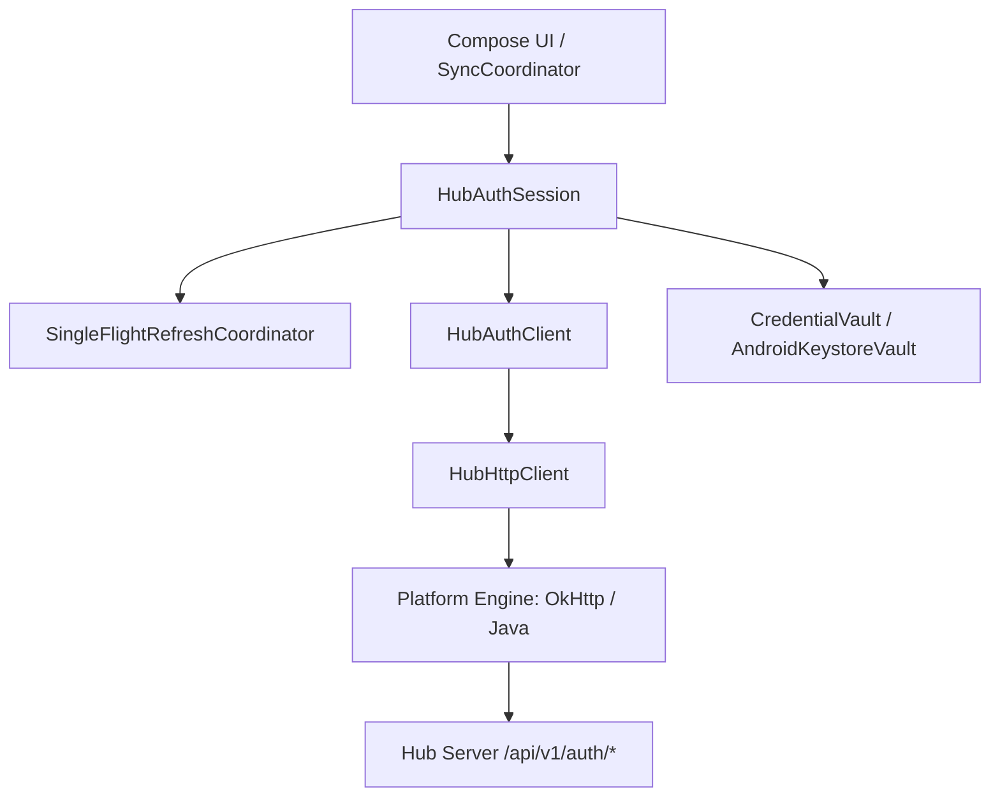

# Authentication and Credentials Specification

Date: 2026-10-14  
Status: Active  
Phase: Phase 04 Auth & Protected Session  
Plan: `plans/261013-1540-doggo-glean-hub-reuse/phase-04-auth-session.md`  

---

## 1. Overview & Architecture

Doggo reuses the existing Glean Hub authentication service for user identity and opt-in strict per-record sync. Authentication operates under strict least-privilege, origin-bound, and protected-storage invariants.

### Key Security Invariants
- **No Passwords Saved**: Passwords are transient in-memory UTF-8 bytes (8..128 bytes), never trimmed, logged, stored in SQLite, or exported to SavedState.
- **Opaque Credentials**: Access tokens (HS256 6h) and refresh tokens (random 32 bytes 30 days) exist only in memory and in the platform-protected vault (`CredentialVault`). StateFlows emit only public identifiers (`AccountIdentity`, `AccountKey`, `AuthState`), never token strings.
- **Single-Flight Refresh**: Concurrent foreground UI requests and background workers share one single-flight refresh leader. Waiters suspend until the successor bundle is atomically committed to storage before proceeding.
- **Generation Fencing**: Every quiescence, logout, or account switch increments a generation counter. Stale network responses or refresh completions cannot resurrect departed sessions or overwrite newer credentials.
- **Prohibited HTTP Replays**: The HTTP auth layer NEVER automatically replays a POST request (such as strict `bootstrap`, `push`, or `pull`) upon token refresh. The caller `SyncCoordinator` exclusively owns retry and reconciliation of identical frozen requests.
- **Local-Only Logout**: Logout deletes the local vault bundle and in-memory tokens. No remote revocation endpoint is called (Hub access tokens expire at natural 6h TTL).

---

## 2. Endpoint Allowlist & Dual-Auth Headers

All outbound traffic is bounded to the configured `canonicalOrigin` validated by `EndpointPolicy`. Redirects are strictly disabled (`followRedirects = false`).

| Path Pattern | Classification | Headers | Description |
|---|---|---|---|
| `POST /api/v1/auth/register` | `AUTH_PUBLIC` | Content-Type | New user registration |
| `POST /api/v1/auth/login` | `AUTH_PUBLIC` | Content-Type | Password authentication |
| `POST /api/v1/auth/refresh` | `AUTH_PUBLIC` | Content-Type | Single-flight token rotation |
| `GET /api/v1/auth/me` | `BEARER_ONLY` | Authorization: Bearer | Authoritative user & app grant info |
| `POST /api/v1/apps/access-requests` | `BEARER_ONLY` | Authorization: Bearer | Submit request for `doggo` app |
| `GET /api/v1/apps/access-requests/me` | `BEARER_ONLY` | Authorization: Bearer | List existing access requests |
| `POST /api/v1/sync/{appId}/strong/bootstrap` | `DUAL_AUTH_STRICT` | Bearer + X-API-Key + X-App-Id | Strict strong sync bootstrap |
| `POST /api/v1/sync/{appId}/strong/push` | `DUAL_AUTH_STRICT` | Bearer + X-API-Key + X-App-Id | Strict mutation push batch |
| `POST /api/v1/sync/{appId}/strong/pull` | `DUAL_AUTH_STRICT` | Bearer + X-API-Key + X-App-Id | Strict scan pull page |

Any request to non-allowlisted paths or legacy endpoints (`/api/v1/sync/:app_id`) is rejected locally with `SafeError.ProtocolIncompatible`.

---

## 3. Account Identity & Account Key

- **AccountIdentity**: `{ userId, username, email }` verified from `/me.userId` matching login response.
- **AccountKey**: 64-character lowercase hex SHA-256 hash of length-framed canonical origin and server userId:
  $$\text{AccountKey} = \text{SHA256}(\text{u32\_be}(\text{len}(\text{origin})) \parallel \text{origin} \parallel \text{u32\_be}(\text{len}(\text{userId})) \parallel \text{userId})$$
- All local database files, credential files, and encryption keys are partitioned by `AccountKey`.

---

## 4. Protected Credential Vault

### 4.1 Android Keystore Vault
- **Master Key**: Android KeyStore hardware-backed AES-256-GCM key per account (`doggo_vault_key_{accountKey}`).
- **Nonce**: Fresh 12-byte cryptographically secure random IV generated per write.
- **Authenticated Additional Data (AAD)**: Binds ciphertext to format version and account:
  $$\text{AAD} = \text{"doggo\_vault\_v1:"} \parallel \text{accountKey}$$
- **Atomic File Replacement**: Written to `account_{accountKey}.vault.tmp`, synced to disk via `FileDescriptor.sync()`, then atomically renamed using `StandardCopyOption.ATOMIC_MOVE`.
- **States**:
  - `READY`: Vault accessible and operations succeed.
  - `LOCKED`: KeyPermanentlyInvalidatedException or UserNotAuthenticatedException (safe actionable state, NO DB wipe).
  - `CORRUPT`: File truncated, bad magic (`DGV1`), or authentication tag verification failed.
  - `UNAVAILABLE`: File I/O failure or keystore service unavailable.

---

## 5. Token Lifetimes & Limits

- **Access Token**: Glean Hub JWT, signed with HS256, 6-hour lifespan.
- **Refresh Token**: Glean Hub cryptographically random 32-byte string, SHA-256 hashed on server, 30-day lifespan.
- **Server Grant Enforcement**: Server JWT claims contain `apps` list at time of issuance. When an admin grants or revokes `doggo` access, the change takes effect upon next token refresh or login. Doggo verifies `/me.apps` before every sync cycle.
