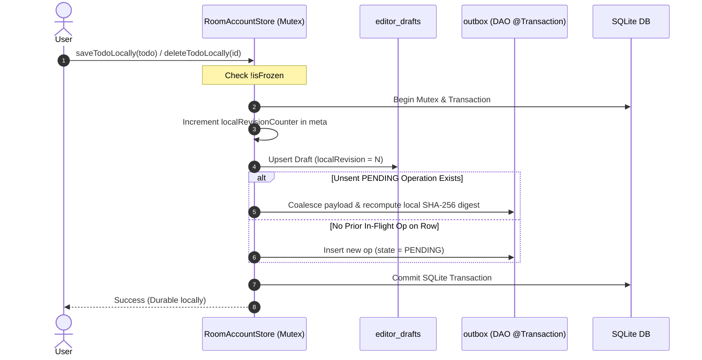
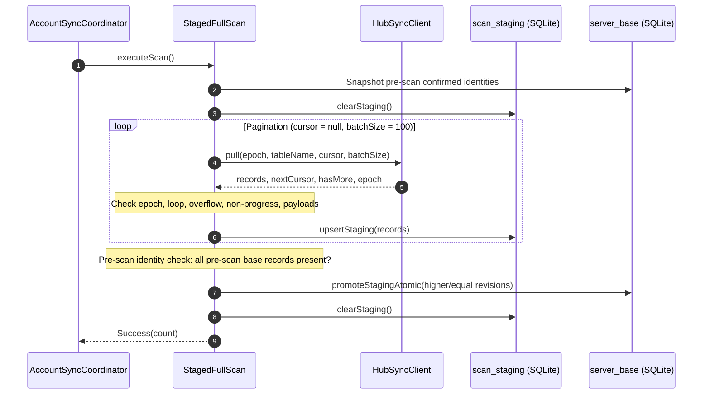
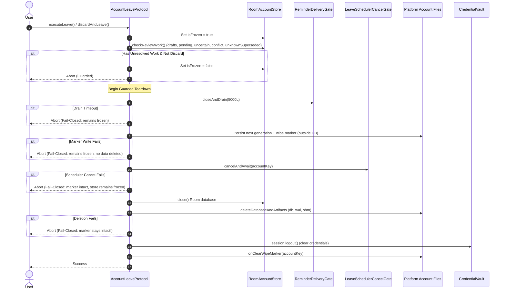

# TabbyRush Local Storage and Strict Synchronization Specification

Date: 2026-10-19  
Phase: Phase 02 Room & Sync delivered; parent-child hierarchy persistence and strict-v3 versioned sync integrated; live transition-recovery acceptance and Phase 06 live Hub staging remain tracked gates
Plan: `plans/261019-1511-parent-child-tasks-deadline-surfaces` (and `plans/261016-1409-sticky-task-surfaces`, `plans/261015-0752-task-deadlines-reminders-strict-upgrades`, `plans/261013-1540-tabbyrush-glean-hub-reuse`)
Related Docs: [System Architecture](./system-architecture.md) · [API Contract](./api-contract.md) · [Code Standards](./code-standards.md) · [Sync Acceptance](./sync-acceptance.md)

---

## 1. Storage Architecture & Partitioning

TabbyRush persists all local application state using **AndroidX Room KMP** (version 2.7.0-alpha12) backed by SQLite via `BundledSQLiteDriver`. Destructive migration fallback is strictly prohibited. Schema evolution uses explicit step-by-step migrations: schema version 1 (`shared/schemas/dev.tabbyrush.shared.data.TabbyRushDatabase/1.json`) upgrades to schema version 2 (`shared/schemas/dev.tabbyrush.shared.data.TabbyRushDatabase/2.json`, identity hash `06a93ffbac4a0570d56446f47e0e3e4c`) via `DatabaseMigrations.MIGRATION_1_2`, and upgrades to schema version 3 (`shared/schemas/dev.tabbyrush.shared.data.TabbyRushDatabase/3.json`, identity hash `3265005b6305fd2db3e01c9ae3cf4458`) via `DatabaseMigrations.MIGRATION_2_3`. Both JVM (`createJvmDatabaseBuilder`) and Android (`createAndroidDatabaseBuilder`) database builders register these migrations via `DatabaseMigrations.ALL`. Direct `2 -> 3` and populated `1 -> 2 -> 3` migration chains are verified in `RoomMigrationV2ToV3Test`.

### 1.1 Account-Level Isolation
- **Storage Partitioning**: Each account directory is keyed exclusively by the 64-character lowercase hexadecimal string of the canonical `AccountKey`:
  `SHA-256(u32_be(origin.len) + origin_bytes + u32_be(userId.len) + userId_bytes)`
- **Directory Layout**:
  - Android: `Context.filesDir/accounts/<accountKey>/`
  - Linux Desktop: `$XDG_DATA_HOME/tabbyrush/accounts/<accountKey>/` (default: `~/.local/share/tabbyrush/accounts/<accountKey>/`)
  - Windows Desktop: `%LOCALAPPDATA%/tabbyrush/accounts/<accountKey>/`
- **Path Traversal Protection & Filesystem Model**: Both `AndroidAccountFiles` and `JvmAccountFiles` verify `canonicalFile.toPath().startsWith(canonicalBase.toPath())` to ensure the resolved directory stays contained within the canonical base root (mitigating path traversal via `..` or symlink escapes outside the accounts root; intra-tree symlinks and TOCTOU races are outside this model). Critical metadata files (`wipe.marker`, `generation.dat`) write to temporary files, flush to disk via `FileOutputStream.fd.sync()`, and replace atomically via `StandardCopyOption.ATOMIC_MOVE` (note: directory metadata fsync is filesystem-dependent).

### 1.2 The Seven Room Entities (Database Version 3)

`TabbyRushDatabase` defines seven entities under `dev.tabbyrush.shared.data`:

| Entity | Table Name | Primary Key | Description & Invariants |
|---|---|---|---|
| `ServerBaseEntity` | `server_base` | `rowId: String` | Authoritative confirmed server state. Monotonically advancing `serverRevision: Long`. Tombstones retain `deleted = true`, empty `title`, `completed = false`, `createdAt`, `updatedAt`, `epoch`. Extended in Room v2 with 12 temporal fields (`deadlineDate`, `deadlineTime`, `deadlineZone`, `deadlineOffsetSeconds`, `reminderAnchorTime`, `deadlineAnchorEpochMs`, `deadlineOverdueEpochMs`, `reminderEnabled`, `reminderLeadMinutes`, `reminderIntervalMinutes`, `reminderCount`, `scheduleToken`). Extended in Room v3 with nullable `parentTaskId: String? = null` (null for root tasks; UUID of parent for child tasks). |
| `OutboxEntity` | `outbox` | `opId: String` | Queued, in-flight, or conflicted strict mutations. Holds frozen `epoch`, `tableName`, `rowId`, `kind` (`create`/`update`/`delete`), `expectedRevision`, payload (`title`, `completed`, `createdAt`), `digest`, `localRevision`, `deliveryState`, `createdAtEpochMs`, `errorMessage`, `consecutiveFailures`. Extended in Room v2 with the 12 temporal fields plus outbox provenance and versioning: `contractVersion` (`strict-v1` vs `strict-v2`), `dispatchHistory`, `intentMask`, `transitionCheckpoint`. Extended in Room v3 with nullable `parentTaskId: String? = null`, `CONTRACT_VERSION_V3 = "strict-v3"`, `INTENT_PARENT = "PARENT"`, and `INTENT_LAST_CHILD_PRESERVATION = "LAST_CHILD_PRESERVATION"`. |
| `EditorDraftEntity` | `editor_drafts` | `rowId: String` | Uncommitted local modifications distinct from confirmed base and frozen outbox. Fields: `draftTitle`, `draftCompleted`, `localRevision: Long`, `updatedAt: Long`, `isDeleted: Boolean`, plus the 12 temporal fields and nullable `parentTaskId: String? = null`. |
| `ScanStagingEntity` | `scan_staging` | `rowId: String` | Temporary records accumulated across pull pagination pages during a full scan. Fields: `tableName`, `serverRevision: Long`, `deleted: Boolean`, `title`, `completed: Boolean`, `createdAt: Long`, `epoch`, plus the 12 temporal fields and nullable `parentTaskId: String? = null`. Promoted atomically upon reaching terminal page. |
| `AccountSyncMetaEntity` | `account_sync_meta` | `id: String` (singleton) | Account partition metadata. Fields: `activeEpoch`, `lastSyncTime`, `localRevisionCounter: Long`, `syncStatus`, `safeErrorCode`, `safeErrorMessage`, `consecutiveFailedRounds: Int`, `credentialPersistencePending: Boolean`. |
| `AccountLocalSettingsEntity` | `account_local_settings` | `id: String` (singleton) | Device- and account-local reminder and notification defaults. Fields: `notificationsEnabled: Boolean` (false), `defaultReminderEnabled: Boolean` (false), `defaultReminderLeadMinutes: Long` (0), `defaultReminderIntervalMinutes: Long?` (null), `defaultReminderCount: Long` (1), `defaultDateOnlyAnchorTime: String` ("09:00"). Strictly account-local, wiped on logout, never synced to Hub. |
| `ReminderDeliveryLedgerEntity` | `reminder_delivery_ledger` | `accountKey`, `generation`, `taskId`, `scheduleToken`, `occurrenceIndex` | Durable occurrence state and claim outcomes for native reminders. Composite PK: 5-tuple. Indices: `[accountKey, generation, taskId]` and `[dueEpochMs]`. Fields: `dueEpochMs: Long`, `claimOutcome: String` (`PENDING`, `CLAIMED`, `POSTED`, `MISSED`, `CANCELLED`, `SKIPPED`), `claimedAtEpochMs: Long?`, `postedPlatformId: String?`, `cancellationState: String` (`ACTIVE`, `CANCELLED`), `updatedAtEpochMs: Long`. Wiped on logout, never sent over wire. |

#### Delivery States & Protocol Versions for `OutboxEntity`
- `PENDING`: Queued locally, never dispatched to network. May coalesce with newer local edits on the same row (only when `transitionCheckpoint == null`).
- `DISPATCHING`: Currently frozen and in-flight over network socket.
- `UNCERTAIN`: Dispatch was interrupted, socket timed out, request cancelled, response omitted the op, or result payload/digest mismatched. **Not a server rejection.** Retains identical frozen payload, epoch, revision, and digest for retry.
- `CONFLICT`: Server explicitly rejected the mutation with `revisionConflict`, `missingRecord`, `deletedRecord`, `opIdReuse`, or `invalidRecord` when the operation had no prior uncertain history.
- `UNKNOWN_SUPERSEDED`: Server returned a conflict for an operation that had previously entered `UNCERTAIN` state. The earlier attempt may have committed remotely before a subsequent edit bumped the revision.
- `contractVersion`: `"strict-v1"` (legacy or migrated mutation), `"strict-v2"` (strict-v2 mutation), or `"strict-v3"` (strict-v3 hierarchy mutation). Frozen or uncertain operations must not be automatically rehashed into another protocol.
---

## 2. Local Mutation Lifecycle & FIFO Dispatch



### 2.1 Atomic Edit & Coalescing Rules
- **Draft & Outbox Atomicity**: Local edits write `account_sync_meta`, `editor_drafts`, and `outbox` atomically via Room `@Transaction` methods (`saveTodoAtomic`, `deleteTodoAtomic`).
- **Coalescing**: Only never-dispatched (`PENDING`) outbox operations are coalesced. Operations in `DISPATCHING`, `UNCERTAIN`, `CONFLICT`, or `UNKNOWN_SUPERSEDED` states are never altered in-flight.
- **Unsent Create-Delete Cancellation**: If a record has only a pending unsent `CREATE` operation and the user deletes it before dispatch, `cancelUnsentCreateAtomic` purges both the draft and the outbox entry locally without generating wire traffic.

### 2.2 FIFO Per-Row Dispatching & Confirmed-Root First-Dispatch Gating
In `OutboxReconciliation.getEligibleDispatchBatch(maxCount = 100)`:
1. **Per-Row Serialization**: Outbox operations are grouped by `rowId`. The earliest operation by `localRevision` is evaluated as the head.
2. **Head Blocking Invariant**: If the head operation on a row is in `DISPATCHING`, `CONFLICT`, or `UNKNOWN_SUPERSEDED` state, **all successor operations on that row are blocked** from dispatching.
3. **Dispatch Eligibility**: Only rows whose head operation is `PENDING` or `UNCERTAIN` are eligible for dispatch.
4. **Confirmed-Root First-Dispatch Gating**:
   - For child tasks (`head.parentTaskId != null`) in `PENDING` state (initial dispatch), the coordinator verifies that the parent task is confirmed live in `server_base` in the active epoch for non-delete operations:
     `parentBase != null && !parentBase.deleted && parentBase.serverRevision > 0L && parentBase.epoch == activeEpoch && parentBase.parentTaskId == null`.
   - If the root is missing, unconfirmed, or conflicted, the child operation remains unfrozen, pending, and visible locally, and is excluded from dispatch.
   - **Child Delete Exception**: Child `DELETE` operations remain legal and dispatchable even if the parent task was already deleted remotely.
5. **Batch Bounds**: Dispatched batches enforce `<= 100` operations, at most one operation per `rowId`, and `<= 256 KiB` total payload size.

### 2.3 Dispatch Freezing & CAS Optimistic Concurrency
In `prepareAndFreezeBatch()`:
- **`PENDING` Operations**:
  - **Root Confirmation Re-check**: For non-delete child operations (`op.parentTaskId != null && op.kind != DELETE`), re-checks root confirmation in `server_base` under mutation lock. If unconfirmed, the child remains unfrozen and pending.
  - `expectedRevision` is bound to current `server_base.serverRevision` (0L for new/tombstone/create; current base revision for update/delete).
  - Active `epoch` is bound.
  - Canonical SHA-256 `digest` is computed via `StrictSyncV3Digest.computeDigest` (for `contractVersion == CONTRACT_VERSION_V3`), `StrictSyncV2Digest.computeDigest` (`strict-v2`), or `StrictSyncDigest.computeDigest` (`strict-v1`), with length-prefixed big-endian UTF-8 strings.
  - `freezeOutboxAtomic` executes a Room `@Transaction`: verifies `current.localRevision == expectedLocalRevision` and `deliveryState == PENDING` before updating to `DISPATCHING`. If an intervening local edit modified the row, the freeze fails and the stale op is omitted from the batch.
- **Protected Legacy & Prior-Version Operations**:
  - Operations with `transitionCheckpoint != null` or older contract versions are never coalesced or automatically rehashed.
- **`UNCERTAIN` Retries & Uncertain Replay Bypass**:
  - All frozen fields (`opId`, `epoch`, `tableName`, `rowId`, `kind`, `expectedRevision`, `digest`, `localRevision`, payload) are **strictly preserved**.
  - Delivery state transitions to `DISPATCHING`. No re-computation of digest or expectedRevision occurs.
  - **Uncertain Replay Bypass**: Retries of already-admitted `UNCERTAIN` child operations bypass renewed parent-liveness gating. Operation identity, account authorization, and integrity checks are retained, allowing the exact operation to resolve against the server (e.g. CAS replay receipt) even if the root was subsequently deleted remotely.

## 3. Staged Full Scan & Monotonic Promotion

Synchronization executes a 3-stage round inside `AccountSyncCoordinator.executeSyncRound()`:
1. **Initial Staged Full Scan**: Ingests remote changes and advances `server_base`.
2. **Push Eligible Outbox**: Transmits eligible mutations and reconciles results.
3. **Final Staged Full Scan**: Captures post-mutation server state.



### 3.1 Pagination Loop Invariants
- **Protocol & Mode Parameters**: `StagedFullScan` accepts `protocol: String` (defaults to `strict-v1`; supports `StrictSyncV2Contract.PROTOCOL_VERSION` and `StrictSyncV3Contract.PROTOCOL_VERSION` during v2/v3 sync rounds and migrations), `isMigration: Boolean = false`, and `isFenced: (() -> Boolean)? = null`.
- **Cursor Tracking**: Loop begins with `cursor = null`. Repeating cursors or non-progressing cursors (empty records page while `hasMore == true`) immediately abort with `SafeError.ProtocolIncompatible`.
- **Epoch Guard**: If any page returns an epoch differing from `activeEpoch`, staging is cleared and sync aborts with `SafeError.ResetRequired("EPOCH_MISMATCH")`.
- **Batch Overflow**: Receiving more records than `batchSize` aborts with `ProtocolIncompatible("BATCH_OVERFLOW")`.
- **Page Budget**: Loop enforces a hard cap (`maxPageBudget = 1000`) to prevent infinite network pagination.
- **Payload & Relationship Validation**: Non-deleted records must contain valid, non-blank titles, matching `rowId`, positive revisions, non-negative timestamps, and canonical temporal framing. Under `strict-v3`, if `parentTaskId` is non-null, it must be a valid canonical UUID, non-blank, and distinct from `id` (self-referencing parent rejected as `INVALID_RELATIONSHIP`). Receiving `parentTaskId` under non-v3 protocols aborts with `SafeError.ProtocolIncompatible("UNEXPECTED_RELATIONSHIP")`.

### 3.2 Pre-Scan Identity Consistency Check
Hub strict scans return all records including permanent tombstones. Before promoting staged records:
- `StagedFullScan` checks every confirmed record in `server_base` that shares the `activeEpoch`.
- If any such pre-scan confirmed identity is missing from `scan_staging`, sync aborts with `SafeError.ResetRequired("CONSISTENCY_ERROR")` and staging is cleared. This prevents silent record loss or split-brain deletions.

### 3.3 Monotonic Promotion Rules & Migration Temporal Enrichment
Staged records are promoted to `server_base` in a single Room `@Transaction` (`promoteStagingAtomic`):
1. **New Record (`currentBase == null`)**: Inserted directly into `server_base`.
2. **Higher Revision (`staged.serverRevision > currentBase.serverRevision`)**:
   - **Parent Immutability & Hierarchy Validation**: On active records, changing an established parent (`currentBase.parentTaskId != null && staged.parentTaskId != currentBase.parentTaskId`) aborts fail-closed with `SafeError.ProtocolIncompatible("IMMUTABLE_PARENT_VIOLATION")`. Converting an existing root to a child (`currentBase.parentTaskId == null && staged.parentTaskId != null`) aborts fail-closed with `SafeError.ProtocolIncompatible("ROOT_CONVERTED_TO_CHILD")`.
   - **Tombstone Relationship Preservation**: When a record is deleted (`staged.deleted == true`), `parentTaskId` is preserved from `currentBase` (`if (staged.deleted) currentBase.parentTaskId else (staged.parentTaskId ?: currentBase.parentTaskId)`), ensuring tombstones retain relationship identity for downstream group projection.
   - Overwrites `server_base` with the higher revision.
3. **Equal Revision (`staged.serverRevision == currentBase.serverRevision`)**:
   - **Normal Steady-State**: Checks logical equivalence (deleted status, title, completed, createdAt, temporal fields, and `parentTaskId`). If logically identical, retained. If divergent (including mismatched `parentTaskId`), staging is cleared and sync aborts with `SafeError.ProtocolIncompatible("DIVERGENT_REVISION")`.
   - **Migration Mode (`isMigration == true`)**: If `staged` possesses remote temporal metadata and `currentBase` lacks temporal metadata at an equal revision, `server_base` is enriched with the remote temporal attributes (`deadlineDate`, `deadlineTime`, `deadlineZone`, `deadlineOffsetSeconds`, `reminderAnchorTime`, `deadlineAnchorEpochMs`, `deadlineOverdueEpochMs`, `reminderEnabled`, `reminderLeadMinutes`, `reminderIntervalMinutes`, `reminderCount`, `scheduleToken`). Core title/completed fields and parent relationship must still match; mismatched core fields remain a fatal `DIVERGENT_REVISION` error.
4. **Lower Revision (`staged.serverRevision < currentBase.serverRevision`)**: Local confirmed base is retained; lower staged revision is discarded.

### 3.4 Pre-Promotion Fencing Check
Immediately before invoking `promoteStagingAtomic`, `StagedFullScan` validates `if (store.isFrozen || isFenced?.invoke() == true)`. If frozen or fenced (e.g. account leave or concurrent logout in progress), `scan_staging` is immediately cleared and the scan aborts fail-closed with `SafeError.Unauthorized("STORE_FROZEN")`.

*Note on Locking*: While `promoteStagingAtomic` executes the database write inside an atomic SQLite transaction, pre-scan base comparisons and pagination occur across several asynchronous steps. Coherence relies on the coordinator's coroutine `coordinatorMutex` preventing concurrent scans or local mutations during sync rounds.

---

## 4. CAS-Ack Reconciliation & Conflict Handling

### 4.1 Exact Acknowledgement Verification
In `OutboxReconciliation.reconcilePushResults()`, response results are indexed by `opId` (`response.results.associateBy { it.opId }`). For each dispatched operation:
1. **Omission Check**: If `result == null`, the operation transitions to `UNCERTAIN` ("Server omitted operation from push response").
2. **RowId Verification**: `result.rowId == op.rowId` must hold; otherwise transitions to `UNCERTAIN`.
3. **Digest Verification**: `result.digest == op.digest` must hold; otherwise transitions to `UNCERTAIN`.
4. **Status & Revision Verification**:
   - `status in ["accepted", "replayed"]`:
     - `result.acceptedRevision` must equal `op.expectedRevision + 1L`.
     - If revision does not match, transitions to `UNCERTAIN`.
     - If valid, calls `store.reconcileAccepted(op.opId, acceptedRevision)`.

### 4.2 Base Monotonicity, Intent-Masked Rebase Safety & Atomic Cleanup
Inside `RoomAccountStore.reconcileAccepted()`:
- **Atomic Regressive Server Revision Cleanup**: If `currentBase != null && serverRevision < currentBase.serverRevision` (a stale acknowledgement arriving after a newer revision was already confirmed), `dao.discardRegressiveReconcileAtomic(opId, op.rowId, clearDraft)` executes an atomic SQLite `@Transaction` deleting the stale outbox op and conditionally clearing the draft without regressing `server_base`.
- **Intent-Masked Non-Destructive Rebase Safety**:
  - Evaluates `preservesRemoteDeadline = isV1Op || (intentMasks.isNotEmpty() && !intentMasks.contains(OutboxEntity.INTENT_DEADLINE) && !intentMasks.contains(OutboxEntity.INTENT_REMINDER))`.
  - When `useBaseDeadline = preservesRemoteDeadline && currentBase != null`, `updatedBase` retains all remote temporal attributes (`deadlineDate`, `deadlineTime`, `deadlineZone`, `deadlineOffsetSeconds`, `reminderAnchorTime`, `deadlineAnchorEpochMs`, `deadlineOverdueEpochMs`, `reminderEnabled`, `reminderLeadMinutes`, `reminderIntervalMinutes`, `reminderCount`, `scheduleToken`) from `currentBase`.
  - **Parent Relationship Preservation**: Unless masked by `INTENT_PARENT`, `updatedBase` preserves remote `parentTaskId` from `currentBase`.
  - `resolvedTitle` and `resolvedCompleted` only overwrite `currentBase` if explicitly masked (`INTENT_TITLE` or `INTENT_COMPLETED`) or on legacy whole-row updates.
  - Acknowledging a legacy strict-v1 mutation or partial title edit never erases remote deadline or reminder metadata.
- **Newer Draft Preservation**: `clearDraft = currentDraft != null && currentDraft.localRevision <= op.localRevision`. If the user edited the record while the push was in-flight (`draft.localRevision > op.localRevision`), the newer draft is retained.
- **Atomic Reconcile**: `dao.reconcileAcceptedAtomic` executes in a single SQLite transaction: upserts `server_base`, deletes `outbox` entry, and conditionally deletes draft.

### 4.3 UnknownSuperseded Disambiguation & UI Safety Warning
When the server returns a conflict status (`revisionConflict`, `missingRecord`, `deletedRecord`), or when the legacy receipts endpoint reports `UNKNOWN_SUPERSEDED`:
- If the operation was in `UNCERTAIN` state, had prior failures (`op.deliveryState == UNCERTAIN || op.consecutiveFailures > 0`), or had prior dispatch history:
  - Delivery state transitions to `STATE_UNKNOWN_SUPERSEDED`.
  - **Rationale**: An uncertain dispatch may have successfully committed to Hub before a subsequent client edit bumped the revision. Server conflict does not prove the original intent failed.
  - **UI Safety Display**: When reviewed in `ConflictReviewDialog`, `EditorState.isUnknownSuperseded` renders a prominent high-contrast warning banner (using `coralSurface` tokens). It alerts the user that the change may have already reached the server before an upgrade or revision bump, advising review of remote state before choosing to reapply or discard.
- If the operation had no prior uncertainty:
  - Delivery state transitions to `CONFLICT`.
### 4.4 User Conflict Resolution Workflows
- **`discardConflict(rowId)`**: Deletes the conflicted head operation via `discardConflictAtomic(conflictOp.opId, rowId, conflictOp.localRevision)` and clears draft if `draft.localRevision <= conflictLocalRev`. Successor outbox operations on the row are preserved.
- **`reapplyConflict(rowId)`**: Inspects current confirmed `server_base.serverRevision`, allocates a new local revision, generates a fresh UUID `opId`, recomputes digest targeting the new base revision, and atomically replaces the outbox entry via `replaceOutboxAtomic`.
- **`copyAsNew(rowId)`**: Discards old conflicted outbox and draft, then creates a brand-new Todo with a fresh UUID, `serverRevision = 0L`, and `parentTaskId = null` (always creating a clean root task, never automatically reparenting or promoting a child). *(Note: executed as sequential DAO operations under `coordinatorMutex`).*

---

## 5. Crash Recovery & Cancellation Safety

1. **Interrupted Dispatches**: If the app process dies or is terminated during network socket transmission, operations remain in `DISPATCHING` state in SQLite. On startup or at the beginning of each sync round, `store.recoverInterruptedDispatches()` resets all `DISPATCHING` rows to `UNCERTAIN` with `errorMessage = "Interrupted dispatch recovered"`.
2. **Cancellation Safety**: In `AccountSyncCoordinator`, network push runs inside a try/catch block. If coroutine cancellation occurs (`CancellationException`), a `withContext(NonCancellable)` block marks the entire dispatched batch as `UNCERTAIN` before rethrowing the exception.
3. **Generation Fencing**: The coordinator tracks `currentGeneration`. If generation changes (e.g. account logout or switch occurs mid-flight), downstream callbacks drop results without modifying local storage.

---

## 6. Fail-Closed Account Leave & Wipe Protocol

Account logout/switch enforces a crash-safe, fail-closed teardown sequence via `AccountLeaveProtocol`:



### 6.1 Teardown Order
1. **Freeze Store**: `store.isFrozen = true` prevents new local edits (`saveTodoLocally` throws `IllegalStateException`).
2. **Close & Drain Delivery Gate**: `store.deliveryGate?.closeAndDrain(5000L)` transitions delivery gate to `CLOSING`, blocks new callback admissions, and waits up to 5s for in-flight callbacks and mutations to reach 0. If drain times out, teardown aborts fail-closed, leaving store frozen without modifying files.
3. **Persist Marker Outside Database**: Atomically writes `generation + 1` to `wipe.marker.tmp` with file sync (`fsync`), then atomically moves to `wipe.marker`. If generation read or marker persistence fails, teardown aborts immediately fail-closed with store frozen.
4. **Cancel & Await Schedulers**: Cancels background WorkManager tasks on Android and coordinates platform teardown cancellation via `LeaveSchedulerCancelGate` (binding `adapter.cancelAllForAccount(accountKey)`; physical native alarm/notification cancellation verified in Phases 08/09). If cancellation throws or fails, teardown aborts fail-closed: **retains `wipe.marker` and remains frozen** (no rollback to unfrozen state).
5. **Close Room Database**: `store.close()` closes all database connections cleanly after in-flight work has drained.
6. **Delete Database Artifacts**: Deletes `tabbyrush.db`, `tabbyrush.db-wal`, `tabbyrush.db-shm`. If deletion fails, the process stays fail-closed with `wipe.marker` intact.
7. **Clear Credentials**: Removes tokens and identity from `CredentialVault` and resets `HubAuthSession`.
8. **Clear Wipe Marker**: Removes `wipe.marker` once database artifacts and credentials are provably eliminated.

*Table vs Filesystem Wipe*: `store.wipeLocalData()` invokes `dao.wipeAllTablesAtomic()`, which transactionally clears all 7 tables in a single SQLite transaction (`editor_drafts`, `outbox`, `scan_staging`, `server_base`, `account_sync_meta`, `account_local_settings`, `reminder_delivery_ledger`). This database transaction is distinct from the 8-step fail-closed filesystem and credential teardown protocol managed by `AccountLeaveProtocol`, which operates on external files, WorkManager schedulers, and Keystore credentials.

### 6.2 Startup Crash Recovery
On application startup, before opening any database or initializing an account, `AccountLeaveProtocol.completePendingWipe()` inspects `hasPendingWipe(accountKey)`. If `wipe.marker` exists:
1. Cancels all background work and alarms via `schedulerCancelGate?.cancelAndAwait(accountKey)`. If cancellation throws, it aborts returning `false` (retaining `wipe.marker`).
2. Deletes remaining database files (`tabbyrush.db`, `tabbyrush.db-wal`, `tabbyrush.db-shm`).
3. If files are deleted successfully, clears vault credentials via `onClearVault(accountKey)`.
4. Clears `wipe.marker` via `onClearWipeMarker(accountKey)`.
If file deletion fails, it returns `false`, preventing the account from being reopened in a corrupted state.
---

## 7. Versioned Client Transitions, Room Schema Evolution & Safe Replay (Phases 05, 06 & 02 Delivered)

*Note: Section 7.1 documents the Room database version 2 schema and explicit `MIGRATION_1_2`. Section 7.2 documents Room database version 3 schema and explicit `MIGRATION_2_3`. Section 7.3 defines cross-version outbox reconciliation, the durable transition pipelines (v1->v2 and v2->v3), and safe replay mechanisms. Section 7.4 defines the mathematical invariants, checked 64-bit arithmetic, and canonical v3 preimages.*
### 7.1 Room Database Migration (1 -> 2) [Phase 05 Delivered]
In Room database version 2, `TabbyRushDatabase` executes explicit step-by-step migration `DatabaseMigrations.MIGRATION_1_2`. Both `createAndroidDatabaseBuilder` and `createJvmDatabaseBuilder` consume `DatabaseMigrations.ALL`, which registers `MIGRATION_1_2`. Destructive migration fallback is strictly forbidden.

- **Expanded Tables (12 Temporal Columns)**:
  `server_base`, `editor_drafts`, `scan_staging`, and `outbox` are altered using SQLite `ALTER TABLE ADD COLUMN`:
  - `deadlineDate TEXT DEFAULT NULL`
  - `deadlineTime TEXT DEFAULT NULL`
  - `deadlineZone TEXT DEFAULT NULL`
  - `deadlineOffsetSeconds INTEGER DEFAULT NULL`
  - `reminderAnchorTime TEXT DEFAULT NULL`
  - `deadlineAnchorEpochMs INTEGER DEFAULT NULL`
  - `deadlineOverdueEpochMs INTEGER DEFAULT NULL`
  - `reminderEnabled INTEGER NOT NULL DEFAULT 0`
  - `reminderLeadMinutes INTEGER NOT NULL DEFAULT 0`
  - `reminderIntervalMinutes INTEGER DEFAULT NULL`
  - `reminderCount INTEGER NOT NULL DEFAULT 1`
  - `scheduleToken TEXT DEFAULT NULL`
  - **Fail-Closed Defaults**: All migrated version 1 records default to `deadlineDate = null` (all deadline/token fields null) and `reminderEnabled = false` (lead=0, count=1, interval=null), eliminating phantom notification triggers on upgrade.

- **Outbox Provenance & Versioning Columns**:
  `outbox` table is altered with 4 provenance columns:
  - `contractVersion TEXT NOT NULL DEFAULT 'strict-v1'`: Distinguishes legacy `"strict-v1"` mutations from `"strict-v2"`.
  - `dispatchHistory TEXT DEFAULT NULL`: JSON log tracking dispatch and migration events.
  - `intentMask TEXT DEFAULT NULL`: Intent mask indicating field mutations (`TITLE`, `COMPLETED`, `DEADLINE`, `REMINDER`, `DELETE`, `REQUIRES_REVIEW`).
  - `transitionCheckpoint TEXT DEFAULT NULL`: Migration checkpoint marker (`MIGRATED_FROM_ROOM_V1`).

- **Conservative SQL Intent Derivation for Legacy Outbox Rows**:
  During `MIGRATION_1_2`, existing uncheckpointed `outbox` rows are updated:
  ```sql
  UPDATE outbox SET 
      transitionCheckpoint = 'MIGRATED_FROM_ROOM_V1',
      intentMask = CASE
          WHEN kind = 'delete' THEN 'DELETE'
          WHEN kind = 'create' THEN 'TITLE|COMPLETED'
          WHEN kind = 'update' AND title IS NOT NULL AND completed IS NOT NULL THEN 'TITLE|COMPLETED'
          ELSE 'REQUIRES_REVIEW'
      END,
      dispatchHistory = '{"event":"ROOM_V1_MIGRATION","priorState":"' || deliveryState || '"}'
  WHERE transitionCheckpoint IS NULL
  ```
  *Provenance Caveat*: This SQL migration assigns conservative classifications; it does not reconstruct true user intent from historical sessions. Any ambiguous update missing title or completed fields is categorized as `REQUIRES_REVIEW`.

- **Newly Recorded Outbox Provenance (`RoomAccountStore`)**:
  When saving mutations in `strict-v2` mode, `RoomAccountStore` writes `contractVersion = CONTRACT_VERSION_V2` and dynamically derives `intentMask` by diffing against confirmed `server_base`:
  - `CREATE`: `TITLE|COMPLETED` + `DEADLINE` (if deadline present) + `REMINDER` (if reminder enabled).
  - `UPDATE`: Diffing against `server_base` assigns `INTENT_TITLE`, `INTENT_COMPLETED`, `INTENT_DEADLINE`, and `INTENT_REMINDER`. If no field differences are detected (e.g. resave), it defaults to `INTENT_TITLE`.
  - **Frozen Operation Invariant**: Frozen (`DISPATCHING`) and uncertain (`UNCERTAIN`) operations retain their original frozen payload, digest, and contract version; they are never automatically rehashed or upgraded across protocol versions.
  - **Tombstone Non-Mutation**: Deleting an already-deleted record throws `IllegalStateException`. Unsent create-delete cancellation and outbox coalescing require `transitionCheckpoint == null`, preventing corruption of migrated entries.

- **New Tables in Version 2**:
  1. `account_local_settings`: Stores per-device reminder/notification defaults (singleton `id = 'singleton'`, initialized with `09:00` date-only anchor time and disabled reminders). Account-partitioned, wiped on logout, never sent to Hub.
  2. `reminder_delivery_ledger`: Durable occurrence state and claim outcomes for native reminders. Composite primary key: `[accountKey, generation, taskId, scheduleToken, occurrenceIndex]`. Indices: `[accountKey, generation, taskId]` and `[dueEpochMs]`. Status values: `PENDING`, `CLAIMED`, `POSTED`, `MISSED`, `CANCELLED`, `SKIPPED`. Cancellation states: `ACTIVE`, `CANCELLED`. Account-partitioned, wiped on logout, never transmitted to Hub.

- **Transactional Database Wipe**:
  `TabbyRushDao.wipeAllTablesAtomic()` incorporates both new tables:
  ```kotlin
  @Transaction
  suspend fun wipeAllTablesAtomic() {
      clearDrafts()
      clearOutbox()
      clearStaging()
      clearServerBase()
      clearMeta()
      clearLocalSettings()
      clearLedger()
  }
  ```

### 7.2 Room Database Migration (2 -> 3) [Phase 02 Delivered]
In Room database version 3 (`shared/schemas/dev.tabbyrush.shared.data.TabbyRushDatabase/3.json`, identity hash `3265005b6305fd2db3e01c9ae3cf4458`), `TabbyRushDatabase` executes explicit migration `DatabaseMigrations.MIGRATION_2_3`.

- **Expanded Tables (`parentTaskId` Column)**:
  `server_base`, `editor_drafts`, `scan_staging`, and `outbox` are altered using SQLite `ALTER TABLE ADD COLUMN`:
  ```sql
  ALTER TABLE `server_base` ADD COLUMN `parentTaskId` TEXT DEFAULT NULL;
  ALTER TABLE `editor_drafts` ADD COLUMN `parentTaskId` TEXT DEFAULT NULL;
  ALTER TABLE `scan_staging` ADD COLUMN `parentTaskId` TEXT DEFAULT NULL;
  ALTER TABLE `outbox` ADD COLUMN `parentTaskId` TEXT DEFAULT NULL;
  ```
- **Null Relationship Semantics**: All existing v1 and v2 records default to `parentTaskId = NULL`, designating them as root-capable tasks without mutating their existing attributes or wire hashes.
- **Migration Registration & Verification**: Both Android and JVM database builders consume `DatabaseMigrations.ALL`, which registers `MIGRATION_1_2` and `MIGRATION_2_3`. Populated step-by-step migrations `2 -> 3` and chained `1 -> 2 -> 3` are verified in `RoomMigrationV2ToV3Test`.

### 7.3 Client Version Transitions, Safe Replay & Intention Preservation [Phases 06 & 02 Delivered]

#### 1. Transition Pipelines & Durable Checkpoints
`ContractTransitionCoordinator` manages orderly, crash-resilient transition state machines for both `strict-v1 -> strict-v2` and `strict-v2 -> strict-v3` upgrades:
- **V1 to V2 Pipeline**: `ready-v1` -> `upgrade-detected` -> `dispatch-quiesced` -> `legacy-reconciling` -> `v2-base-scanning` -> `safe-intents-translating` -> `ready-v2`.
- **V2 to V3 Pipeline**: `ready-v2` -> `v3-base-scanning` -> `safe-intents-translating` -> `ready-v3`.
- **Durable State Storage**: The active phase is persisted in `AccountSyncMetaEntity.syncStatus` prefixed with `TRANSITION:` (e.g. `TRANSITION:v3-base-scanning` or `TRANSITION:dispatch-quiesced`) along with `safeErrorCode = "CHECKPOINT_<PHASE>"`. Upon process restart or crash, the coordinator inspects `getDurablePhase()` and resumes execution at the exact interrupted checkpoint without re-running completed phases.

#### 2. Strict-v3 Upgrade Workflow
When upgrading an established client partition from `strict-v2` to `strict-v3`:
1. **Quiesce Dispatches**: Recovers all in-flight `DISPATCHING` operations to `UNCERTAIN` via `store.recoverInterruptedDispatches()`.
2. **V3 Base Scanning (`V3_BASE_SCANNING`)**: Persists durable phase checkpoint; executes `StagedFullScan` with `protocol = StrictSyncV3Contract.PROTOCOL_VERSION` and `isMigration = true`, populating `server_base` with authoritative 17-column records including remote `parentTaskId`.
3. **Safe Intents Translating (`SAFE_INTENTS_TRANSLATING`)**:
   - Translates verified pending, unsent, or proven-not-accepted mutations into `CONTRACT_VERSION_V3` (`transitionCheckpoint = "TRANSLATED_V3"`), preserving all 12 temporal fields and `parentTaskId`.
   - **Visible User Review Fencing**: Any un-reconciled strict-v2 operation during strict-v3 upgrade that cannot be safely translated transitions to `STATE_CONFLICT` with `errorMessage = "Requires user review: un-reconciled strict-v2 operation during strict-v3 upgrade"`. This ensures un-reconciled work is surfaced prominently in `ConflictReviewDialog` rather than stalling silently or being dropped.
4. **Ready V3 (`READY_V3`)**: Transitions `syncStatus` to `ready-v3`, enabling strict-v3 mutations, push (`syncClient.pushV3`), pull, and SHA-256 digest computation with domain `strict-v3`.

#### 3. Exact Legacy Receipt Matching (`POST /api/v1/sync/{appId}/strong/legacy-receipts`)
- **Route & Security Classification**: Explicitly allowlisted under `RouteClassification.DUAL_AUTH_STRICT` in `HubHttpClient`, requiring both valid Bearer token and App API Key (`X-API-Key`, `X-App-Id`).
- **Batch Bounds**: Legacy receipt items are chunked into bounded batches of `<= 100` operations.
- **Exact Identity & Digest Verification**: Transmits frozen v1 preimage fields (`opId`, `tableName`, `rowId`, `kind`, `expectedRevision`, `digest`, `data`). The server matches against confirmed operation history:
  - `PROVEN_ACCEPTED`: Mutation committed on server. Coordinator calls `store.reconcileAccepted(opId, acceptedRevision)`, advancing base.
  - `PROVEN_NOT_ACCEPTED`: Server confirms operation never committed. Coordinator updates outbox to `deliveryState = PENDING`, `transitionCheckpoint = "PROVEN_NOT_ACCEPTED"`, clearing errors.
  - `UNKNOWN_SUPERSEDED`: Server revision advanced beyond `expectedRevision` without verifiable receipt record. Coordinator updates outbox to `deliveryState = STATE_UNKNOWN_SUPERSEDED` for user review.
  - `INTEGRITY_FAILURE`: Server detected digest or payload corruption. Coordinator marks op as `deliveryState = STATE_CONFLICT`.
  - **Omission Safety**: If an operation is omitted from the receipts response, it remains in `deliveryState = STATE_UNCERTAIN`. Receipt omission is never treated as proof of non-delivery.

#### 4. Migration Full Scan & Equal-Revision Temporal Enrichment
- `ContractTransitionCoordinator` executes `StagedFullScan` with `protocol = StrictSyncV2Contract.PROTOCOL_VERSION` (or `StrictSyncV3Contract.PROTOCOL_VERSION`) and `isMigration = true`.
- **Equal-Revision Temporal Enrichment**: If `staged.serverRevision == currentBase.serverRevision`, staged records containing remote temporal metadata enrich the confirmed `server_base` (populating deadlines, reminder rules, schedule tokens) when local base lacks them. Core title and completed fields must still match; mismatched core fields or divergent revisions outside this explicit migration path remain fatal `DIVERGENT_REVISION` errors.

#### 5. Never-Sent Safe Intent Translation
Provably unsent legacy v1 operations (`transitionCheckpoint == "PROVEN_NOT_ACCEPTED"` or never-dispatched pending ops) are translated over confirmed v2 base records:
- **Review Guard**: Operations with `intentMask == INTENT_REQUIRES_REVIEW` (from conservative Room v1 migration) fail closed to `STATE_CONFLICT` for explicit user decision.
- **CREATE Translation**: If the record already exists on the server (`currentBase != null && !currentBase.deleted`), translation blocks as `STATE_CONFLICT` ("Cannot translate create: row already exists on server"). Otherwise, mints a fresh v2 UUID `opId`, sets `expectedRevision = 0L`, and atomically replaces the outbox entry via `replaceOutboxAtomic` with `transitionCheckpoint = "TRANSLATED_V2"`.
- **UPDATE Translation**: If base is missing or deleted on the server, translation blocks as `STATE_CONFLICT` ("Cannot translate update: base row missing or deleted on server"). Otherwise, mints a fresh v2 UUID `opId`, binds base `serverRevision`, retains base temporal metadata, and replaces atomically with `transitionCheckpoint = "TRANSLATED_V2"`.
- **DELETE Translation**: If base is missing or deleted, purges the outbox entry locally. Otherwise, mints a fresh v2 UUID `opId`, binds base `serverRevision`, and replaces atomically with `transitionCheckpoint = "TRANSLATED_V2"`.

#### 6. Intent-Masked Rebase Safety & Atomic Cleanup
- **Non-Destructive Rebase**: In `RoomAccountStore.reconcileAccepted()`, acknowledging a legacy strict-v1 outbox operation (`op.contractVersion == CONTRACT_VERSION_V1`) or a masked edit without deadline/reminder intents preserves remote temporal fields (`deadlineDate`, `deadlineTime`, `reminderEnabled`, `scheduleToken`, etc.) and remote `parentTaskId` from `currentBase`.
- **Atomic Regressive Cleanup**: In `TabbyRushDao.discardRegressiveReconcileAtomic()`, receiving a server revision lower than confirmed base deletes the stale outbox entry and conditionally clears the draft in a single SQLite transaction without regressing `server_base`.

#### 7. Cross-Version Invariant & Server Compatibility Guard
- In `AccountSyncCoordinator.executeSyncRound()`:
  - If the server reports protocol lower than the local outbox contract version (e.g. server on `strict-v1` when outbox contains v2/v3 ops, or server on `strict-v2` when outbox contains v3 ops), sync aborts with `SafeError.ProtocolIncompatible("SERVER_VERSION_REGRESSION")`.
  - Local v2/v3 intentions created while offline are preserved in SQLite and never down-converted or pushed to an un-upgraded server.

### 7.4 Canonical Wire Preimages & Checked Arithmetic
- **Strict-v3 Preimage Framing**: Domain `strict-v3` with length-prefixed identity strings followed by 8-byte big-endian signed revision. Data payload is 0 bytes for DELETE; CREATE/UPDATE serialize 4 base fields, 12 temporal fields, and `parentTaskId` (`0x00` if null; `0x01` followed by length-prefixed UUID bytes if present).
- **Canonical Schema Fingerprints**: Canonical strict-v3 schema fingerprint is frozen at `7f033e7b432a95e2e95e25fc32ea469a5d6715ea347a88b2edbf9264e6b88a8f` (TabbyRush) / `eec72663e7367b4330d1c94196f8e44888df02fa34e240fa4d3bd29222136094` (generic Hub).
- **Strict-v2 Mathematical Invariants & Checked Arithmetic**:
  - `reminderCount` strictly constrained to `1..10`. Non-repeating rules require `reminderIntervalMinutes == null`; repeating rules require non-null interval `>= 15`.
  - Checked 64-bit integer operations (`safeMultiply`, `safeSubtract`, `safeAdd`) prevent overflow. Timed deadline requires `deadlineOverdueEpochMs == deadlineAnchorEpochMs`. Date-only deadline requires non-null `reminderAnchorTime`.
---

## 8. Shared Scheduling, Persisted Eligibility & Delivery Gate (Phase 07 Delivered)

### 8.1 Deterministic Checked Arithmetic & 5-Minute Grace Window (`ReminderScheduleCalculator`)
Reminder occurrences are computed deterministically without floating-point arithmetic or platform-specific temporal classes:
- **First Occurrence Due**: `firstDue = safeSubtract(anchorEpochMs, safeMultiply(rule.leadMinutes, 60_000L))`.
- **Interval Offset**: For repeat index `i in 0 until rule.count`: `offset = safeMultiply(i, safeMultiply(intervalMinutes, 60_000L))`, with `due = safeAdd(firstDue, offset)`.
- **Checked Arithmetic**: All operations invoke `safeMultiply`, `safeSubtract`, and `safeAdd`, throwing `ArithmeticException` on integer overflow.
- **Repeat Invariants**:
  - `rule.count` is constrained to `1..10`.
  - Non-repeating rule (`count == 1`): `intervalMinutes` must be null; single occurrence at `firstDue`.
  - Repeating rule (`count > 1`): `intervalMinutes` must be non-null and `>= 15`.
  - Boundary check: `due <= anchorEpochMs` (last scheduled occurrence cannot exceed anchor instant).
- **Strict 5-Minute Grace Evaluation (`evaluateGrace`)**:
  Evaluates planned occurrences against current time `nowEpochMs` with constant `GRACE_PERIOD_MS = 300_000L`:
  - **Exact Boundary**: Exactly 300,000ms is included (`now - due <= 300_000L`); 300,001ms is skipped (`now - due > 300_000L`).
  - **Latest Opportunity Only**: If multiple past occurrences fall within the grace window, selects at most the single occurrence with the largest index (the latest opportunity).
  - **Older Occurrences Skipped**: All unconsumed past occurrences older than the latest opportunity are returned in `skippedIndices` and marked `SKIPPED` in SQLite.
  - **Consumed Barrier**: If the latest opportunity is already in `consumedIndices` (`CLAIMED` or `POSTED`), `eligibleOpportunity` returns null and fallback to older opportunities is strictly blocked (`isLatestConsumed = true`).
  - **Future Retention**: All occurrences with `dueEpochMs > nowEpochMs` are retained for future alarm scheduling.

### 8.2 Draft-Free Reactive Projection & Conflict Head Suppression (`PersistedScheduleProjector`)
`PersistedScheduleProjector.computeProjection()` computes active task schedules exclusively from durable persistence:
- **Zero Draft Contamination**: Schedule projections read solely from `server_base` overlaid with submitted `outbox` records (`PENDING`, `DISPATCHING`, `UNCERTAIN`). The `editor_drafts` table is strictly unread, guaranteeing uncommitted user input or draft editing dialogs never schedule alarms or cancel reminders.
- **Submitted Intention Overlay**: Applies submitted outbox mutations in strictly ascending `localRevision` order:
  - `CREATE`: Instantiates title, completed status, deadline, schedule token, and reminder rule.
  - `UPDATE`: Inspects `intentMask` or field presence, updating title, completed flag, deadline, and reminder rule.
  - `DELETE`: Sets `isDeleted = true`.
- **Explicit Nullable Clearing**: Explicit deadline removal sets all deadline fields (`deadlineDate = null`, etc.) and `scheduleToken = null`, resetting reminder rule to `ReminderRule.DISABLED`. Updating deadline parameters recomputes schedule projection with the new temporal bounds.
- **Conflict Head Suppression**: If the earliest outbox operation on a row has `deliveryState == STATE_CONFLICT` or `STATE_UNKNOWN_SUPERSEDED`, active schedule projection is suppressed (`hasUnresolvedConflict = true`). Unreviewed conflict drafts are never scheduled.
- **Cancellation Barriers**: Task completion (`completed = true`), deletion (`isDeleted = true`), or disabled reminder rules act as an immediate cancellation barrier, de-scheduling alarms even while another rule on the row is conflicted.

### 8.3 Durable Occurrence Ledger Lifecycle (`ReminderOccurrenceStore`)
The ledger lifecycle is managed over `reminder_delivery_ledger` in SQLite:
- **Composite Primary Key 5-Tuple**: `[accountKey, generation, taskId, scheduleToken, occurrenceIndex]`.
- **Occurrence Idempotency & Reconciliation (`syncPlannedOccurrences`)**:
  - New occurrences start with `claimOutcome = OUTCOME_PENDING` and `cancellationState = CANCELLATION_ACTIVE`.
  - Reopened tasks: If an existing occurrence has `cancellationState == CANCELLED`, it transitions back to `ACTIVE` while preserving prior consumed claim outcomes (`CLAIMED`, `POSTED`), ensuring reopenings do not reset occurrence counters or duplicate alerts.
  - Orphan and stale token cancellation: Occurrences belonging to superseded schedule tokens or deleted tasks transition to `cancellationState = CANCELLATION_CANCELLED`.
- **Atomic Claim-Before-Post (`evaluateAndClaimDueOpportunity`)**:
  1. Filters active ledger entries matching `taskId` and `scheduleToken`.
  2. Gathers consumed indices (`OUTCOME_CLAIMED`, `OUTCOME_POSTED`).
  3. Evaluates 5-minute grace window via `ReminderScheduleCalculator.evaluateGrace()`.
  4. Marks skipped indices in SQLite via `TabbyRushDao.markOccurrencesSkippedAtomic()`.
  5. Atomically claims the single eligible occurrence in SQLite via `TabbyRushDao.claimOccurrenceAtomic()` inside a Room `@Transaction`.
- **Notification Removal Acknowledgment**: When an obsolete notification is removed via `adapter.removeOwnedNotification()`, `clearPostedNotificationId()` transactionally clears `postedPlatformId` in the ledger.

### 8.4 Lock Hierarchy & Delivery Gate Concurrency (`ReminderDeliveryGate`)
Coordinates concurrency across mutations, alarm callbacks, and account teardown:
- **Strict Three-Tier Lock Hierarchy**:
  `delivery gate admission -> store mutex -> DB transaction`
  Inversion is prohibited. Gate admission tracks in-flight deliveries across native adapter operations so teardown can drain them, while the gate's internal mutex and SQLite transaction locks are never held across platform IPC or network socket calls.
- **Gate Lifecycle States**:
  - `OPEN`: Normal operation; permits mutation and callback admissions.
  - `CLOSING`: Teardown initiated; blocks new callback admissions while existing in-flight work drains.
  - `CLOSED`: Fully quiescent; database can be safely closed and deleted.
- **Fail-Closed Callback Admission (`withDeliveryAdmission`)**:
  1. Verifies gate state is `OPEN`.
  2. Verifies absence of pending `wipe.marker` outside SQLite.
  3. Verifies persisted generation equals callback's `expectedGeneration`.
  Any check failure or exception aborts callback execution and returns `null` fail-closed.
- **Teardown Quiescence & Drain Synchronization (`closeAndDrain`)**:
  Transitions gate to `CLOSING`, rejects subsequent admissions, and polls with a 5000ms timeout until `inFlightDeliveries == 0` and `inFlightMutations == 0`. Returns true on clean drain; returns false on timeout, remaining frozen fail-closed.

### 8.5 Per-Account Scheduling Coordinator & Native Adapter Interface (`ReminderSchedulingCoordinator`)
Encapsulates the reminder lifecycle for an active account runtime:
- **Mutation-Gated Alarm Reconciliation (`reconcile()`)**:
  Executes under gate mutation admission (`withMutationAdmission`). Queries `store.getPersistedScheduleProjection()`, computes delta via `occurrenceStore.syncPlannedOccurrences()`, maps future alarms to opaque `ScheduledAlarmHandle` instances, calls `adapter.reconcileSchedule()`, removes obsolete notifications via `adapter.removeOwnedNotification()`, and acknowledges removals in SQLite.
- **Fail-Closed Delivery Flow (`deliverReminder()`)**:
  1. Acquires delivery gate admission (`withDeliveryAdmission`).
  2. Queries platform capabilities (`adapter.queryCapabilities()`); aborts if delivery not permitted.
  3. Re-reads current persisted task projection under store mutex to re-verify eligibility and fetch fresh title text.
  4. Atomically claims occurrence in SQLite (`evaluateAndClaimDueOpportunity`).
  5. Pre-post re-check: verifies gate is still `OPEN`, wipe marker absent, and task eligibility unchanged before calling native post.
  6. Posts natively via `adapter.postOwnedNotification()`.
  7. On success, records platform notification ID via `occurrenceStore.recordPosted()`. On failure, the occurrence remains claimed/attempted with no unconstrained retry loop.
- **Opportunity Delivery Semantics**: Cross-process OS notification posting and SQLite commits cannot achieve two-phase atomic commit; claim-before-post enforces at most one posting attempt per durable occurrence identity (assuming atomic claims and preserved ledger state; crashes after claim may forfeit alerts to avoid double posting). Failed native posting is recorded as claimed/attempted with no retry loop.
- **Teardown Cancellation Gate**: Implements `LeaveSchedulerCancelGate`, cancelling all alarms and posted notifications on account teardown via `adapter.cancelAllForAccount(accountKey)`.

---

## 9. Shared Deadline Editor State, Authoritative Temporal Projection & Local Settings (Phase 10 Delivered)

### 9.1 Authoritative Temporal Snapshot Projection & Resurrection Prevention (`RoomAccountStore`)
In `RoomAccountStore.resolveTemporalProjection`:
- **Unit Precedence Hierarchy**: Local state resolution evaluates stored entities as a complete unit rather than falling back field-by-field:
  `editor_drafts` -> `outbox` (latest by `localRevision`) -> `server_base`.
- **Resurrection Prevention**: When an active local draft or outbox mutation explicitly clears deadline fields (`hasDeadline = false`, null temporal fields), the projection treats the temporal parameters as intentionally absent rather than falling back field-by-field to `server_base` or prior outbox operations (verified by `testClearingDeadlineToServerBaseDoesNotResurrect` preventing the fallback pattern where `draft.deadlineDate ?: base.deadlineDate` resurrected deleted deadlines against a populated server base).
- **Separation of Concerns**: This local UI/editing snapshot projection is strictly distinct from the background scheduling projection (`PersistedScheduleProjector`). The scheduling projection remains completely draft-free (reading only confirmed `server_base` overlaid with submitted `outbox` records), ensuring uncommitted editor drafts never schedule or cancel native alarms.

### 9.2 Schedule Token Semantic Invariance (`hasScheduleSemanticChange`)
In `RoomAccountStore.saveTodoLocally`:
- **Temporal Edit Rotation**: A new UUID `scheduleToken` is generated whenever a semantic temporal change occurs: modifying `deadlineDate`, `deadlineTime`, `deadlineZone`, `deadlineOffsetSeconds`, or any field of `ReminderRule` (enabled, lead, interval, count).
- **Non-Temporal Edit Preservation**: Editing non-temporal attributes (task title or description) preserves the existing `scheduleToken`. This prevents native alarm reconciliation from flapping alarm IDs, re-allocating AlarmManager intents, or dropping active notifications on simple title edits. (Note: while schedule tokens are also preserved on completion status edits, completing a task acts as an independent cancellation barrier in `PersistedScheduleProjector`).

### 9.3 Strict-v2 Account Enforcement (`isAccountV2`)
In `RoomAccountStore.isAccountV2()`:
- Inspects active account synchronization status via `ContractTransitionCoordinator` and `account_sync_meta`.
- Verifies that the active account has completed transition to `strict-v2`. On strict-v1 accounts, `isUpgradeBlocked` in `TodoEditor` disables deadline and reminder submission with a clear Hub administrator upgrade requirement message, while permitting normal title and completion edits.

### 9.4 Device-Local Account Settings (`AccountLocalSettingsEntity`)
In `RoomAccountStore.getAccountLocalSettings()` and `updateAccountLocalSettings()`:
- Manages singleton per-account settings in `account_local_settings`: `notificationsEnabled` (boolean), `defaultReminderEnabled` (boolean), `defaultReminderLeadMinutes` (Long), `defaultReminderIntervalMinutes` (Long?), `defaultReminderCount` (Long), and `defaultDateOnlyAnchorTime` (String, defaulting to `"09:00"`).
- **Strictly Device- and Account-Local**: Defaults are applied to newly created tasks on the local device only. Settings changes do not rewrite existing stored tasks or sync across devices over the wire.
- **Teardown Scrubbing**: Settings are wiped during account sign-out/leave alongside all account-partitioned SQLite databases.

## 10. Sticky Task Surface Observation, Mutations & Preferences (Phases 01–06 Delivered)

### 10.1 Reactive Todo Observation
`AccountStore.observeTodos(): Flow<List<Todo>>` exposes the current task projection for surface consumers. `RoomAccountStore` maps its shared task invalidation signal to a fresh `loadTodos()` result and applies `distinctUntilChanged()`. The signal replays its current invalidation to new collectors, has bounded extra capacity, and uses `DROP_OLDEST`; it is a change notification rather than a durable event log. Consumers should render the latest snapshot, not expect one emission per intermediate mutation.

### 10.2 Desired-State Completion Mutation
`AccountStore.setCompletedLocally(id, completed, nowEpochMs)` sets the requested completion value rather than toggling an old snapshot. In `RoomAccountStore`, the read and possible write run under one mutation lock (and the configured delivery-admission gate when present), using a fresh task projection:
- Returns `Missing` for absent, deleted, or authoritatively tombstoned tasks, including a tombstone that still has a local draft or outbox overlay. This path does not throw or resurrect the task.
- Returns `Unchanged` when the stored completion value already matches. It performs no write, revision bump, or task invalidation.
- On a change, saves from the fresh projection so concurrent title and temporal fields are retained; `updatedAt` is set to `maxOf(nowEpochMs, current.updatedAt, current.createdAt)`. A frozen store rejects mutation during account leave.

### 10.3 Shared Surface Projections
- `partitionSurfaceTodos` is a pure single-pass projection: deleted tasks are omitted; incomplete and completed tasks retain the input encounter order. `RoomAccountStore.loadTodos()` supplies `createdAt DESC, id DESC` order.
- `selectNextDeadline` is a pure single-pass projection over persisted schedules. It excludes deleted, completed, and deadline-free entries; unresolved conflicts remain eligible and the selected `DeadlineSelection` carries `hasUnresolvedConflict`. Reminder enablement does not affect eligibility.
- At `nowEpochMs >= overdueEpochMs`, a schedule is overdue. If any overdue task exists, it wins over every upcoming task; within either class, the smallest `(overdueEpochMs, taskId)` pair wins. Date-only due/overdue interpretation is already represented by the persisted deadline boundary; this selector does not recalculate temporal rules.


### 10.4 Surface Preference Storage
- Android `TaskSurfacePreferences` uses private, account-keyed `SharedPreferences` named `tabbyrush_task_surface_<accountKey>`, outside Room and task synchronization. It stores the notification opt-in (disabled by default), deadline suppression key, and active posted-notification key/receipt. The versioned `DeadlineSelectionKeyCodec` persists deadline identity/temporal fields without a task title. Account leave/wipe clears this preference file.
- Desktop `StickyWindowPreferences` stores only presentation metadata—visibility, window geometry, and saved display scale—in `sticky-window.properties`, outside Room and synchronization. Its default is hidden; writes use a temporary file, fsync, and atomic move. It contains no account or task content.
- These surface preferences are distinct from `AccountLocalSettingsEntity`, which stores device/account-local reminder defaults and existing reminder notification settings.

### 10.5 Surface Observer Ownership

Android account-runtime observers and the desktop sticky controller consume the shared task observation/mutation contracts. They do not create a second synchronized task store; native surface lifecycle and OS-retained content are described in [System Architecture](./system-architecture.md) and [Security & Recovery](./security-and-recovery.md).

### 10.6 Phase 07 Integration and Acceptance Boundary
The task-surface implementation consumes the existing Room task projection and persisted deadline projection; it does not add a second task store or synchronization protocol. Phase 07 records automated unit/security/build evidence only. Android launcher/shade interactions, Windows window/tray/multi-monitor behavior, process-death races, and live multi-device convergence remain unaccepted native scenarios; see the [Android evidence summary](./evidence/sticky-surfaces-android-summary.md) and [Windows evidence summary](./evidence/sticky-surfaces-windows-summary.md). Linux session behavior remains a Phase 08 gate.
