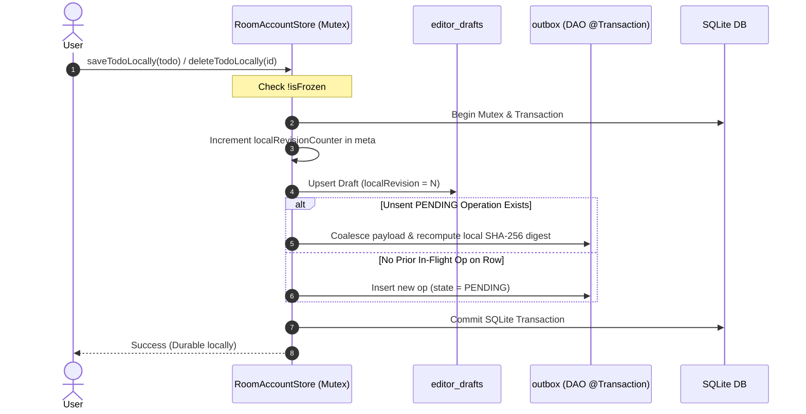
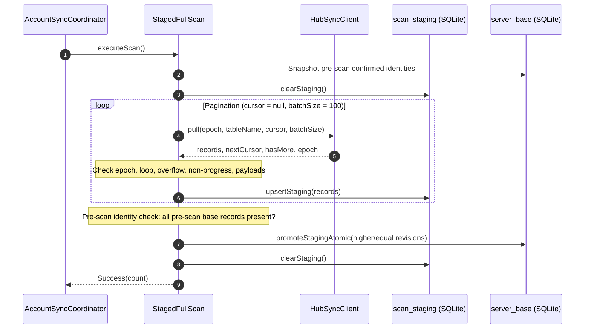
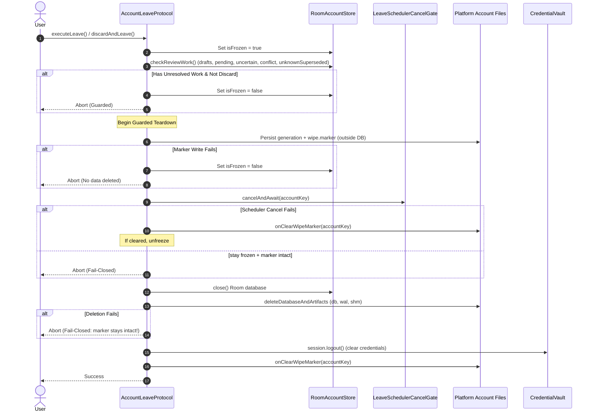

# Doggo Local Storage and Strict Synchronization Specification

Date: 2026-10-15  
Phase: Phase 05 Shared Task Model & Explicit Room v2 Migration (Storage Migration Delivered; Connected Platform & Sync Acceptance Pending)  
Plan: `plans/261015-0752-task-deadlines-reminders-strict-upgrades` (and `plans/261013-1540-doggo-glean-hub-reuse`)  
Related Docs: [System Architecture](./system-architecture.md) · [API Contract](./api-contract.md) · [Code Standards](./code-standards.md) · [Sync Acceptance](./sync-acceptance.md)

---

## 1. Storage Architecture & Partitioning

Doggo persists all local application state using **AndroidX Room KMP** (version 2.7.0-alpha12) backed by SQLite via `BundledSQLiteDriver`. Destructive migration fallback is strictly prohibited. Schema evolution uses explicit step-by-step migrations: schema version 1 (`shared/schemas/dev.doggo.shared.data.DoggoDatabase/1.json`) upgrades to schema version 2 (`shared/schemas/dev.doggo.shared.data.DoggoDatabase/2.json`, identity hash `06a93ffbac4a0570d56446f47e0e3e4c`) via `DatabaseMigrations.MIGRATION_1_2`. Both JVM (`createJvmDatabaseBuilder`) and Android (`createAndroidDatabaseBuilder`) database builders register this migration via `DatabaseMigrations.ALL`.

### 1.1 Account-Level Isolation
- **Storage Partitioning**: Each account directory is keyed exclusively by the 64-character lowercase hexadecimal string of the canonical `AccountKey`:
  `SHA-256(u32_be(origin.len) + origin_bytes + u32_be(userId.len) + userId_bytes)`
- **Directory Layout**:
  - Android: `Context.filesDir/accounts/<accountKey>/`
  - Linux Desktop: `$XDG_DATA_HOME/doggo/accounts/<accountKey>/` (default: `~/.local/share/doggo/accounts/<accountKey>/`)
  - Windows Desktop: `%LOCALAPPDATA%/doggo/accounts/<accountKey>/`
- **Path Traversal Protection & Filesystem Model**: Both `AndroidAccountFiles` and `JvmAccountFiles` verify `canonicalFile.toPath().startsWith(canonicalBase.toPath())` to ensure the resolved directory stays contained within the canonical base root (mitigating path traversal via `..` or symlink escapes outside the accounts root; intra-tree symlinks and TOCTOU races are outside this model). Critical metadata files (`wipe.marker`, `generation.dat`) write to temporary files, flush to disk via `FileOutputStream.fd.sync()`, and replace atomically via `StandardCopyOption.ATOMIC_MOVE` (note: directory metadata fsync is filesystem-dependent).

### 1.2 The Seven Room Entities (Database Version 2)

`DoggoDatabase` defines seven entities under `dev.doggo.shared.data`:

| Entity | Table Name | Primary Key | Description & Invariants |
|---|---|---|---|
| `ServerBaseEntity` | `server_base` | `rowId: String` | Authoritative confirmed server state. Monotonically advancing `serverRevision: Long`. Tombstones retain `deleted = true`, empty `title`, `completed = false`, `createdAt`, `updatedAt`, `epoch`. Extended in Room v2 with 12 temporal fields (`deadlineDate`, `deadlineTime`, `deadlineZone`, `deadlineOffsetSeconds`, `reminderAnchorTime`, `deadlineAnchorEpochMs`, `deadlineOverdueEpochMs`, `reminderEnabled`, `reminderLeadMinutes`, `reminderIntervalMinutes`, `reminderCount`, `scheduleToken`). |
| `OutboxEntity` | `outbox` | `opId: String` | Queued, in-flight, or conflicted strict mutations. Holds frozen `epoch`, `tableName`, `rowId`, `kind` (`create`/`update`/`delete`), `expectedRevision`, payload (`title`, `completed`, `createdAt`), `digest`, `localRevision`, `deliveryState`, `createdAtEpochMs`, `errorMessage`, `consecutiveFailures`. Extended in Room v2 with the 12 temporal fields plus outbox provenance and versioning: `contractVersion` (`strict-v1` vs `strict-v2`), `dispatchHistory`, `intentMask`, `transitionCheckpoint`. |
| `EditorDraftEntity` | `editor_drafts` | `rowId: String` | Uncommitted local modifications distinct from confirmed base and frozen outbox. Fields: `draftTitle`, `draftCompleted`, `localRevision: Long`, `updatedAt: Long`, `isDeleted: Boolean`, plus the 12 temporal fields. |
| `ScanStagingEntity` | `scan_staging` | `rowId: String` | Temporary records accumulated across pull pagination pages during a full scan. Fields: `tableName`, `serverRevision: Long`, `deleted: Boolean`, `title`, `completed: Boolean`, `createdAt: Long`, `epoch`, plus the 12 temporal fields. Promoted atomically upon reaching terminal page. |
| `AccountSyncMetaEntity` | `account_sync_meta` | `id: String` (singleton) | Account partition metadata. Fields: `activeEpoch`, `lastSyncTime`, `localRevisionCounter: Long`, `syncStatus`, `safeErrorCode`, `safeErrorMessage`, `consecutiveFailedRounds: Int`, `credentialPersistencePending: Boolean`. |
| `AccountLocalSettingsEntity` | `account_local_settings` | `id: String` (singleton) | Device- and account-local reminder and notification defaults. Fields: `notificationsEnabled: Boolean` (false), `defaultReminderEnabled: Boolean` (false), `defaultReminderLeadMinutes: Long` (0), `defaultReminderIntervalMinutes: Long?` (null), `defaultReminderCount: Long` (1), `defaultDateOnlyAnchorTime: String` ("09:00"). Strictly account-local, wiped on logout, never synced to Hub. |
| `ReminderDeliveryLedgerEntity` | `reminder_delivery_ledger` | `accountKey`, `generation`, `taskId`, `scheduleToken`, `occurrenceIndex` | Durable occurrence state and claim outcomes for native reminders. Composite PK: 5-tuple. Indices: `[accountKey, generation, taskId]` and `[dueEpochMs]`. Fields: `dueEpochMs: Long`, `claimOutcome: String` (`PENDING`, `CLAIMED`, `POSTED`, `MISSED`, `CANCELLED`, `SKIPPED`), `claimedAtEpochMs: Long?`, `postedPlatformId: String?`, `cancellationState: String` (`ACTIVE`, `CANCELLED`), `updatedAtEpochMs: Long`. Wiped on logout, never sent over wire. |

#### Delivery States & Protocol Versions for `OutboxEntity`
- `PENDING`: Queued locally, never dispatched to network. May coalesce with newer local edits on the same row (only when `transitionCheckpoint == null`).
- `DISPATCHING`: Currently frozen and in-flight over network socket.
- `UNCERTAIN`: Dispatch was interrupted, socket timed out, request cancelled, response omitted the op, or result payload/digest mismatched. **Not a server rejection.** Retains identical frozen payload, epoch, revision, and digest for retry.
- `CONFLICT`: Server explicitly rejected the mutation with `revisionConflict`, `missingRecord`, `deletedRecord`, `opIdReuse`, or `invalidRecord` when the operation had no prior uncertain history.
- `UNKNOWN_SUPERSEDED`: Server returned a conflict for an operation that had previously entered `UNCERTAIN` state. The earlier attempt may have committed remotely before a subsequent edit bumped the revision.
- `contractVersion`: `"strict-v1"` (legacy or migrated mutation) or `"strict-v2"` (new strict-v2 mutation). Frozen or uncertain operations must not be automatically rehashed into another protocol.
---

## 2. Local Mutation Lifecycle & FIFO Dispatch



### 2.1 Atomic Edit & Coalescing Rules
- **Draft & Outbox Atomicity**: Local edits write `account_sync_meta`, `editor_drafts`, and `outbox` atomically via Room `@Transaction` methods (`saveTodoAtomic`, `deleteTodoAtomic`).
- **Coalescing**: Only never-dispatched (`PENDING`) outbox operations are coalesced. Operations in `DISPATCHING`, `UNCERTAIN`, `CONFLICT`, or `UNKNOWN_SUPERSEDED` states are never altered in-flight.
- **Unsent Create-Delete Cancellation**: If a record has only a pending unsent `CREATE` operation and the user deletes it before dispatch, `cancelUnsentCreateAtomic` purges both the draft and the outbox entry locally without generating wire traffic.

### 2.2 FIFO Per-Row Dispatching
In `OutboxReconciliation.getEligibleDispatchBatch(maxCount = 100)`:
1. **Per-Row Serialization**: Outbox operations are grouped by `rowId`. The earliest operation by `localRevision` is evaluated as the head.
2. **Head Blocking Invariant**: If the head operation on a row is in `DISPATCHING`, `CONFLICT`, or `UNKNOWN_SUPERSEDED` state, **all successor operations on that row are blocked** from dispatching.
3. **Dispatch Eligibility**: Only rows whose head operation is `PENDING` or `UNCERTAIN` are eligible for dispatch.
4. **Batch Bounds**: Dispatched batches enforce `<= 100` operations, at most one operation per `rowId`, and `<= 256 KiB` total payload size.

### 2.3 Dispatch Freezing & CAS Optimistic Concurrency
In `prepareAndFreezeBatch()`:
- **`PENDING` Operations**:
  - `expectedRevision` is bound to current `server_base.serverRevision` (0L for new/tombstone/create; current base revision for update/delete).
  - Active `epoch` is bound.
  - Canonical SHA-256 `digest` is computed via `StrictSyncDigest.computeDigest` with big-endian UTF-8 byte lengths.
  - `freezeOutboxAtomic` executes a Room `@Transaction`: verifies `current.localRevision == expectedLocalRevision` and `deliveryState == PENDING` before updating to `DISPATCHING`. If an intervening local edit modified the row, the freeze fails and the stale op is omitted from the batch.
- **`UNCERTAIN` Retries**:
  - All frozen fields (`opId`, `epoch`, `tableName`, `rowId`, `kind`, `expectedRevision`, `digest`, `localRevision`, payload) are **strictly preserved**.
  - Delivery state transitions to `DISPATCHING`. No re-computation of digest or expectedRevision occurs.

---

## 3. Staged Full Scan & Monotonic Promotion

Synchronization executes a 3-stage round inside `AccountSyncCoordinator.executeSyncRound()`:
1. **Initial Staged Full Scan**: Ingests remote changes and advances `server_base`.
2. **Push Eligible Outbox**: Transmits eligible mutations and reconciles results.
3. **Final Staged Full Scan**: Captures post-mutation server state.



### 3.1 Pagination Loop Invariants
- **Cursor Tracking**: Loop begins with `cursor = null`. Repeating cursors or non-progressing cursors (empty records page while `hasMore == true`) immediately abort with `SafeError.ProtocolIncompatible`.
- **Epoch Guard**: If any page returns an epoch differing from `activeEpoch`, staging is cleared and sync aborts with `SafeError.ResetRequired("EPOCH_MISMATCH")`.
- **Batch Overflow**: Receiving more records than `batchSize` aborts with `ProtocolIncompatible("BATCH_OVERFLOW")`.
- **Page Budget**: Loop enforces a hard cap (`maxPageBudget = 1000`) to prevent infinite network pagination.
- **Payload Validation**: Non-deleted records must contain valid, non-blank titles, matching `rowId`, positive revisions, and non-negative timestamps.

### 3.2 Pre-Scan Identity Consistency Check
Hub strict-v1 scans return all records including permanent tombstones. Before promoting staged records:
- `StagedFullScan` checks every confirmed record in `server_base` that shares the `activeEpoch`.
- If any such pre-scan confirmed identity is missing from `scan_staging`, sync aborts with `SafeError.ResetRequired("CONSISTENCY_ERROR")` and staging is cleared. This prevents silent record loss or split-brain deletions.

### 3.3 Monotonic Promotion Rules
Staged records are promoted to `server_base` in a single Room `@Transaction` (`promoteStagingAtomic`):
1. **New Record (`currentBase == null`)**: Inserted directly into `server_base`.
2. **Higher Revision (`staged.serverRevision > currentBase.serverRevision`)**: Overwrites `server_base` with the higher revision.
3. **Equal Revision (`staged.serverRevision == currentBase.serverRevision`)**: Checks logical equivalence (deleted status, title, completed, createdAt). If logically identical, retained. If logically divergent, staging is cleared and sync aborts with `SafeError.ProtocolIncompatible("DIVERGENT_REVISION")`.
4. **Lower Revision (`staged.serverRevision < currentBase.serverRevision`)**: Local confirmed base is retained; lower staged revision is discarded.

*Note on Locking*: While `promoteStagingAtomic` executes the database write inside an atomic SQLite transaction, pre-scan base comparisons and pagination occur across several asynchronous steps. Coherence relies on the coordinator's coroutine `coordinatorMutex` preventing concurrent scans or local mutations during sync rounds.

---

## 4. CAS-Ack Reconciliation & Conflict Handling

### 4.1 Exact Acknowledgement Verification
In `OutboxReconciliation.reconcilePushResults()`, response results are indexed by `opId` (`response.results.associateBy { it.opId }`). For each dispatched operation:
1. **Omission Check**: If `result == null`, the operation transitions to `UNCERTAIN` ("Server omitted operation from push response").
2. **RowId Verification**: `result.rowId == op.rowId` must hold; otherwise transitions to `UNCERTAIN`.
3. **Digest Verification**: `result.digest == op.digest` must hold; otherwise transitions to `UNCERTAIN`.
4. **Status & Revision Verification**:
   - `status in ["accepted", "replayed"]`:
     - `result.acceptedRevision` must equal `op.expectedRevision + 1L`.
     - If revision does not match, transitions to `UNCERTAIN`.
     - If valid, calls `store.reconcileAccepted(op.opId, acceptedRevision)`.

### 4.2 Base Monotonicity & Newer Draft Preservation
Inside `RoomAccountStore.reconcileAccepted()`:
- **Base Monotonicity**: If `serverRevision < currentBase.serverRevision` (stale ack arriving after a newer ack was already applied), the outbox op is deleted without regressing `server_base`.
- **Newer Draft Preservation**: `clearDraft = currentDraft != null && currentDraft.localRevision <= op.localRevision`. If the user edited the record while the push was in-flight (`draft.localRevision > op.localRevision`), the draft is retained.
- **Atomic Reconcile**: `dao.reconcileAcceptedAtomic` executes in a single SQLite transaction: upserts `server_base`, deletes `outbox` entry, and conditionally deletes draft.

### 4.3 UnknownSuperseded Disambiguation
When the server returns a conflict status (`revisionConflict`, `missingRecord`, `deletedRecord`):
- If the operation was in `UNCERTAIN` state or had prior failures (`op.deliveryState == UNCERTAIN || op.consecutiveFailures > 0`):
  - Delivery state transitions to `UNKNOWN_SUPERSEDED`.
  - **Rationale**: An uncertain dispatch may have successfully committed to Hub before a subsequent client edit bumped the revision. Server conflict does not prove the original intent failed.
- If the operation had no prior uncertainty:
  - Delivery state transitions to `CONFLICT`.

### 4.4 User Conflict Resolution Workflows
- **`discardConflict(rowId)`**: Deletes the conflicted head operation via `discardConflictAtomic(conflictOp.opId, rowId, conflictOp.localRevision)` and clears draft if `draft.localRevision <= conflictLocalRev`. Successor outbox operations on the row are preserved.
- **`reapplyConflict(rowId)`**: Inspects current confirmed `server_base.serverRevision`, allocates a new local revision, generates a fresh UUID `opId`, recomputes digest targeting the new base revision, and atomically replaces the outbox entry via `replaceOutboxAtomic`.
- **`copyAsNew(rowId)`**: Discards old conflicted outbox and draft, then creates a brand-new Todo with a fresh UUID and `serverRevision = 0L`. *(Note: executed as sequential DAO operations under `coordinatorMutex`).*

---

## 5. Crash Recovery & Cancellation Safety

1. **Interrupted Dispatches**: If the app process dies or is terminated during network socket transmission, operations remain in `DISPATCHING` state in SQLite. On startup or at the beginning of each sync round, `store.recoverInterruptedDispatches()` resets all `DISPATCHING` rows to `UNCERTAIN` with `errorMessage = "Interrupted dispatch recovered"`.
2. **Cancellation Safety**: In `AccountSyncCoordinator`, network push runs inside a try/catch block. If coroutine cancellation occurs (`CancellationException`), a `withContext(NonCancellable)` block marks the entire dispatched batch as `UNCERTAIN` before rethrowing the exception.
3. **Generation Fencing**: The coordinator tracks `currentGeneration`. If generation changes (e.g. account logout or switch occurs mid-flight), downstream callbacks drop results without modifying local storage.

---

## 6. Fail-Closed Account Leave & Wipe Protocol

Account logout/switch enforces a crash-safe, fail-closed teardown sequence via `AccountLeaveProtocol`:



### 6.1 Teardown Order
1. **Freeze Store**: `store.isFrozen = true` prevents new local edits (`saveTodoLocally` throws `IllegalStateException`).
2. **Persist Marker Outside Database**: Atomically writes `generation + 1` to `wipe.marker.tmp` with file sync (`fsync`), then atomically moves to `wipe.marker`. If marker persistence fails, teardown aborts immediately and unfreezes the store—no data is deleted.
3. **Cancel & Await Schedulers**: Cancels background WorkManager or job schedulers via `LeaveSchedulerCancelGate`. If cancellation throws, it attempts to clear the marker and unfreezes only if the marker was successfully cleared.
4. **Close Room Database**: `store.close()` closes all database connections.
5. **Delete Database Artifacts**: Deletes `doggo.db`, `doggo.db-wal`, `doggo.db-shm`. If deletion fails, the process stays fail-closed with `wipe.marker` intact.
6. **Clear Credentials**: Removes tokens and identity from `CredentialVault` and resets `HubAuthSession`.
7. **Clear Wipe Marker**: Removes `wipe.marker`.

*Table vs Filesystem Wipe*: `store.wipeLocalData()` invokes `dao.wipeAllTablesAtomic()`, which transactionally clears all 7 tables in a single SQLite transaction (`editor_drafts`, `outbox`, `scan_staging`, `server_base`, `account_sync_meta`, `account_local_settings`, `reminder_delivery_ledger`). This database transaction is distinct from the 7-step fail-closed filesystem and credential teardown protocol managed by `AccountLeaveProtocol`, which operates on external files, WorkManager schedulers, and Keystore credentials.

### 6.2 Startup Crash Recovery
On application startup, before opening any database or initializing an account, `AccountLeaveProtocol.completePendingWipe()` inspects `hasPendingWipe(accountKey)`. If `wipe.marker` exists:
- Deletes remaining database files (`doggo.db`, `doggo.db-wal`, `doggo.db-shm`).
- Clears vault credentials.
- Clears `wipe.marker`.
If file deletion fails, it returns `false`, preventing the account from being reopened in a corrupted state.

---

## 7. Strict-v2 Schema Evolution & Outbox Reconciliation (Room v2 Delivered; Client Replay Pending Phase 06)

*Note: Section 7.1 documents the Room database version 2 schema, explicit `MIGRATION_1_2`, and shared models delivered in Phase 05. Section 7.2 defines the cross-version outbox reconciliation and client transition rules scheduled for Phase 06. Section 7.3 defines the mathematical invariants and checked 64-bit arithmetic implemented in `dev.doggo.shared.contract`.*

### 7.1 Room Database Migration (1 -> 2) [Phase 05 Delivered]
In Room database version 2, `DoggoDatabase` executes explicit step-by-step migration `DatabaseMigrations.MIGRATION_1_2`. Both `createAndroidDatabaseBuilder` and `createJvmDatabaseBuilder` consume `DatabaseMigrations.ALL`, which registers `MIGRATION_1_2`. Destructive migration fallback is strictly forbidden.

- **Expanded Tables (12 Temporal Columns)**:
  `server_base`, `editor_drafts`, `scan_staging`, and `outbox` are altered using SQLite `ALTER TABLE ADD COLUMN`:
  - `deadlineDate TEXT DEFAULT NULL`
  - `deadlineTime TEXT DEFAULT NULL`
  - `deadlineZone TEXT DEFAULT NULL`
  - `deadlineOffsetSeconds INTEGER DEFAULT NULL`
  - `reminderAnchorTime TEXT DEFAULT NULL`
  - `deadlineAnchorEpochMs INTEGER DEFAULT NULL`
  - `deadlineOverdueEpochMs INTEGER DEFAULT NULL`
  - `reminderEnabled INTEGER NOT NULL DEFAULT 0`
  - `reminderLeadMinutes INTEGER NOT NULL DEFAULT 0`
  - `reminderIntervalMinutes INTEGER DEFAULT NULL`
  - `reminderCount INTEGER NOT NULL DEFAULT 1`
  - `scheduleToken TEXT DEFAULT NULL`
  - **Fail-Closed Defaults**: All migrated version 1 records default to `deadlineDate = null` (all deadline/token fields null) and `reminderEnabled = false` (lead=0, count=1, interval=null), eliminating phantom notification triggers on upgrade.

- **Outbox Provenance & Versioning Columns**:
  `outbox` table is altered with 4 provenance columns:
  - `contractVersion TEXT NOT NULL DEFAULT 'strict-v1'`: Distinguishes legacy `"strict-v1"` mutations from `"strict-v2"`.
  - `dispatchHistory TEXT DEFAULT NULL`: JSON log tracking dispatch and migration events.
  - `intentMask TEXT DEFAULT NULL`: Intent mask indicating field mutations (`TITLE`, `COMPLETED`, `DEADLINE`, `REMINDER`, `DELETE`, `REQUIRES_REVIEW`).
  - `transitionCheckpoint TEXT DEFAULT NULL`: Migration checkpoint marker (`MIGRATED_FROM_ROOM_V1`).

- **Conservative SQL Intent Derivation for Legacy Outbox Rows**:
  During `MIGRATION_1_2`, existing uncheckpointed `outbox` rows are updated:
  ```sql
  UPDATE outbox SET 
      transitionCheckpoint = 'MIGRATED_FROM_ROOM_V1',
      intentMask = CASE
          WHEN kind = 'delete' THEN 'DELETE'
          WHEN kind = 'create' THEN 'TITLE|COMPLETED'
          WHEN kind = 'update' AND title IS NOT NULL AND completed IS NOT NULL THEN 'TITLE|COMPLETED'
          ELSE 'REQUIRES_REVIEW'
      END,
      dispatchHistory = '{"event":"ROOM_V1_MIGRATION","priorState":"' || deliveryState || '"}'
  WHERE transitionCheckpoint IS NULL
  ```
  *Provenance Caveat*: This SQL migration assigns conservative classifications; it does not reconstruct true user intent from historical sessions. Any ambiguous update missing title or completed fields is categorized as `REQUIRES_REVIEW`.

- **Newly Recorded Outbox Provenance (`RoomAccountStore`)**:
  When saving mutations in `strict-v2` mode, `RoomAccountStore` writes `contractVersion = CONTRACT_VERSION_V2` and dynamically derives `intentMask` by diffing against confirmed `server_base`:
  - `CREATE`: `TITLE|COMPLETED` + `DEADLINE` (if deadline present) + `REMINDER` (if reminder enabled).
  - `UPDATE`: Diffing against `server_base` assigns `INTENT_TITLE`, `INTENT_COMPLETED`, `INTENT_DEADLINE`, and `INTENT_REMINDER`. If no field differences are detected (e.g. resave), it defaults to `INTENT_TITLE`.
  - **Frozen Operation Invariant**: Frozen (`DISPATCHING`) and uncertain (`UNCERTAIN`) operations retain their original frozen payload, digest, and contract version; they are never automatically rehashed or upgraded across protocol versions.
  - **Tombstone Non-Mutation**: Deleting an already-deleted record throws `IllegalStateException`. Unsent create-delete cancellation and outbox coalescing require `transitionCheckpoint == null`, preventing corruption of migrated entries.

- **New Tables in Version 2**:
  1. `account_local_settings`: Stores per-device reminder/notification defaults (singleton `id = 'singleton'`, initialized with `09:00` date-only anchor time and disabled reminders). Account-partitioned, wiped on logout, never sent to Hub.
  2. `reminder_delivery_ledger`: Durable occurrence state and claim outcomes for native reminders. Composite primary key: `[accountKey, generation, taskId, scheduleToken, occurrenceIndex]`. Indices: `[accountKey, generation, taskId]` and `[dueEpochMs]`. Status values: `PENDING`, `CLAIMED`, `POSTED`, `MISSED`, `CANCELLED`, `SKIPPED`. Cancellation states: `ACTIVE`, `CANCELLED`. Account-partitioned, wiped on logout, never transmitted to Hub.

- **Transactional Database Wipe**:
  `DoggoDao.wipeAllTablesAtomic()` incorporates both new tables:
  ```kotlin
  @Transaction
  suspend fun wipeAllTablesAtomic() {
      clearDrafts()
      clearOutbox()
      clearStaging()
      clearServerBase()
      clearMeta()
      clearLocalSettings()
      clearLedger()
  }
  ```

### 7.2 Outbox Replay & Reconciliation Safety [Planned Phase 06]
- **Unprovable Legacy Outbox**: In Room v1 databases, existing `OutboxEntity` records lacked dispatch history and intent diff masks. If an outbox operation cannot be proven (via server monotonic revision, missing row for expected0 create, or matching receipt from `POST /api/v1/sync/:app_id/strong/legacy-receipts`), it enters `UNKNOWN_SUPERSEDED` for explicit user review; it is never automatically rehashed or re-applied.
- **Safe Intent Rebase**: Whole-row v1 mutations must never overwrite newly introduced remote v2 fields. When rebasing a safe v1 pending intention over a newly scanned v2 record, only the explicitly changed fields (title, completed) are applied over the remote base.
- **Cross-Version Base Reconciliation Risk**: In `RoomAccountStore.reconcileAccepted()`, acknowledging a legacy strict-v1 outbox operation (`op.contractVersion == CONTRACT_VERSION_V1`) must be safeguarded in Phase 06 so that `updatedBase` copies don't overwrite remote v2 deadline fields on equal/higher revisions.
- **Atomic Cleanup on Regressive Server Revision**: Deferring `discardRegressiveReconcileAtomic` means `deleteDraft` and `deleteOutbox` on regressive server revisions currently execute non-atomically; a crash between calls leaves partially reconciled state until Phase 06 transaction wrapping lands.

### 7.3 Strict-v2 Mathematical Invariants & Checked Arithmetic
- **Preimage Framing**: Domain `strict-v2` with 8 length-prefixed identity strings followed by 8-byte big-endian signed revision. Data payload is 0 bytes for DELETE; CREATE/UPDATE serialize 4 base fields followed by 12 strict-v2 fields in table order with explicit presence tags (`0x00`/`0x01`).
- **Rule Opportunity Bounds**: `reminderCount` is strictly constrained to `1..10`. For non-repeating reminders (`reminderCount == 1`), `reminderIntervalMinutes` MUST be null. For repeating reminders (`reminderCount > 1`), `reminderIntervalMinutes` MUST be non-null and `>= 15`.
- **Non-Negative Constraints**: `createdAt >= 0` and `reminderLeadMinutes >= 0`.
- **Checked 64-bit Arithmetic**: All time computations use checked 64-bit integer operations (`safeMultiply`, `safeSubtract`, `safeAdd`), preventing integer overflow wrapping at all intermediate steps:
  - Lead conversion: `reminderLeadMinutes * 60_000L`
  - First anchor: `deadlineAnchorEpochMs - leadMs`
  - Interval conversion: `reminderIntervalMinutes * 60_000L`
  - Last repeat offset: `(reminderCount - 1L) * intervalMs`
  - Last anchor: `firstAnchor + lastOffset`
  - Occurrence boundary: `lastAnchor <= deadlineAnchorEpochMs`
- **Deadline Alignment**: Timed deadline requires `deadlineOverdueEpochMs == deadlineAnchorEpochMs`. Date-only deadline requires non-null `reminderAnchorTime`. Deadline removal clears all deadline and schedule token attributes and resets reminder preferences to default (`reminderEnabled = false`, `lead = 0`, `count = 1`, `interval = null`).
