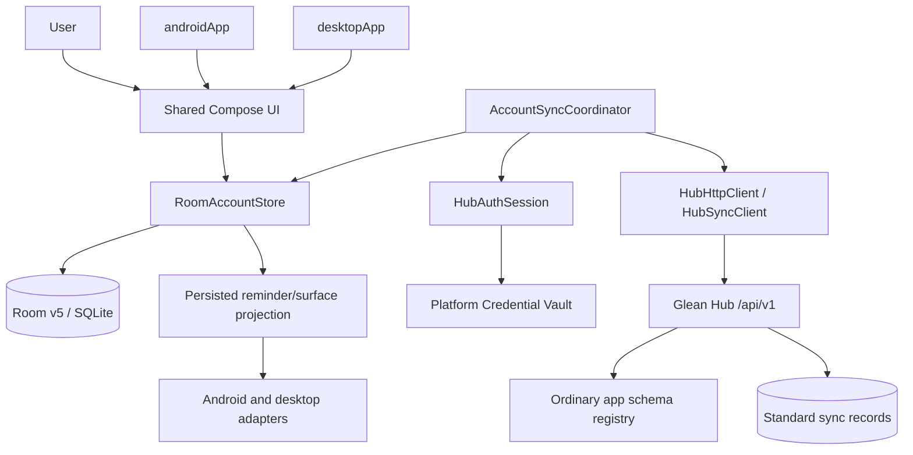
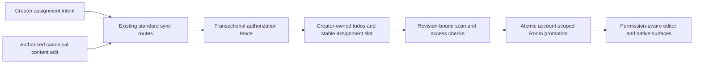

# TabbyRush System Architecture

Last Updated: 2026-10-22
Status: Collaborative task assignees and Room v5 implementation is complete (Phases 01–09) and approved with noted issues. Cycle 3 targeted review (2026-10-22) scored 9.5/10 with 0 critical findings and 3 warnings. G0 is confirmed; G1 reports 625/625 in the 2026-10-21 broad suite and 390/390 in a separate 2026-10-22 selected-suite run (not additive). G2–G5 runtime/device acceptance remains pending; G6 audit is not evidenced. Rotation of a disposable Mongo test credential flagged by QA is not evidenced. Release remains blocked; production migration is unauthorized.
Related Docs: [Standard Sync Design](./standard-sync-cutover-design.md) · [API Contract](./api-contract.md) · [Codebase Summary](./codebase-summary.md) · [Deployment Guide](./deployment-guide.md) · [Release Acceptance](./release-acceptance.md) · [Local Storage & Sync](./local-storage-and-sync.md) · [Hub Schema Integration](./hub-schema-integration.md) · [Hub Compatibility Acceptance](./hub-compatibility-acceptance.md) · [Security & Recovery](./security-and-recovery.md) · [Android Acceptance](./android-acceptance.md) · [Linux Acceptance](./linux-acceptance.md) · [Windows Acceptance](./windows-acceptance.md)

---

## 1. Product and Runtime Boundaries

TabbyRush is a native Android and desktop task application built with Kotlin Multiplatform and Compose. `shared/` owns domain contracts, shared UI, account persistence, authentication, and synchronization. `androidApp/` and `desktopApp/` provide native lifecycle, platform storage, scheduler, and presentation integrations. Glean Hub is the remote account/authentication/schema service and task-sync backend; its admin UI is operational tooling, not a TabbyRush web app.

The current client synchronizes with an ordinary Hub app registration through standard `push`, `pull`, and `delta` routes under `/api/v1/sync/{app_id}/`; app-schema provisioning remains an administrator action, not automatic native startup behavior. The current binary does not use the former strict-v1/v2/v3 route trees, epochs, or operation-receipt contracts. Schema changes do not generate native UI, Kotlin fields, or Room columns automatically.

## 2. Component and Data Flow

Local edits are persisted before network activity. Account-scoped storage and auth generations fence stale callbacks after account changes. A sync round authenticates, reconciles standard push results, and obtains server state through pull/delta; delta is a sequential push followed by pull, not an atomic transaction. Room applies related state changes transactionally where implemented, but a client transaction does not create server-side group-write atomicity.

### 2.1 Proposed Desktop Sticky Typography and Compact Controls

Design recorded 2026-10-21; implementation and native acceptance pending. See the [implementation plan](../plans/261021-0844-compact-sticky-font-resize/plan.md).

- `StickyWindowPresentation` gains a defaulted `fontScale` presentation field. `StickyWindowPreferences` loads/saves `sticky.window.font_scale` in the existing device-profile `sticky-window.properties`; no Room schema, task payload, account identity, or sync contract changes.
- Proposed flow: preferences load → `DesktopController` seeds `DesktopStickyTaskController` → immutable `StickyTaskState.fontScale` → sticky content. Header buttons and sticky-only keyboard shortcuts emit presentation actions through the existing action path; changed scale is persisted with current geometry and visibility by `DesktopController`.
- Zoom range is 0.75–1.50 inclusive, step 0.125, default/reset 1.0. Missing, malformed, non-finite, or out-of-range persisted scale falls back independently to 1.0 without discarding otherwise valid geometry/visibility. Task-state clearing preserves this non-sensitive, device-profile preference.
- A sticky-subtree `LocalDensity` override retains display density and multiplies inherited font scale by sticky zoom. Only scalable text changes; window geometry, main-app typography, Android targets, task projections, and account-generation fences stay unchanged.
- Compact spacing and 24dp row controls are desktop-sticky-only; shared/Android 48dp touch-target defaults remain unchanged. Implementation must document the explicit sticky exception in code/design standards, preserve semantic roles/state, keyboard focus/activation, and keep Open App/Quit reachable with narrow-window wrapping and large text.
- Native Windows/Linux checks must establish actual measured controls, text fit, focus, restart persistence, and recovery behavior. Unit tests or design baselines do not close existing native acceptance/release holds.

### 2.2 Task Assignment Collaboration Architecture

Implementation across Phases 01–09 is complete and approved with noted issues. G0 was confirmed 2026-10-21. G1 automation is reported passing: 625/625 in the broad [QA report](../plans/reports/qa-261021-2225-critical-fix-regression-tests.md), and 390/390 in a later selected-suite [QA report](../plans/reports/qa-261022-1521-selected-test-suite-results.md); these are separate scopes, not additive totals. The 2026-10-22 targeted [Cycle 3 review](../plans/reports/code-review-261022-1649-collaborative-assignees-cycle3.md) scored 9.5/10 with 0 critical findings and 3 warnings. G2/G3 disposable runtime acceptance and G4/G5 device/interactive acceptance remain pending; G6 security/release audit is not evidenced. The selected-suite QA report flags a disposable Mongo test credential in command text; rotation is not evidenced. Release remains blocked; production migration and operational enablement are unauthorized.

- Hub `SharingConfig` includes optional `assignmentPolicy` version 1. Absent policy preserves other apps' viewer-only behavior. Explicit same-table `parentTaskId` mapping and editable-field allowlist encode task semantics without app-ID branches or a generic role engine.
- Content remains in creator-owned `todos`. A versioned `taskAssignees` relationship has one stable slot per canonical task: its row ID equals task ID within the same stored owner namespace. Reassignment updates that slot; unassignment tombstones it; regrant reuses it. Assignment-slot tombstones are retained to prevent stale recreation.
- Canonical record identity is `(ownerUserId, tableName, rowId)` and task identity is `TaskRef(ownerUserId, rowId)`; app ID is the sync/request context, not a field in these Kotlin identity types. A caller-supplied owner is a selector, never authority. Exact accepted-version tuples include owner. Capable-mode pagination uses unique stored record ID, not row ID, as the timestamp tie-breaker.
- The creator alone manages assignment, deletion/restoration, structure, and child creation. Direct and parent-derived access compose as a union. Assignee content edits are limited to the configured allowlist; child-only access does not expose private parent/sibling content. Automatic parent completion requires reconciled full-group coverage.
- Shared Compose `TaskAssigneePicker` uses `/api/v1/auth/lookup?username=...` and submits assignment changes as versioned relationship intents; lookup identifies a candidate but does not grant app membership or access by itself.
- Opted-in apps require a transaction-capable MongoDB replica set and use the app-scoped `_sync_assignment_fences` guard to serialize canonical edits and visibility revisions (`accessRevision`). The Cycle 3 review verified the prior in-transaction policy reload, transactional schema/fence publication, strict checkpoint ordering, and affirmative gating in core Android/Desktop handlers; this targeted code review does not establish runtime acceptance.
- Existing `/push`, `/pull`, `/delta` routes carry additive collaboration capability (`collaborationVersion: 1`), owner and access-revalidation metadata (`accessChecks`, bounded to <= 100 keys and <= 256 KiB). A full scan and bounded explicit checks of staged/cached/pending identities must agree on one access revision before Room promotion or queued replay. Scan absence alone never proves revocation/deletion. Each push independently reauthorizes live grants; delta stays non-atomic.
- Room v5 explicitly migrates private state, canonical identities, relationship state and access metadata without reset. Legacy owner binding is resolved from verified account identity (`ownerBinding = LOCAL_ACCOUNT`), never reversed from the one-way account-key hash. Confirmed base, outbox, drafts and staging remain separate.
- Access loss is not a task tombstone. Reconciliation removes inaccessible active content, cancels reminders and refreshes widgets/sticky views; only content-free non-replayable failure evidence remains (`access_loss_evidence`). Regrant loads the same live canonical task without replaying revoked edits. Disconnected cached content cannot be remotely erased.
- Assignment-policy apps reject old clients lacking the required capability (HTTP 426 `COLLABORATION_REQUIRED`) before any sync mutation or shared pull. Other apps are unchanged. Policy choices confirmed 2026-10-21; runtime acceptance and production configuration authorization remain separate; no production change is authorized.
- G2/G3 acceptance requires disposable Hub/API and Room v5 coordinator runtime exercises; G4/G5 require actual Android/desktop device or interactive-surface acceptance. G6 security/release audit is not evidenced. Passing automated tests do not close these acceptance gates or the release hold.
- **Cycle 3 warnings (reported 2026-10-22):** The review lists a permissive desktop sticky-row fallback when cached access is null, repeated app-membership queries during bounded pull access checks, and missing replica-set integration coverage for concurrent insert-collision recovery. Their disposition after the review is not evidenced; do not treat these warnings as critical findings or infer they are fixed. The review is not release approval.

## 3. Native Persistence

`TabbyRushDatabase` is Room version 5 and registers explicit migrations 1→2, 2→3, 3→4, and 4→5. Destructive fallback is prohibited. Its entities are:

| Table | Responsibility |
|---|---|
| `server_base` | Confirmed standard server projection, deletion state, record version, raw JSON, projection metadata, and canonical owner binding. |
| `outbox` | Local submitted intent, delivery/review state, intent mask, current standard payload/envelope, record version, and canonical TaskRef. |
| `editor_drafts` | Uncommitted user edits, separate from server base and submitted intent. |
| `scan_staging` | Paginated full-scan rows isolated by scan generation before promotion. |
| `access_check_staging` | Staged access-validation results across multiple pages, validated against a consistent access revision before promotion. |
| `task_access` | Authoritative reconciled task rights, capability flags (`editContent`, `manageAssignment`, etc.), and hierarchy coverage (`full-group`, `child-only`). |
| `access_loss_evidence` | Non-replayable, content-free records of authoritative access loss (identity, versions, timestamp, reason) retained for review without leaking purged payloads. |
| `account_sync_meta` | Hub schema observation, pull checkpoint, scan generation/state, sync progress metadata, and cached access revision. |
| `account_local_settings` | Device/account-local preferences, not synced as task data. |
| `reminder_delivery_ledger` | Durable reminder occurrence and delivery claims. |
| `legacy_sync_evidence` | Lossless archive of pre-v4 outbox SQLite values for review; never sent to sync endpoints. |

Room 4→5 migrates local tables to canonical identity representation without data loss. Legacy rows are stored with `ownerBinding = LOCAL_ACCOUNT` and nullable `ownerUserId` until store initialization verifies that restored `AccountIdentity` matches `AccountKey.create(origin, userId)`. Unresolved rows remain strictly local-only and are never dispatched to network sync.

Account data uses an origin/user-derived account key and platform account directories. Platform credential vaults are Android Keystore, Linux Secret Service, and current-user Windows DPAPI. The desktop credential-vault file ACL is a separate concern from provisioning-file DACL; documented best-effort ACL behavior is not an owner-only guarantee.
## 4. Standard Synchronization

### 4.1 Wire Contract

All routes use `/api/v1`. Account routes include `/auth/register`, `/auth/login`, `/auth/refresh`, and `/auth/me`. Sync requests use Bearer JWT, `X-API-Key`, and `X-App-Id` headers. Push records carry `tableName`, `rowId`, `ownerUserId` (mandatory for collaborative apps), raw JSON `data`, `version`, `deleted`, and `assumedServerVersion`; pull pagination uses the composite `{updatedAt,id}` checkpoint. Collaborative requests require `collaborationVersion: 1`. Hub `schemaVersion` is returned as informational metadata.

The client enforces a 256 KiB serialized UTF-8 request-body limit before freezing a batch. A known record that individually exceeds this limit is marked conflicted/actionable and remains unsent; it is not represented as an uncertain network result. Fitting records can be submitted while other records remain pending.

### 4.2 Raw JSON, Schema, Collaborative Authorization, and Acknowledgement

`server_base` and scan staging retain raw JSON so fields unknown to an older native build survive. Merging applies only keys selected by a valid explicit intent mask. The client does not infer unknown legacy intent as “all known fields.” Assignees are restricted to the configured `editableFields` allowlist; non-editable field modifications or structural changes (creating children, reparenting, deleting, restoring) are rejected.

Hub `schemaVersion` is a positive exact integer used for admin schema concurrency, not a feature gate or Room migration trigger. Effective no-op schema changes do not increment it. Changed updates use `expectedSchemaVersion`; stale changed edits conflict rather than overwriting newer schema.

For collaborative apps, an internal app guard (`_sync_assignment_fences`) in a transaction-capable MongoDB replica set serializes writes. Only an explicit accepted `(ownerUserId, tableName, rowId, version)` tuple confirms the submitted version. Pulled matching content/version/deletion can establish desired-state convergence, not operation-receipt proof. Standard sync does not provide strict exact-revision CAS receipts, server-enforced hierarchy, permanent tombstones, or transactional group writes.

### 4.3 Full Scan and Restart Safety

The client starts a full scan from a null checkpoint every sync round/reconnect because no trustworthy server retention horizon is assumed. Pages are staged with a generation and promoted only after a complete scan. If a process restarts, staging from an older generation is discarded and a fresh scan begins. An incomplete scan never proves that an absent record was deleted. The composite checkpoint is not replaced with `serverTimestamp`.

### 4.4 Legacy Conflict Review and Copy-Latest

Room v4 migration archives legacy outbox values without assuming delivery outcome. If intent is ambiguous, the row remains for review. Reapply is constrained to explicit supported changed fields and never falls back to all known fields. Discard removes the reviewed conflicting intent. Copy-latest reads the latest authoritative projection and creates a new root record; it does not resurrect/reparent the conflicted row implicitly.

## 5. Hub Schema and Operator Boundary

Ordinary app schema management is separate from task transport. `GET /api/v1/apps/{app_id}` reads metadata and `PUT /api/v1/apps/{app_id}/schema` uses `expectedSchemaVersion`. The current provisioning script creates a new ordinary registration only; it does not convert an existing strict registration. On Windows, its output directory must already exist as a private, non-symlink directory with protected DACL/owner limited to the current user, `SYSTEM`, and `Administrators`. It refuses unsafe directories without changing permissions and establishes the credential file DACL before registration POST.

The standard-sync conversion operator is source-built separately from the native client. Parent reports 7/7 disposable-Mongo operator checks passed, including concurrency, deadline, and recovery. Any failed mutating run leaves a durable exclusive claim with no automatic expiry/takeover. Recovery requires `maintenance.executionRecovery` for the exact `expectedExecutionId`, `executorStopped: true` with `executorStopEvidence`, `mongoOperationsDrained: true` with `mongoDrainEvidence`, and `authorizedActions` containing `recoverExecution`. Renew/verify the maintenance window before every collection rename and registry CAS. The operator does not restart services, release external isolation, or automatically roll back. Live cutover requires separate explicit approval and verified backup/isolation scope.

## 6. Authentication, Scheduling and Announcements

`HubAuthSession` owns account authentication state and generation fencing. Token refresh is coordinated to avoid concurrent refreshes; configured requests use the Hub HTTP allowlist and dual-auth sync headers. Sign-out/account leave freezes mutations, cancels account-scoped work, handles unresolved local work according to the selected leave action, and clears account data/credentials under the guarded teardown protocol.

Reminder scheduling is driven from persisted task/server/outbox state rather than uncommitted editor drafts. Android uses native alarm/notification integrations; desktop scheduling is process-scoped with platform adapters. Native service behavior, widget/window/tray appearance, accessibility, Doze behavior, and connected-device convergence require platform acceptance and are not established by backend smoke or package generation.

Announcements are a separate Hub service and contract from task synchronization. The TabbyRush client uses authenticated inbox APIs and in-memory announcement state rather than Room task tables or an offline announcement outbox. See [announcement contract](./announcement-contract.md) for the versioned wire contract.

## 7. Current Verification and Release Boundary

Reported disposable-local API/browser smoke used MongoDB 27191, Hub 3100, and admin UI 3102. It exercised ordinary provisioning, standard create/pull/delta/update/stale-conflict/delete, unknown JSON retention, nullable `customNotes` schema update 1→2, no-op version stability, and stale admin draft preservation.

A separate standalone Windows runtime smoke passed against disposable loopback services: Windows DPAPI, real HTTP auth, Room offline restart, two independent stores using actual coordinator push/pull/delta, schemaVersion 2, unknown nested JSON and `customNotes` retained through native edit, parent/child sync, and group deletion. It was invoked through a strict Gradle JavaExec entry point. This is not interactive UI acceptance or connected-Android proof. UI provider approval timed out twice; connected-device verification was not run. Do not claim native acceptance passed, production migrated, or release unblocked.

## 8. Historical Strict Architecture

Strict-v1/v2/v3 route, epoch, schema-fingerprint, digest, migration, and acceptance descriptions in earlier phase documents are historical snapshots from 2026-10-14 through 2026-10-20. They are not current runtime guidance. Former strict runbooks and strict-specific CLI/rehearsal scripts have been retired. See [release acceptance](./release-acceptance.md).
