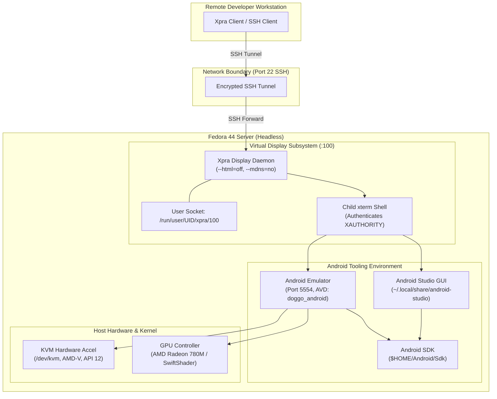
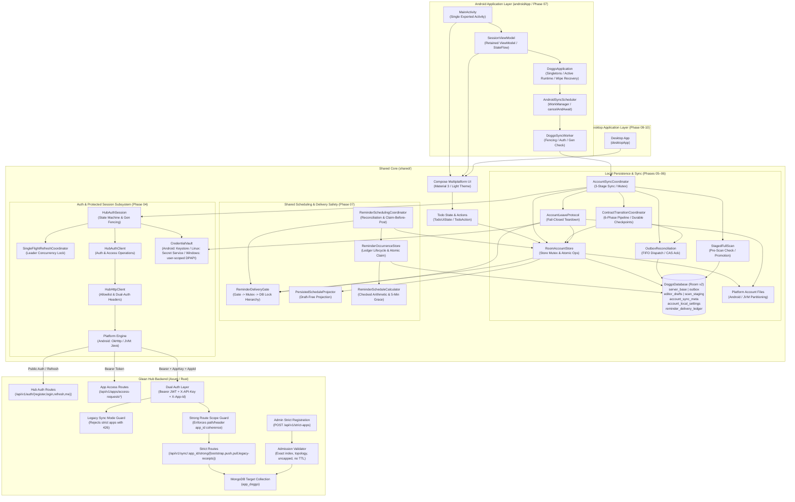

# Doggo System Architecture

Last Updated: 2026-10-15
Phase: Phases 01–10 Delivered (Gate G1 passed, Gate G4 client transition delivered, Gate G5 shared scheduling passed; Gate G2 physical native delivery & platform acceptance pending Phase 11; Gate G3 live cluster execution on staging hold)
Related Docs: [Project Roadmap](./project-roadmap.md) · [Codebase Summary](./codebase-summary.md) · [Deployment Guide](./deployment-guide.md) · [Windows Desktop Guide](./windows-desktop-guide.md) · [Windows Acceptance](./windows-acceptance.md) · [Linux Acceptance](./linux-acceptance.md) · [Android Acceptance](./android-acceptance.md) · [Headless Android Setup](./headless-android-setup.md) · [Host Tooling Evidence](./host-tooling-evidence.md) · [Local Storage & Sync](./local-storage-and-sync.md) · [Sync Acceptance](./sync-acceptance.md) · [Hub Schema Integration](./hub-schema-integration.md) · [Hub Compatibility Acceptance](./hub-compatibility-acceptance.md) · [Auth Acceptance](./auth-acceptance.md) · [Authentication & Credentials](./authentication-and-credentials.md)

---

## 1. Architectural Scope & Principles

Doggo is designed as an Android-first shared Compose Multiplatform application developed on a headless Linux host. Development and validation rely on an isolated virtualization architecture that enables full graphical IDE and Android emulator capabilities without installing desktop environments (GNOME/KDE) or exposing insecure network services.

### Core Architectural Principles
1. **Headless Isolation**: The host operates in headless server boot mode. Graphical access is strictly encapsulated within user-isolated virtual display servers.
2. **Encrypted Transport Only**: All remote graphical interaction transits SSH tunnels with out-of-band host key verification. Zero public TCP listeners are permitted.
3. **Hardware-Accelerated Emulation**: Android virtual devices leverage host Linux KVM (`/dev/kvm`) acceleration directly without compromising system device permissions.
4. **Idempotent Tooling**: Host management scripts are deterministic, side-effect free on error, and safe for automated or repetitive execution.
5. **Durable Local State & Strict Sync**: Local mutations persist immediately in SQLite before network dispatch; outbox enforces FIFO per-row serialization; remote updates promote monotonically.

---

## 2. Infrastructure & Virtualization Architecture

### Component Topology

---

## 3. Subsystem Breakdown

### 3.1 Remote Display Subsystem (Xpra)
- **Display Identifier**: Dedicated display `:100` managed by `scripts/start-xpra.sh`.
- **Socket Isolation**: UNIX domain socket located in `/run/user/$(id -u)/xpra/` (mode `0700`).
- **Security Flags**: `--bind-tcp` omitted; `--html=off`; `--mdns=no`.
- **Authentication**: Spawns an authenticated child `xterm` shell ensuring child processes inherit valid `DISPLAY` and `XAUTHORITY`.

### 3.2 Android SDK & Tooling Subsystem
Configured through `scripts/android-sdk-env.sh`:
- **`ANDROID_HOME`**: Points to `$HOME/Android/Sdk`.
- **Tool Resolution**: Adds `cmdline-tools/latest/bin`, `platform-tools`, and `emulator` to `PATH`.
- **Java Compatibility**: Respects existing `JAVA_HOME`; detects Studio JBR or JDK 21 LTS; leaves `JAVA_HOME` unset if only host Java 25 is present.

### 3.3 Emulator Subsystem
Managed via `scripts/start-android-emulator.sh`:
- **Port Allocation**: Strictly bounded to decimal even integers in `5554` to `5682`.
- **Hardware Acceleration**: Checks `/dev/kvm` read/write access (AMD-V, KVM API 12).
- **Rendering Fallback**: Defaults to `-gpu auto`, supporting `-gpu swiftshader` if GLX rendering fails.
- **Headless Mode**: Supports `EMULATOR_HEADLESS=1` for automated CI runs.

---

## 4. Multiplatform Application & Sync Architecture

### 4.1 Storage Namespace & Backend Isolation
Strict sync completely segregates Doggo data from legacy Hub storage:
- **Naming Pattern**: `app_<appId>` (e.g. `app_doggo`).
- **Document Key (`_id`)**: Exact composite key `userId:rowId` preventing cross-user collisions.
- **Scan Index**: Exact compound index `{ userId: 1, tableName: 1, rowId: 1 }` with simple collation.
- **Publication-Last Registration**: Schema entry published only after storage and indexes pass admission.

### 4.2 Route Fencing & Middleware Isolation
- **Legacy Guard (`legacy_sync_mode_guard`)**: Rejects strict apps requesting legacy sync routes with HTTP 426 (`protocolUnsupported`).
- **Scope Guard (`strong_route_scope_guard`)**: Enforces exact match between `X-App-Id` header and URL path parameter `:app_id`.
- **Schema Immutability**: `PUT /api/v1/apps/:app_id/schema` updates reject strict apps with HTTP 400.

### 4.3 Mutation Semantics & Replay Confirmation
- **Create**: Conditional insert-only write requiring expectedRevision = 0, setting revision = 1 and atomic `lastOp`.
- **Update**: Conditional write matching current `revision == expectedRevision` and live row filter (`deleted: false`), incrementing revision by 1.
- **Delete**: Conditional write matching current `revision == expectedRevision`, incrementing revision by 1, replacing data with canonical empty document, and recording permanent tombstone.
- **Replay Confirmation**: Identical `(opId, digest)` mutations perform a conditional write updating `confirmationNonce` with journaled write concern, requiring `matched_count == 1`.

### 4.4 Durability Policy & Backend Topology Observation
- **Replica Set**: `{ w: "majority", j: true }` write concern and `majority` read concern.
- **Standalone**: `{ w: 1, j: true }` write concern and `local` read concern.
- **Implementation Observation**: In `services/strong_sync_service.rs`, `get_strict_collection` runs `hello` to inspect topology and falls back to standalone (`w: 1, local`) if `hello` errors. This behavior is flagged for downstream review to ensure fail-closed topology verification rather than transient fail-open on replica sets.

### 4.5 Hub Authentication & Protected Session Subsystem (Phase 04)
- **Session State Machine (`HubAuthSession`)**: `UNAUTHENTICATED`, `AUTHENTICATING`, `AUTHENTICATED`, `ACCESS_PENDING`, `REAUTH_REQUIRED`. Evaluates `/me.apps` for `"doggo"` grant.
- **Single-Flight Refresh (`SingleFlightRefreshCoordinator`)**: Deduplicates simultaneous refresh requests to a single leader network request.
- **Generation Fencing**: Atomic generation counter fences stale async completions on quiesce/logout/switch.
- **Prohibited Automatic POST Replays**: `authorizedRequest()` refreshes tokens on HTTP 401 but never replays mutating POST requests.
- **Android Keystore Vault (`AndroidKeystoreVault`)**: AES-256-GCM encryption per account key (`doggo_vault_key_{accountKey}`), fresh 12-byte random nonces per write, AAD binding (`"doggo_vault_v1:" + accountKey`), atomic file replacement.

### 4.6 Local Storage & Strict Synchronization Subsystem (Phases 05–06 of Deadlines/Reminders Plan)

1. **Room KMP Persistence (`DoggoDatabase`)**:
   - Backed by `BundledSQLiteDriver`. Destructive migration is strictly forbidden; explicit step-by-step migration `DatabaseMigrations.MIGRATION_1_2` upgrades schema version 1 (`shared/schemas/.../1.json`) to schema version 2 (`shared/schemas/.../2.json`, identity hash `06a93ffbac4a0570d56446f47e0e3e4c`). Both Android (`createAndroidDatabaseBuilder`) and JVM (`createJvmDatabaseBuilder`) builders register `DatabaseMigrations.ALL`.
   - Seven stores: `server_base` (authoritative base & tombstones with 12 temporal fields), `outbox` (queued/frozen strict mutations with 12 temporal fields and provenance tracking), `editor_drafts` (uncommitted local edits with 12 temporal fields), `scan_staging` (cursor pagination staging with 12 temporal fields), `account_sync_meta` (account sync metadata and active epoch), `account_local_settings` (device- and account-local reminder defaults), and `reminder_delivery_ledger` (durable native reminder claim outcomes and cancellation).
2. **Domain Models & Strict Invariants (`dev.doggo.shared.contract`)**:
   - `TaskDeadline`: Immutable value class (`date`, nullable `time`, `zone`, `offsetSeconds`, nullable `reminderAnchorTime`, `anchorEpochMs`, `overdueEpochMs`). Enforces non-empty date and zone. Date-only deadlines require non-null `reminderAnchorTime`. Timed deadlines require null `reminderAnchorTime` and `overdueEpochMs == anchorEpochMs`.
   - `ReminderRule`: Immutable value class (`enabled`, non-negative `leadMinutes`, nullable `intervalMinutes`, `count` in 1..10). When `count == 1`, `intervalMinutes` must be null; when `count > 1`, `intervalMinutes` must be non-null and `>= 15`. Provides `ReminderRule.DISABLED`.
   - `Todo`: Integrates `TaskDeadline?`, `ReminderRule`, and `scheduleToken: String?`. Validates schedule consistency: when deadline is null, reminders must be disabled (lead 0, count 1, interval null) and token null; when deadline is present, non-empty `scheduleToken` is required and checked 64-bit integer arithmetic (`safeMultiply`, `safeSubtract`, `safeAdd`) verifies `last <= anchor` (last scheduled reminder occurrence cannot exceed deadline anchor).
3. **Outbox Provenance & Versioning**:
   - `contractVersion`: `"strict-v1"` (legacy or migrated mutation) or `"strict-v2"` (new strict-v2 mutation). Frozen or uncertain operations retain their original contract version and digest; they are never automatically rehashed across versions.
   - `transitionCheckpoint`: Migration marker (e.g. `'MIGRATED_FROM_ROOM_V1'`). Coalescing and unsent create-delete cancellation require `transitionCheckpoint == null`, preventing corruption of migrated entries.
   - `intentMask`: Bitwise/pipe-delimited string representing mutated fields (`TITLE`, `COMPLETED`, `DEADLINE`, `REMINDER`, `DELETE`, `REQUIRES_REVIEW`). Dynamically derived in `RoomAccountStore` by diffing against `server_base` (defaulting to `INTENT_TITLE` if no field differences are observed).
   - Legacy outbox rows migrated via SQL receive conservative classification (`'TITLE|COMPLETED'` for create/complete update, `'DELETE'` for delete, `'REQUIRES_REVIEW'` otherwise) with migration event recorded in `dispatchHistory`.
4. **Account Partitioning & New Entities**:
   - `AccountLocalSettingsEntity`: Stores device- and account-local reminder and notification defaults (singleton `id = 'singleton'`). Strictly account-partitioned, wiped on logout, and never sent to Hub.
   - `ReminderDeliveryLedgerEntity`: Durable occurrence state and claim outcomes for native reminders. Composite PK: 5-tuple (`accountKey`, `generation`, `taskId`, `scheduleToken`, `occurrenceIndex`). Indices on `[accountKey, generation, taskId]` and `[dueEpochMs]`. Status values: `PENDING`, `CLAIMED`, `POSTED`, `MISSED`, `CANCELLED`, `SKIPPED`. Cancellation: `ACTIVE`, `CANCELLED`. Account-partitioned, wiped on logout, never sent over wire.
   - `DoggoDao.wipeAllTablesAtomic()` transactionally clears all 7 tables in a single SQLite transaction, distinct from the multi-step external filesystem/credential teardown protocol in `AccountLeaveProtocol`.
5. **Account Directory Partitioning & Filesystem Model**:
   - Partitioned strictly by canonical `AccountKey` SHA-256 string.
   - `AndroidAccountFiles` and `JvmAccountFiles` verify `canonicalFile.toPath().startsWith(canonicalBase.toPath())` to reject path traversal outside the base root (intra-tree symlinks and TOCTOU races are outside this check).
   - Critical metadata writes (`wipe.marker`, `generation.dat`) flush file bytes via `fsync()` before atomic rename (`StandardCopyOption.ATOMIC_MOVE`).
6. **Local Mutation Lifecycle & FIFO Dispatch**:
   - Atomic local saves (`saveTodoAtomic`, `deleteTodoAtomic`) persist drafts and outbox entries under the store mutex before returning.
   - Only never-dispatched `PENDING` outbox operations coalesce; unsent create-delete cancels locally without network traffic.
   - Per-row FIFO: Outbox operations dispatch at most one operation per `rowId` in FIFO order (`localRevision`). If the head operation on a row is `DISPATCHING`, `CONFLICT`, or `UNKNOWN_SUPERSEDED`, all successor operations on that row are blocked.
   - Dispatch freezing: `prepareAndFreezeBatch` recomputes digest and expectedRevision from current base and executes `freezeOutboxAtomic` CAS transaction. `UNCERTAIN` retries strictly preserve original frozen fields.
7. **Staged Full Scan & Monotonic Promotion**:
   - 3-stage sync loop: Initial scan -> Push eligible outbox -> Final scan.
   - Pagination stages rows in SQLite `scan_staging`; detects loops, batch overflow, non-progressing cursors, and epoch mismatches.
   - Pre-scan identity check: All confirmed records in `server_base` sharing the `activeEpoch` must appear in staging; missing records trigger `SafeError.ResetRequired("CONSISTENCY_ERROR")`.
   - Monotonic promotion: Higher revisions promote; equal revisions check logical equivalence (divergent data triggers `SafeError.ProtocolIncompatible("DIVERGENT_REVISION")`); lower revisions retain higher local base. Promoted atomically via `promoteStagingAtomic`.
8. **Exact CAS-Ack Matching & Draft Preservation**:
   - Acknowledges an outbox op if and only if `opId`, `rowId`, and `digest` match, status is in `[accepted, replayed]`, and `acceptedRevision == expectedRevision + 1`.
   - Monotonically advances `server_base`. Retains `editor_drafts` if `draft.localRevision > outbox.localRevision`.
9. **UnknownSuperseded Disambiguation**:
   - Conflicts returned for operations with prior uncertain delivery history are classified as `UNKNOWN_SUPERSEDED` (the mutation may have committed remotely before being superseded). User workflows: `discardConflict`, `reapplyConflict`, `copyAsNew`.
10. **Crash Recovery & Interrupted Dispatches**:
   - `recoverInterruptedDispatches()` resets leftover `DISPATCHING` operations to `UNCERTAIN` on startup or round start.
   - Coroutine push cancellation uses `withContext(NonCancellable)` to mark dispatched batches `UNCERTAIN`.
11. **Fail-Closed Account Leave & Wipe Protocol**:
   - Teardown checks 5 unresolved work categories (`drafts`, `pending`, `uncertain`, `conflict`, `unknownSuperseded`).
   - Strict 7-step sequence: freeze store -> write generation and `wipe.marker` outside DB -> cancel/await schedulers -> close Room -> delete DB files -> clear vault -> clear marker.
   - Startup recovery (`completePendingWipe`) inspects `wipe.marker` and finishes teardown fail-closed before any account opens.
12. **Client Version Transition & Safe Replay (`ContractTransitionCoordinator`)**:
   - Manages an orderly 6-phase state machine: `ready-v1` -> `upgrade-detected` -> `dispatch-quiesced` -> `legacy-reconciling` -> `v2-base-scanning` -> `safe-intents-translating` -> `ready-v2`.
   - Durable state checkpointing: Persists active phase in `AccountSyncMetaEntity.syncStatus` (`"TRANSITION:<phase>"`) and `safeErrorCode = "CHECKPOINT_<PHASE>"`. Resumes uninterrupted upon crash/restart.
   - Quiescence and interrupted recovery: `store.recoverInterruptedDispatches()` resets in-flight `DISPATCHING` operations to `UNCERTAIN`. Uncheckpointed uncertain/failed v1 ops are marked with `transitionCheckpoint = "QUIESCED"` and durable `dispatchHistory`.
13. **Legacy Receipt Reconciliation (`POST /api/v1/sync/{appId}/strong/legacy-receipts`)**:
   - Allowlisted under `RouteClassification.DUAL_AUTH_STRICT` in `HubHttpClient`. Batches up to 100 v1 ops.
   - Exact matching: Transmits frozen v1 preimages (`opId`, `rowId`, `expectedRevision`, `digest`, `data`). Server outcomes: `PROVEN_ACCEPTED` (advances base via `reconcileAccepted`), `PROVEN_NOT_ACCEPTED` (marks `deliveryState = PENDING`, `transitionCheckpoint = "PROVEN_NOT_ACCEPTED"`), `UNKNOWN_SUPERSEDED` (marks `STATE_UNKNOWN_SUPERSEDED`), `INTEGRITY_FAILURE` (marks `STATE_CONFLICT`). Receipt omission defaults safely to `UNCERTAIN` and is never treated as non-delivery proof.
14. **Migration Full Scan & Equal-Revision Temporal Enrichment**:
   - `StagedFullScan` executes with `protocol = StrictSyncV2Contract.PROTOCOL_VERSION` and `isMigration = true`.
   - Equal-revision enrichment: If `staged.serverRevision == currentBase.serverRevision`, staged records containing remote temporal metadata enrich confirmed `server_base` (deadlines, reminder rules, schedule tokens) when local base lacks them. Core title/completed fields must still match; mismatched core fields or divergent revisions outside this explicit migration path remain fatal `DIVERGENT_REVISION` errors.
   - Pre-promotion fencing check: Validates `if (store.isFrozen || isFenced?.invoke() == true)` right before `promoteStagingAtomic`, clearing staging and aborting fail-closed if frozen.
15. **Never-Sent Safe Intent Translation**:
   - Provably unsent v1 operations (`PROVEN_NOT_ACCEPTED` or never-dispatched pending ops) are translated over confirmed v2 base records.
   - Conservative classification check: Operations with `intentMask == INTENT_REQUIRES_REVIEW` (from Room v1 migration) fail closed to `STATE_CONFLICT` for explicit user review.
   - `CREATE`: If row already exists on server, blocks as `STATE_CONFLICT`; otherwise mints fresh v2 UUID `opId`, `expectedRevision = 0L`, and replaces atomically via `replaceOutboxAtomic` with `transitionCheckpoint = "TRANSLATED_V2"`.
   - `UPDATE`: If base is missing or deleted, blocks as `STATE_CONFLICT`; otherwise mints fresh v2 UUID `opId`, binds base `serverRevision`, retains base temporal metadata, and replaces atomically.
   - `DELETE`: If base is missing or deleted, purges outbox entry; otherwise mints fresh v2 UUID `opId`, binds base `serverRevision`, and replaces atomically.
16. **Intent-Masked Rebase Safety & Atomic Regressive Cleanup**:
   - Non-destructive rebase: In `RoomAccountStore.reconcileAccepted()`, acknowledging a legacy strict-v1 outbox operation (`op.contractVersion == CONTRACT_VERSION_V1`) or a masked edit without deadline/reminder intents preserves remote temporal fields (`deadlineDate`, `deadlineTime`, `reminderEnabled`, `scheduleToken`, etc.) from `currentBase`.
   - Atomic regressive cleanup: `DoggoDao.discardRegressiveReconcileAtomic` wraps `deleteDraft` and `deleteOutbox` in a single SQLite transaction, ensuring atomic cleanup when server revision is lower than confirmed base.
   - Cross-version server compatibility guard: In `AccountSyncCoordinator.executeSyncRound()`, if the server reports protocol `strict-v1` and the local outbox contains any strict-v2 operations (`dao.countOutboxByVersion(CONTRACT_VERSION_V2) > 0`), sync aborts with `SafeError.ProtocolIncompatible("SERVER_VERSION_REGRESSION")`.

### 4.7 Shared Compose UI & Accessible Light Theme Subsystem (Phase 06 of Foundation Plan)
*(Note: This subsection documents Phase 06 of the initial UI foundation plan, distinct from Phase 06 client version transition in the task deadlines plan).*

1. **Light Theme & Design Tokens (`DoggoTheme`, `DoggoColors`)**:
   - Material 3 `LightColorScheme` mapping with custom semantic extensions (`DoggoCustomColors`).
   - Dynamic colors are disabled to avoid overriding calculated token ratios.
   - Calculated high-contrast pairings: 16 verified opaque token pairs exceeding 4.5:1 (text) and 3.0:1 (outline borders). Overall rendered control contrast across OEM devices is deferred to Phase 07.
2. **Platform-Universal Typography (`DoggoTypography`)**:
   - Pinned 12sp–34sp type scale built on Compose `FontFamily.SansSerif`.
   - Documented omission of upstream Latin-only binary font assets (`font-provenance.md`), delegating font resolution to platform system fonts. Broad Unicode script rendering, TalkBack/Orca, and OS-level 200% scaling require platform testing.
3. **Responsive Breakpoint Layout (`DoggoApp`)**:
   - Compact mode (<840dp): Vertical layout with warm cream header and scrolling list. Note: compact top bar is non-scrolling in `Scaffold.topBar`, tracked for Phase 07 200% font scale verification.
   - Expanded desktop mode (>=840dp): Two-column layout with fixed-width deep teal navigation sidebar (280dp) and constrained-width task workspace (max 760dp).
4. **Credential Security & Privacy in UI (`AccountForm`)**:
   - Masked inputs with `PasswordVisualTransformation` and `semantics { password() }`.
   - Transient password state is held in component memory and dereferenced upon submission, mode switch, or composable disposal (JVM string immutability precludes guaranteed memory erasure; device screen-reader behavior unverified).
   - `AuthSubmitAction.toString()` masks passwords with `[REDACTED]` to prevent leakage in diagnostic logs.
5. **Task Management & Dialogs**:
   - `TodoList`: LazyColumn with stable keys (`rowId`), non-color completion checkboxes (`stateDescription`), and >=48dp touch targets.
   - `TodoEditorDialog`: Modal task creation/editing dialog with `TitlePolicy` validation (1–200 Unicode scalars).
   - `SyncFeedback`: Real-time sync status badges, pause/reset guidance, and relative/UTC reconciliation timestamp display.
   - `ConflictReviewDialog`: Side-by-side local vs remote diff inspection with Discard, Reapply, CopyAsNew, and Decide Later workflows. For `isUnknownSuperseded` conflicts, renders a high-contrast coral warning banner (`coralSurface`) cautioning against blind reapply; `VersionCard` displays full deadline date, time, zone, and reminder recurrence details with WCAG 2.1 AA accessible tokens.
   - `LeaveGuardDialog`: Fail-closed sign-out confirmation warning displaying unsynced draft, pending, uncertain, and conflict tallies.
   - `LicenseNoticesDialog`: In-app attribution viewer for bundled open-source dependencies.

### 4.8 Native Android Architecture & Runtime Integration (Phase 07)

1. **Application Process Container & Singletons (`DoggoApplication`)**:
   - Manages process-scoped singletons: `hubConfig` (dynamically configured via `BuildConfig.DEBUG`), `vault` (`AndroidKeystoreVault`), `accountFiles` (`AndroidAccountFiles`), `syncScheduler` (`AndroidSyncScheduler`), and `authSession` (`HubAuthSession`).
   - Active account runtime is encapsulated in `AccountRuntime` (`accountKey`, `generation`, `database`, `store`, `coordinator`, `leaveProtocol`). Foreground UI (`SessionViewModel`) and background jobs (`DoggoSyncWorker`) share the exact same runtime instance and `coordinatorMutex`.
2. **Cold-Start Active Identity Persistence & Session Restoration**:
   - When an account authenticates, `saveActiveAccount(identity, accountKey)` writes serialized account identity to `active_account.tmp` and executes `StandardCopyOption.ATOMIC_MOVE`.
   - On application cold start, `completePendingWipesOnStartup()` executes synchronously before `checkAndRestoreEstablishedSession()` restores the auth session from the vault, ensuring wiped accounts cannot resurrect.
3. **Retained ViewModel & Reactive State Flow (`SessionViewModel`)**:
   - Extends AndroidX `ViewModel` with `viewModelScope`.
   - Collects `authSession.state` to trigger authenticated runtime initialization or unauthenticated teardown.
   - Collects `coordinator.progress` to update `TodoUiState.syncProgress`, inspect and present conflicts via `ConflictReviewDialog`, and reload todos.
   - Sanitizes storage errors to `SafeError.Internal` and validation errors to `SafeError.Validation`, preventing raw system exception details from leaking to the UI layer. Passwords and auth tokens are not retained in ViewModel fields or `SavedStateHandle` after submission.
4. **WorkManager Sync Scheduling & Worker Fencing**:
   - `AndroidSyncScheduler` schedules unique one-shot sync (`doggo_sync_oneshot_<key>_<gen>`) with `NetworkType.CONNECTED` constraint and `ExistingWorkPolicy.KEEP`, and unique periodic 15-minute sync (`doggo_sync_periodic_<key>`) with `ExistingPeriodicWorkPolicy.UPDATE`.
   - All sync tasks are tagged with `doggo_sync_account_<accountKey>`.
   - `DoggoSyncWorker` enforces check order: wipe marker check (fails closed) -> auth session check (retries if unauthenticated) -> account key check (drops mismatch) -> persisted generation check (drops stale work) -> runtime generation check.
5. **Teardown Quiescence & Fail-Closed Wipe Protocol**:
   - `cancelAndAwait(accountKey)` cancels WorkManager tasks by account tag, polls `WorkInfo.state.isFinished` for up to 5s (throwing `IllegalStateException` on timeout), and polls `coordinatorMutex.tryLock()` for up to 5s (throwing `IllegalStateException` on timeout).
   - `completePendingWipesOnStartup()` scans `accounts/*/wipe.marker` synchronously during `Application.onCreate`, cancelling tasks, deleting database files, clearing vault credentials, and removing markers fail-closed.
6. **Manifest Hardening, Cleartext Policies & Release Gating**:
   - Base manifest enforces single exported `MainActivity`, `allowBackup="false"`, and `usesCleartextTraffic="false"`.
   - Debug manifest links `network_security_config.xml` strictly allowing `127.0.0.1`, `localhost`, and `10.0.2.2`. Merged manifest inspection across dependencies is pending AGP compilation.
   - `build.gradle.kts` release signing task graph gate checks for `DOGGO_KEYSTORE`, `DOGGO_KEY_ALIAS`, `DOGGO_STORE_PASSWORD`, and `DOGGO_KEY_PASSWORD`, failing closed with a `GradleException` if any are missing.
7. **Diagnostic & Fault Injection Infrastructure**:
   - `scripts/debug-fault-proxy.mjs`: Dedicated loopback HTTP proxy (127.0.0.1:3000 -> 3001) for deterministic sync fault injection (`drop-push-response`, `drop-refresh-response`) with strict route allowlist and zero payload logging.
   - `scripts/android-smoke.sh`: Device smoke verification runner supporting device auto-detection, reverse port forwarding, and evidence screenshot capture.
---

### 4.9 Native Desktop Vault & Distribution (Phases 09–10)

Desktop code is shared at the JVM layer while platform-specific providers are selected through target-specific source sets and ServiceLoader descriptors. `desktopApp/build.gradle.kts` isolates Linux D-Bus dependencies from the Windows JNA dependencies and selects `gradle-linux.lockfile` or `gradle-windows.lockfile`; unsupported or host-mismatched targets fail before dependency resolution.

On Windows, `WindowsDpapiVault` calls JNA-backed `CryptProtectData` and `CryptUnprotectData` with `CRYPTPROTECT_UI_FORBIDDEN` and current-user scope. It serializes the account key and token pair as one JSON payload, protects the bytes through DPAPI, then atomically replaces `credentials.dpapi`. Plaintext byte buffers are cleared after cryptographic operations. The vault attempts an owner-only ACL through `AclFileAttributeView`, but unsupported views, absent owners, and ACL exceptions are not surfaced; effective filesystem ACL enforcement is therefore not guaranteed by this implementation.

The Windows `META-INF/services/dev.doggo.desktop.CredentialVaultProvider` descriptor registers the Windows provider. The distributable contains a bundled Java runtime and `Doggo.exe`; the MSI is configured for per-user installation. `scripts/windows-package-smoke.ps1` inspects packaged classes/provider registration, checks Linux D-Bus exclusion, hashes the MSI, reports Authenticode status, and reads MSI properties using Windows Installer COM. Phase 10 implementation is recorded at **100% (2026-10-14)**; technical acceptance remains blocked pending operator prerequisites for interactive MSI installation, Narrator verification, and strict dependency verification. Separately, ACL enforcement is not guaranteed by the current source, and clean-user runtime/sync plus uninstall/reinstall evidence remain open. The evidence report records a generated unsigned MSI, not an interactive installation.

### 4.10 Native Notification Candidates & Strict Timezone Architecture (Phase 02)

1. **Strict Timezone & DST Resolution Engine (`shared`)**:
   - `StrictTimeZoneResolver` domain contract and `StrictZoneOffsetResult` sealed hierarchy (`Single`, `Overlap`, `Gap`) enforce explicit temporal boundaries across transitions.
   - Platform actuals in `jvmMain` and `androidMain` bind to standard `java.time.zone.ZoneRules` (built into Java 8+ and Android API 26+).
   - **DST Spring-Forward Gap**: A clock jump skipping local time has zero valid offsets; `resolveOffset()` returns `Gap(gapBeforeOffsetSeconds, gapAfterOffsetSeconds)`. `resolveInstant()` throws `IllegalArgumentException` fail-closed.
   - **DST Fall-Back Overlap**: A repeated clock hour has two valid offsets; `resolveOffset()` returns `Overlap(earlierOffsetSeconds, earlierEpochMs, laterOffsetSeconds, laterEpochMs)`. `resolveInstant()` requires explicit disambiguation via `chosenOffsetSeconds` matching one of the two valid offsets, throwing `IllegalArgumentException` on missing or unaligned offsets.
   - **Calendar Day Arithmetic**: `computeNextCalendarDayStartEpochMs` performs calendar date arithmetic (yielding 23h on spring-forward and 25h on fall-back day boundaries), never fixed instant +24h addition.
   - **Input Validation**: Zone IDs are validated against platform tzdb; calendar date/time bounds and leap-year rules are strictly enforced.

2. **Native Android Notification & Alarm Architecture (`androidApp` / Phase 08 Delivered)**:
   - `AndroidNotificationAdapter`: Implements `NativeReminderAdapter`, managing the `doggo_reminders` notification channel (`IMPORTANCE_HIGH`, lights, vibration, `VISIBILITY_PRIVATE`), exact scheduling via `AlarmManager.setExactAndAllowWhileIdle` (falling back to `setAndAllowWhileIdle`), public generic notification pairing (`setPublicVersion`), and active notification cancellation.
   - `AndroidAlarmRegistry`: Synchronized SharedPreferences storage (`doggo_alarms_<accountKey>`) tracking scheduled alarms (`generation:taskId:scheduleToken:occurrenceIndex`) and active notification IDs per account via synchronous `commit()` writes.
   - `DoggoAlarmReceiver`: Non-exported (`android:exported="false"`) BroadcastReceiver receiving explicit `ACTION_DELIVER_REMINDER` intents. Enforces direct-boot storage barrier (`UserManager.isUserUnlocked`), validates identity-only extras (no user text in alarm PendingIntent extras or data URIs; task title loaded freshly from SQLite at delivery time), and checks wipe markers, generation matches, and active account identity before bounded delivery (`goAsync()`, cooperative 9,000ms timeout) via `ReminderSchedulingCoordinator`.
   - `ReminderRestoreReceiver`: Non-exported (`android:exported="false"`) BroadcastReceiver handling system events (`BOOT_COMPLETED`, `USER_UNLOCKED`, `MY_PACKAGE_REPLACED`, `TIME_SET`, `TIMEZONE_CHANGED`, `SCHEDULE_EXACT_ALARM_PERMISSION_STATE_CHANGED`). Enforces direct-boot storage barrier and wipe-first ordering (`completePendingWipesSuspend()`) before reconciling active account reminders. Note: permission action signals grants, not revocations.
   - `CompositeLeaveSchedulerCancelGate`: Coordinates 4-stage teardown during account leave: (1) delivery gate drain -> (2) schedule observer cancel -> (3) WorkManager sync cancel -> (4) AlarmManager/notification cancel.
   - `ReminderPermissionController`: Evaluates sealed capability state (`Exact`, `BestEffort`, `NotificationDenied`, `ChannelDisabled`) and builds platform settings intents.
   - Cold-Start Deep Linking: `MainActivity` routes `ACTION_VIEW_TASK` click intents to `SessionViewModel.selectTaskFromNotification`, buffering targets in `pendingTarget` until auth and todos load, then validating account matching and wipe status before opening task editor.

3. **Linux Desktop Notification Candidate (`desktopApp/src/linuxMain`)**:
   - `DbusLinuxNotificationAdapter` communicates with `/org/freedesktop/Notifications` on the D-Bus session bus via `SessionBusNotificationTransport`.
   - Safe error handling: Catches `DBusExecutionException` (`org.freedesktop.DBus.Error.ServiceUnknown`) or missing session bus and maps to `LinuxNotificationStatus.Unavailable` without process crashes.
   - Reconciled dependency locking in `desktopApp/gradle-linux.lockfile`. Desktop bubble delivery requires an active desktop notification daemon in Phase 09.

4. **Windows Desktop Notification Candidate (`desktopApp/src/windowsMain`)**:
   - `WindowsNotificationAdapter` configures stable AUMID `dev.doggo.desktop` and default group `doggo_reminders`.
   - `escapeXml()` sanitizes XML attribute and entity characters (`&`, `<`, `>`, `"`, `'`) for toast templates.
   - **Status: Unimplemented / Candidate**: `JnaWindowsToastBridge` explicitly returns `isAvailable() = false` and `WindowsNotificationStatus.Unavailable` for all operations. Real WinRT/COM toast delivery and MSI AUMID history removal remain outstanding implementation and runtime acceptance work in Phase 09.

### 4.11 Shared Scheduling, Persisted Eligibility and Account Safety (Phase 07)

1. **Deterministic Checked Arithmetic & Strict Grace Window (`ReminderScheduleCalculator`)**:
   - Checked 64-bit integer operations (`safeMultiply`, `safeSubtract`, `safeAdd`) calculate first reminder due instant (`anchor - leadMs`) and successive repeat intervals (`offset = index * intervalMs`), throwing `ArithmeticException` rather than wrapping silently on overflow.
   - Enforces strict repeat bounds: `rule.count` constrained to `1..10`. Non-repeating rules (`count == 1`) require null interval; repeating rules (`count > 1`) require non-null interval `>= 15m`. Last scheduled occurrence is verified `<= anchor`.
   - Strict 5-minute grace window (`GRACE_PERIOD_MS = 300_000L`): evaluates occurrences against current epoch time. Exactly 300,000ms is included; 300,001ms is skipped.
   - Opportunity selection: selects at most the single latest eligible occurrence per task (`dueEpochMs <= now && now - dueEpochMs <= 300_000L`). All older unconsumed occurrences are marked `SKIPPED`. If the latest opportunity was already consumed, fallback to older opportunities is strictly blocked (`isLatestConsumed = true`). All future occurrences (`dueEpochMs > nowEpochMs`) are retained.

2. **Draft-Free Reactive Projection (`PersistedScheduleProjector`)**:
   - Computes schedule projections solely from atomic SQLite snapshots of confirmed `server_base` overlaid with submitted `outbox` records (`PENDING`, `DISPATCHING`, `UNCERTAIN`).
   - Strict isolation from `editor_drafts`: uncommitted user typing and draft dialog states are strictly excluded from projection calculations, guaranteeing unpersisted input never schedules alarms or cancels reminders.
   - Explicit nullable clearing: explicit deadline removal clears all deadline fields and scheduleToken, resetting reminder rules to disabled (`ReminderRule.DISABLED`), while updating deadline parameters recomputes schedule projection with the new temporal bounds.
   - Conflict head suppression: if the head outbox operation on a row has `deliveryState == STATE_CONFLICT` or `STATE_UNKNOWN_SUPERSEDED`, active schedule projection is suppressed (`hasUnresolvedConflict = true`).
   - Cancellation barriers: task completion (`completed = true`), deletion (`isDeleted = true`), or disabled reminder rules act as immediate cancellation barriers, de-scheduling alarms even while another rule on the row is conflicted.

3. **Durable Occurrence Ledger Lifecycle (`ReminderOccurrenceStore`)**:
   - Manages `reminder_delivery_ledger` in SQLite under composite primary key 5-tuple (`accountKey`, `generation`, `taskId`, `scheduleToken`, `occurrenceIndex`).
   - Semantic schedule token rotation: schedule tokens rotate exclusively on temporal schedule changes; task title updates modify notification copy without altering schedule tokens or duplicating occurrence opportunities.
   - Task reopen preservation: completing and reopening a task reactivates ledger records from `CANCELLED` to `ACTIVE` while preserving prior consumed claim outcomes (`CLAIMED`, `POSTED`), ensuring occurrence opportunities are not duplicated.
   - Atomic claim-before-post (`evaluateAndClaimDueOpportunity`): evaluates the 5-minute grace window, marks older unconsumed opportunities `SKIPPED` in SQLite, and atomically transitions the eligible occurrence from `PENDING` to `CLAIMED` via Room `@Transaction` (`DoggoDao.claimOccurrenceAtomic`).
   - Native notification removal acknowledgment: upon successful removal via `adapter.removeOwnedNotification()`, `clearPostedNotificationId()` transactionally clears `postedPlatformId` in SQLite.

4. **Three-Tier Lock Hierarchy & Teardown Gate (`ReminderDeliveryGate`)**:
   - Enforces strict hierarchical locking: `delivery gate admission -> store mutex -> DB transaction`. Inversion is strictly prohibited. Gate admission tracks in-flight deliveries across native adapter operations so teardown can drain them, while the gate's internal mutex and SQLite transaction locks are never held across platform IPC or network socket calls.
   - Tri-state lifecycle: `OPEN`, `CLOSING`, `CLOSED`.
   - Fail-closed callback admission (`withDeliveryAdmission`): verifies gate state is `OPEN`, no pending `wipe.marker` exists, and persisted generation counter equals the callback's expected generation; any mismatch or error returns `null` fail-closed.
   - Teardown drain synchronization (`closeAndDrain(5000L)`): called during account teardown before Room database closure; transitions state to `CLOSING`, rejects new callback admissions, and waits up to 5s for in-flight callbacks (`inFlightDeliveries == 0`) and mutations (`inFlightMutations == 0`) to reach 0 before transitioning to `CLOSED`.

5. **Per-Account Scheduling Coordinator (`ReminderSchedulingCoordinator`)**:
   - Binds `RoomAccountStore`, `ReminderOccurrenceStore`, `NativeReminderAdapter`, and `ReminderDeliveryGate` per authenticated account runtime.
   - Mutation-gated reconciliation (`reconcile()`): executes under gate mutation admission, computes planned occurrence deltas, reconciles future alarms (`adapter.reconcileSchedule`), removes obsolete notifications (`adapter.removeOwnedNotification`), and acknowledges removals in SQLite.
   - Claim-before-post delivery flow (`deliverReminder()`): acquires delivery gate admission, verifies platform capabilities, re-reads current persisted task projection from SQLite (re-validating eligibility and fetching fresh title text), executes atomic SQLite claim, re-checks wipe marker and eligibility pre-post, posts natively via `adapter.postOwnedNotification()`, and commits platform notification ID via `occurrenceStore.recordPosted()`.
   - Opportunity delivery semantics: cross-process OS posting and SQLite commits cannot achieve two-phase atomic commit; claim-before-post enforces at most one posting attempt per durable occurrence identity (assuming atomic claims and preserved ledger state; crashes after claim may forfeit alerts to avoid double posting). Failed native posting is recorded as claimed/attempted with no retry loop.
   - Teardown cancellation: implements `LeaveSchedulerCancelGate`, establishing the required teardown cancellation contract via `adapter.cancelAllForAccount(accountKey)` (physical platform alarm/notification removal verified in Phases 08/09).

6. **Fail-Closed Teardown & Startup Recovery (`AccountLeaveProtocol`)**:
   - Drains in-flight deliveries and mutations via `deliveryGate.closeAndDrain(5000L)` before touching database files; drain timeout remains frozen fail-closed.
   - Fail-closed marker retention: if background scheduler cancellation (`schedulerCancelGate.cancelAndAwait()`) fails or throws, `AccountLeaveProtocol.executeLeave()` retains `wipe.marker` and remains frozen fail-closed.
   - Interrupted startup recovery (`completePendingWipe`): checks `hasPendingWipe(accountKey)`, cancels schedulers via `schedulerCancelGate`, deletes remaining database files (`doggo.db`, `doggo.db-wal`, `doggo.db-shm`), clears vault credentials, and clears `wipe.marker` fail-closed.
---

## 5. Security & Isolation Invariants

1. **Virtual Display Network Policy**: Script policy omits `--bind-tcp` and specifies `--html=off --mdns=no`. A smoke test on display `:199` observed zero listening TCP sockets associated with Xpra.
2. **Device Nodes**: `/dev/kvm` permissions (`0666` on host) are managed by system udev rules; scripts do not run `chmod` on system devices.
3. **Privilege Separation**: Android Studio, emulator, and build tasks execute as unprivileged user (`loidinh`).
4. **Credential Safety**: Authentication tokens and keystores are never written to version control; `.gitignore` strictly excludes `local.properties`, keystores, and credentials.
5. **Memory-Only Unpersisted Secrets**: Passwords and raw credential tokens are excluded from logs, error envelopes, and toString representations.
6. **Strict Storage Isolation**: Strict-mode collections (`app_<appId>`) are strictly unreachable by legacy sync routes, background cleanup jobs, and older Hub binaries.
7. **Key Custody & Perms**: Provisioning outputs write API keys with strict `0600` file permissions; scripts support protected environment variables (`GLEAN_ADMIN_TOKEN`, `DOGGO_APP_KEY`) to prevent command-line argument exposure.
8. **Opaque In-Memory Credential Custody**: Tokens are held in memory and persisted only through the platform-protected vault (Android Keystore, Linux Secret Service, or Windows current-user DPAPI). `StateFlow` and public state models emit only `AccountIdentity`, `AccountKey`, and `AuthState`; `CredentialBundle.toString()` redacts token strings.
9. **Single-Flight Generation Fencing**: Foreground and background refresh calls are deduplicated into a single network operation; generation fencing discards stale async completions on quiesce or logout.
10. **Prohibited Automatic POST Replays**: The HTTP auth layer never automatically replays mutating POST requests across 401 refresh cycles; coordinator controls retry idempotency.
11. **Cryptographic AAD Binding & Nonce Freshness**: Android Keystore vault generates a fresh 12-byte random nonce per write and cryptographically binds ciphertext to the account key via Authenticated Additional Data (AAD).
12. **Strict Origin & Route Allowlisting**: Outbound requests are bound to `canonicalOrigin` and classified into public, bearer-only, and dual-auth strict routes; non-allowlisted and legacy endpoints fail closed locally.
13. **Zero Destructive Migration**: Room database version 2 uses explicit step-by-step migrations (`DatabaseMigrations.MIGRATION_1_2`); `fallbackToDestructiveMigration()` is forbidden. Both JVM and Android builders register `DatabaseMigrations.ALL`.
14. **Per-Row FIFO Queueing & Head Blocking**: Outbox operations dispatch at most one operation per `rowId` in FIFO order. A head operation in `DISPATCHING`, `CONFLICT`, or `UNKNOWN_SUPERSEDED` state blocks all successors on that row.
15. **Exact CAS-Ack Matching & Monotonic Promotion**: Acknowledgements require exact 5-tuple verification. Staged scans verify pre-scan confirmed identity presence; promotion monotonically advances confirmed base without regressing.
16. **Fail-Closed Teardown & External Marker**: Account leave freezes edits, writes generation and `wipe.marker` outside SQLite before deleting files, and requires startup recovery to complete any interrupted wipe before reopening an account.
17. **Transient Password Privacy**: Password fields configure `PasswordVisualTransformation` visual masking, emit `semantics { password() }`, and dereference transient strings upon submission, mode switch, or disposal; `AuthSubmitAction.toString()` masks passwords with `[REDACTED]`. (JVM string immutability precludes guaranteed memory erasure; device screen-reader behavior unverified).
18. **WCAG 2.1 AA Palette Contrast**: Baseline mathematical pairing verified for 16 opaque token pairs (text >= 4.5:1, interactive outline borders >= 3.0:1); decorative mint is restricted to non-text accents. Rendered UI contrast across devices is deferred to Phase 07.
19. **Non-Color Conveyance**: Task completion, conflict, error, and leave status indicators provide explicit icons, text descriptions, and accessibility state descriptions without relying solely on color.
20. **Single Exported Activity**: Manifest declares only `MainActivity` as exported (`android:exported="true"`) with launcher intent filters. Zero public services, receivers, or content providers are declared in the application manifest. Merged manifest verification is pending AGP compilation.
21. **Strict Backup & Data Extraction Exclusions**: `backup_rules.xml` (API <= 30) and `data_extraction_rules.xml` (API >= 31) explicitly exclude private SQLite databases, shared preferences, and `accounts/` partition directories from cloud backups and device-to-device transfers.
22. **Cleartext Restrictions & Debug NSC**: Cleartext HTTP traffic is disabled globally (`usesCleartextTraffic="false"`). Debug builds override this exclusively for loopback development hosts (`127.0.0.1`, `localhost`, `10.0.2.2`) via `network_security_config.xml`. Custom trust anchors and public domain overrides are prohibited.
23. **WorkManager Account-Tag Cancellation**: All WorkManager sync requests are tagged with `doggo_sync_account_<accountKey>`, ensuring `cancel` and `cancelAndAwait` cancel all pending and running work for an account across generation increments.
24. **Teardown Quiescence & Wipe Fail-Closed Enforcement**: `cancelAndAwait()` verifies WorkManager and coordinator mutex quiescence with 5s deadlines, throwing `IllegalStateException` on timeout. Startup recovery completes pending wipes fail-closed before any account or database resources are initialized.
25. **Release Signing Custody Fail-Closed Gate**: The Gradle task graph dynamically inspects release build tasks; execution fails closed with a `GradleException` if `DOGGO_KEYSTORE`, `DOGGO_KEY_ALIAS`, `DOGGO_STORE_PASSWORD`, or `DOGGO_KEY_PASSWORD` are missing or the keystore file does not exist.

26. **Windows DPAPI Scope**: Windows credentials use DPAPI user scope; machine-wide protection and plaintext token fallback are not used. JSON credentials are written as one encrypted bundle and atomically replaced.
27. **Windows ACL Caveat**: The vault attempts to apply an owner ACL, but the current implementation suppresses ACL-view/owner errors; restricted ACLs are not guaranteed when that operation fails or is unavailable.
28. **Windows MSI Release Status**: The recorded MSI is unsigned and has only been generated and inspected. Authenticode signing and interactive installer/runtime acceptance are separate release gates.
29. **Non-Exported Alarm Receiver Isolation**: `DoggoAlarmReceiver` strictly specifies `android:exported="false"` in `AndroidManifest.xml` preventing inter-app intent injection or unauthorized alarm notification spoofing; intent handling validates all required extras before posting.
30. **Decoupled Mobile Notification & Timing Permissions**: Notification posting authorization (`POST_NOTIFICATIONS`) and exact-alarm scheduling permission (`SCHEDULE_EXACT_ALARM`) are checked independently, preventing silent alarm scheduling failures or unauthorized notifications.
31. **Explicit Desktop Notification Unavailability**: Desktop Linux D-Bus and Windows toast adapters return explicit `Unavailable` statuses when host daemons (`ServiceUnknown`) or native bridges (WinRT/COM) are not present, preventing unhandled runtime exceptions or false-positive success reporting.
32. **Fail-Closed DST Ambiguity Resolution**: Timezone and DST calculations reject ambiguous overlaps and non-existent gaps with explicit exceptions rather than silently shifting or rounding to erroneous local instants.
33. **Bounded Coordination Permits & Atomic CAS Gate**: Strict sync data operations acquire an identifiable permit in `_coordination` (`permit:<appId>`), enforcing a strict 1,000 active permit ceiling (`MAX_CONCURRENT_PERMITS`) via atomic CAS update checking `fenced: false` and `permitCount: { $lt: 1000 }` with `$inc: { permitCount: 1 }`. Release operations verify the permit ID exists in `activePermits` before decrementing.
34. **App-Scoped Admin Authorization for Schema Upgrades**: Strict upgrade administration endpoints (`/api/v1/apps/:app_id/strict-contract`, `/api/v1/apps/:app_id/strict-upgrades*`) require JWT claims with both `is_admin: true` and the target `app_id` present in `claims.apps`. Non-admin requests receive HTTP 401; admin tokens lacking the explicit target app grant receive HTTP 403.
35. **Exclusive Fence Draining & In-Place Strict Migration**: Schema upgrades claim an exclusive fence (`fenced: true`, `fenceOwner`, incremented `fenceGeneration`) in `_coordination`, immediately rejecting client ingress with HTTP 503 `migrationInProgress`. Admitted permits drain before in-place data transformation begins in batches (`BATCH_SIZE = 500`) with idempotent `$exists: false` matching; resumption passes prior recorded counts, though exact mid-batch interruption accounting remains an open correctness item awaiting formal revalidation.
36. **Strict-v1 Legacy Receipt Replay Verification**: Legacy receipt reconciliation (`POST /api/v1/sync/:app_id/strong/legacy-receipts`) enforces bounded batches (`<= 100`) and strictly validates `request.protocol == "strict-v1"`. Matching receipts execute durable replay confirmation nonces without mutating payload records or applying legacy mutations.
37. **Strict Lock Hierarchy Ordering**: Reminder scheduling and store mutations enforce `delivery gate admission -> store mutex -> DB transaction`. Inversion is prohibited. Gate admission tracks in-flight deliveries across native adapter operations so teardown can drain them, while the gate's internal mutex and SQLite transaction locks are never held across platform IPC or network socket calls.
38. **Draft-Free Persistence Isolation**: Schedule projections read solely from committed `server_base` and submitted outbox mutations (`PENDING`, `DISPATCHING`, `UNCERTAIN`). `editor_drafts` are strictly isolated from schedule projections; uncommitted typing never creates, updates, or cancels reminder schedules.
39. **Strict 5-Minute Grace Window**: `ReminderScheduleCalculator` evaluates occurrences against current epoch time: exactly 300,000ms included, 300,001ms skipped. Delivers at most the single latest eligible opportunity; older past opportunities are marked `SKIPPED`. If the latest opportunity is already consumed, fallback to older opportunities is strictly blocked.
40. **Atomic Claim-Before-Post Invariant**: Reminders execute claim-before-post in SQLite via `claimOccurrenceAtomic` inside a Room transaction before invoking native notification adapters, enforcing at most one posting attempt per durable occurrence identity. Crashes after claim may forfeit alerts to avoid double posting; unconstrained retry loops are prohibited.
41. **Fail-Closed Teardown Marker Retention**: If background scheduler cancellation fails during `AccountLeaveProtocol.executeLeave()`, the process retains `wipe.marker` and remains frozen fail-closed. Rolling back to an unfrozen state with an un-cleared wipe marker is forbidden.
42. **Opaque OS Alarm Handle Identity**: `ScheduledAlarmHandle` serializes strictly non-sensitive identity keys (`accountKey`, `generation`, `taskId`, `scheduleToken`, `occurrenceIndex`, `triggerAtEpochMs`). Task titles and user payload text are never passed to OS alarm schedulers; title text is fetched freshly from SQLite at delivery time after account and generation validation.
43. **Android Storage Barrier & Identity-Only Receivers**: `DoggoAlarmReceiver` and `ReminderRestoreReceiver` enforce `android:exported="false"`, verify `UserManager.isUserUnlocked` before accessing databases, validate identity-only intent extras with no user text in alarm PendingIntent extras or data URIs, and run bounded under `goAsync()` with a 9,000ms cooperative timeout.
44. **Coordinated Four-Stage Account Teardown**: `CompositeLeaveSchedulerCancelGate` guarantees clean quiescence during account departure by strictly sequencing: (1) delivery gate drain, (2) schedule observation job cancellation, (3) WorkManager sync task cancellation, and (4) AlarmManager/notification clearing. In contrast, local runtime teardown (`closeRuntimeInternal`) initiates delivery gate draining and cancels observation without joining before closing the Room database.
45. **Cold-Start Notification Navigation Buffering**: When `MainActivity` receives `ACTION_VIEW_TASK` while authentication or task storage is hydrating, `SessionViewModel.selectTaskFromNotification` buffers the target in `pendingTarget`. Upon data load, it verifies that the active account matches the notification intent and has no pending wipe marker before opening the task editor.

## 6. Deadlines, Reminders & Strict Upgrade Design (Phases 01–10 Status)

Phase 01 Contract and Transition Design frozen on 2026-10-15 (Gate G1 approved). Phase 02 logic contracts and platform candidate adapters delivered on 2026-10-15 (Gate G2 physical native delivery formally recorded as BLOCKED pending missing host prerequisites). Phase 03 backend contracts, admission guards, and in-place migration engine delivered on 2026-10-15 with passing unit/contract checks; production admission remains on hold with Gate G3 live multi-instance replica-set acceptance unexecuted pending staging testbed, coordination-document compatibility/backfill for documents missing `permitCount` requiring live verification, and exact cumulative accounting across mid-batch crash interruption requiring formal revalidation. Phase 04 operator tooling delivered on 2026-10-15. Phase 05 Shared Task Model & Explicit Room v2 Migration delivered on 2026-10-15: Room database version 2 schema, explicit `MIGRATION_1_2`, shared temporal models (`TaskDeadline`, `ReminderRule`, checked 64-bit arithmetic in `Todo`), and new entities (`AccountLocalSettingsEntity`, `ReminderDeliveryLedgerEntity`) verified via `:shared:jvmTest` (128 passing tests). Phase 06 Client Version Transition, Safe Replay & Intention Preservation delivered on 2026-10-15: `ContractTransitionCoordinator` 7-state / 6-transition pipeline, legacy receipt reconciliation under `RouteClassification.DUAL_AUTH_STRICT`, intent-masked rebasing in `RoomAccountStore.reconcileAccepted()`, atomic cleanup via `DoggoDao.discardRegressiveReconcileAtomic()`, and migration-mode equal-revision temporal enrichment in `StagedFullScan` verified via reported test suites (243 passing checks with 0 failures); connected platform acceptance and live mixed-version cutover remain pending Phases 08–11.

### 6.1 Wire Schema & Fingerprints
- Target sync protocol: `strict-v2`. Full replacement payloads, absent fields rejected, nulls explicit.
- Canonical schema files:
  - `strict-v1`: `integration/glean-hub/doggo-schema-v1.json` (fingerprint: `3361a80fdbc304a09d7847fad90841f82a3617b143a6a6eb8273d8c9d41fadec`).
  - `strict-v2`: `integration/glean-hub/doggo-schema-v2.json` (fingerprint: `5f53955105701cc8c778f4189a2f9a4b90787e36763d62133e11616cf801f6e4`).
  - Active `integration/glean-hub/doggo-schema.json` remains strictly on v1 until cutover.
- Table columns (16): `id` (string), `title` (string), `completed` (boolean), `createdAt` (integer), `deadlineDate` (nullable string), `deadlineTime` (nullable string), `deadlineZone` (nullable string), `deadlineOffsetSeconds` (nullable integer), `reminderAnchorTime` (nullable string), `deadlineAnchorEpochMs` (nullable integer), `deadlineOverdueEpochMs` (nullable integer), `reminderEnabled` (boolean), `reminderLeadMinutes` (integer), `reminderIntervalMinutes` (nullable integer), `reminderCount` (integer), `scheduleToken` (nullable string). Primary key: `id`.

### 6.2 Strict Binary Digest Specification
- Domain: `strict-v2`.
- Framed identity prefix: 8 strings (domain, appId, userId, epoch, tableName, rowId, opId, kind.wireName) each encoded as u32 big-endian length + UTF-8 bytes, followed by `expectedRevision` as 8-byte big-endian signed 64-bit integer.
- Data encoding: 0 bytes for DELETE operations. For CREATE/UPDATE, base 4 fields followed by 12 v2 fields in table order:
  - Strings: 1 byte presence tag (`0x00`=null, `0x01`=present) + u32 big-endian length + UTF-8 bytes.
  - Booleans: 1 byte (`0x00`=false, `0x01`=true).
  - Integers: 8-byte big-endian two's complement signed 64-bit integers (`createdAt`, `reminderLeadMinutes`, `reminderCount`). Nullable integers use 1 byte presence tag (`0x00`=null, `0x01`=present + 8 bytes).
- Validation rules: Wire input with `reminderCount == 1` MUST have `reminderIntervalMinutes: null`; wire input with non-null interval is rejected (`invalidRecord`), never silently normalized. Repeating count 2..10 requires interval >= 15m. Last scheduled occurrence cannot exceed anchor instant.
- Reference vectors: `integration/glean-hub/strict-v2-vectors.json` stores 9 valid vectors with explicit preimage hex and SHA-256 hashes, and 11 boundary/overflow rejection vectors. Validated across Kotlin (`dev.doggo.shared.contract.StrictSyncV2Digest`), Rust (`glean_hub_sync::models::strong_sync_v2`), and Node (`scripts/strict-v2-vector-runner.mjs`) per Phase 01 QA report ([QA report](../plans/reports/qa-261015-0938-phase-01-freeze-temporal-model.md)).

### 6.3 Management API, Fencing & In-Place Migration (Phase 03 Delivered Logic)
- **Delivered Endpoints**:
  - `GET /api/v1/apps/:app_id/strict-contract`: returns `appId`, `syncMode`, `epoch`, canonical `schemaFingerprint`, `tables`, and `schema`. Protected by `app_scoped_admin_middleware`.
  - `POST /api/v1/apps/:app_id/strict-upgrades`: initiates migration with body `{ migrationId, expectedVersion, expectedSchemaFingerprint, expectedEpoch, targetVersion, targetSchemaFingerprint, dryRun }`. Protected by `app_scoped_admin_middleware`. Validates schema fingerprints and active epoch. Acquires exclusive fence in `_coordination`, drains in-flight reader/writer permits, transforms documents in `app_<appId>` in-place in batches (`BATCH_SIZE = 500`), validates all records, publishes target schema via CAS to `_schemas` with majority journaled write concern, and releases fence. Supports dry-run preflight and preactivation rollback. Resumption mechanism passes prior recorded transformed and tombstone counts, though exact cumulative counts across mid-batch crash interruptions remain unverified.
  - `GET /api/v1/apps/:app_id/strict-upgrades/:migrationId`: queries migration transition state (`ready-v1` -> `fencing` -> `transforming` -> `validating` -> `publishing` -> `ready-v2`, `operatorRequired`, or `rolledBack`).
- **Authorization**: Requires JWT token with `is_admin: true` AND target app present in `claims.apps` via `app_scoped_admin_middleware`. Non-admin requests receive HTTP 401; admin without app grant receives HTTP 403.
- **Coordination & Fencing**: Collection `_coordination`, document `permit:<app_id>`. Readers and writers acquire durable permits with bounded concurrency (`MAX_CONCURRENT_PERMITS = 1000`) enforced via atomic CAS `permitCount: { $lt: 1000 }` with `$inc: { permitCount: 1 }`. Release checks `activePermits.<permit_id>: { $exists: true }` and decrements `permitCount: -1`. Exclusive fence sets `fenced: true`, `fenceOwner`, incremented `fenceGeneration`. New permits fail fast with HTTP 503 `migrationInProgress`.

### 6.4 Legacy-Receipt Reconciliation & Outbox Replay (Phase 03 Backend & Phase 06 Client Delivered)
- **Delivered Endpoint**: `POST /api/v1/sync/:app_id/strong/legacy-receipts`: app-scoped and user-scoped dual-auth (`Authorization: Bearer <jwt>`, `X-API-Key: <key>`, `X-App-Id: <appId>`), bounded batch size `<= 100` (`MAX_BATCH_SIZE`).
- **Protocol Validation**: Strictly requires `request.protocol == "strict-v1"`; non-v1 requests are rejected with HTTP 426 `protocolUnsupported`.
- **Verification Logic**: Recomputes original v1 preimage and SHA-256 digest against submitted payload. Classifies operations into 4 statuses:
  - `provenAccepted`: Matches current row's `lastOp` (`opId` and `digest`). Performs durable conditional update writing fresh `confirmationNonce` (`matched_count == 1`). Returns `acceptedRevision`.
  - `provenNotAccepted`: Current revision matches expected revision (operation was never applied). Returns current state.
  - `unknownSuperseded`: Current revision differs from expected revision (operation was superseded by later mutation). Returns current state for manual review.
  - `integrityFailure`: Invalid UUIDs, unknown table, non-matching digest, or malformed data payload.
- **Outbox Transition (Phase 06 Client Delivered)**: Legacy Room v1 databases lack original contract version, dispatch history flag, and changed-field mask. Where dispatch provenance or intention history cannot be proven, the record transitions to `UNKNOWN_SUPERSEDED` for explicit user review; it is never auto-reapplied or auto-rehashed.
### 6.5 Strict Timezone & Native Candidate Status (Phase 02 / Gate G2 Blocked)
- **Delivered Logic Contracts**: Strict timezone resolver in `:shared` and candidate notification adapters in `:androidApp` and `:desktopApp`.
- **Automated Verification**: Reported test runs pass 147 tests across `:shared:jvmTest` (115 tests, including 7 timezone vectors) and `:desktopApp:test` (32 tests, including 4 Linux D-Bus tests), executed with `--dependency-verification=off`.
- **Gate G2 Blocked**: Physical native delivery is formally blocked on missing implementation and workstation prerequisites:
  1. Android: Android native reminder adapters, receivers, and cancel gates delivered in Phase 08; connected physical device/emulator and Doze mode execution remain pending Phase 11.
  2. Linux: Process-scoped scheduler, ServiceLoader SPI provider, D-Bus notification adapter, and composite leave cancel gate delivered in Phase 09; live desktop session notification display with an active notification daemon remains pending Phase 11.
  3. Windows: Process-scoped scheduler, Windows adapter wrapper, AUMID configuration (`dev.doggo.desktop`), and group scoping delivered in Phase 09; native WinRT/COM toast bridge (`JnaWindowsToastBridge`) remains an unintegrated candidate stub (`Unavailable`), and installed MSI testing is pending Phase 11.
### 6.6 Hub Versioned Admission & Migration Status (Phase 03 / Gate G3 Staging Hold)
- **Delivered Logic Contracts**: Strict upgrade models, coordination permit service, in-place migration engine, app-scoped admin authorization middleware, and legacy receipt reconciliation routes in `glean-hub-sync`.
- **Automated Verification**: Reported test runs pass 54 tests in Rust `glean-hub-sync` (1 ignored: `test_strong_sync_live_mongo_acceptance_gate` due to missing `MONGO_TEST_URI`), 23/23 vector runner checks (`scripts/strict-v2-vector-runner.mjs`), 18/18 live smoke offline fixture checks (`hub-live-smoke.mjs --fixture-test`), and 116 shared JVM tests (`:shared:jvmTest --dependency-verification=off`).
- **Gate G3 Staging Hold**: Phase 03 backend contracts and logic are delivered with passing unit/contract checks. Production admission remains on hold: (1) Gate G3 live multi-instance replica-set acceptance is unexecuted pending staging testbed, (2) coordination-document compatibility/backfill for documents missing `permitCount` requires live verification, and (3) exact cumulative accounting across mid-batch crash interruption requires formal revalidation.

### 6.7 Client Version Transition, Safe Replay & Intention Preservation (Phase 06 Delivered)
- **Delivered Logic Contracts**: `ContractTransitionCoordinator` in `:shared` managing the 6-phase transition pipeline (`ready-v1` -> `upgrade-detected` -> `dispatch-quiesced` -> `legacy-reconciling` -> `v2-base-scanning` -> `safe-intents-translating` -> `ready-v2`), durable phase checkpoints in `account_sync_meta`, legacy receipt DTOs and client integration under `RouteClassification.DUAL_AUTH_STRICT`, intent-masked non-destructive rebasing in `RoomAccountStore.reconcileAccepted()`, atomic transactional cleanup for regressive server revisions via `DoggoDao.discardRegressiveReconcileAtomic()`, migration-mode equal-revision temporal enrichment in `StagedFullScan`, and accessible `isUnknownSuperseded` warning card in Compose UI `ConflictReview`.
- **Automated Verification**: Total 243 executed checks passed with 0 failures:
  1. `:shared:jvmTest` (155 tests PASS across 20 classes), including `ContractTransitionTest` (4 tests), `AccountSyncCoordinatorTest` (9 tests), `HubSyncClientTest` (12 tests), `OutboxReconciliationTest` (12 tests), `StagedFullScanTest` (13 tests), `RoomAccountStoreTest` (21 tests), `TodoSemanticsTest` (8 tests).
  2. `:desktopApp:test` (32 tests PASS across 6 classes).
  3. `scripts/strict-v2-vector-runner.mjs` (23/23 checks PASS: 2 schema fingerprints, 10 valid vectors, 11 rejection vectors).
  4. `scripts/hub-live-smoke.mjs --fixture-test` (18/18 checks PASS against in-process strict-v1 fixture mock).
  5. `scripts/release-security-check.mjs --diagnose-source` (6/6 checks PASS: manifest flags, export audit, security XML, HTTPS origin, zero hardcoded secrets).
  6. `scripts/hub-strict-upgrade.test.mjs` (9/9 CLI test suites PASS).
- **Gate G4 Delivery Boundaries & Remaining Holds**: Phase 06 client version transition and replay logic are delivered and verified on JVM/BundledSQLite. Connected platform acceptance remains bounded: (1) Android instrumented test execution (`:shared:connectedAndroidTest`) is deferred to Phase 08 emulator/device testbeds, (2) connected platform notification delivery (Android AlarmManager, Linux D-Bus, Windows toast) is deferred to Phase 08–10, and (3) live mixed-version multi-device cutover across network boundaries is scheduled for Phase 11.

### 6.8 Shared Scheduling, Persisted Eligibility and Account Safety (Phase 07 / Gate G5 Passed)
- **Delivered Logic Contracts**: `ReminderScheduleCalculator` (checked 64-bit arithmetic, 1..10 repeat bounds, strict 300,000ms grace evaluation), `PersistedScheduleProjector` (draft-free reactive projection, conflict head suppression, completion/delete cancellation barriers), `ReminderOccurrenceStore` (durable ledger lifecycle, atomic claim-before-post, task reopen preservation, orphan purging), `ReminderDeliveryGate` (three-tier lock hierarchy, fail-closed callback admission, teardown drain synchronization), `ReminderSchedulingCoordinator` (per-account coordination, mutation-gated alarm reconciliation, pre-post re-check, opportunity semantics), and `AccountLeaveProtocol` enhancements (fail-closed wipe marker retention on scheduler cancellation failure, startup wipe recovery).
- **Code Review Remediations Applied**:
  1. Outbox error state mutation admission: Wrapped all outbox error state transitions (retryable failures, malformed accepted revisions, unrecognized statuses) in `store.withMutationLock` to ensure gate admission tracking and schedule invalidation flow notifications.
  2. Teardown abort fail-closed consistency: Retained frozen state and persistent `wipe.marker` on teardown abort if scheduler cancellation fails.
  3. Ledger notification removal acknowledgment: Added `clearPostedNotificationId()` to acknowledged native removals in the SQLite ledger via `DoggoDao.clearPostedNotificationId`.
  4. Volatile gate reference: Annotated `store.deliveryGate` with `@kotlin.jvm.Volatile` in `RoomAccountStore` for multi-threaded visibility across coroutine dispatchers.
  5. Authoritative teardown barrier proof: Implemented `ReminderTeardownBarrierSqliteTest` demonstrating that `AccountLeaveProtocol.executeLeave()` enters `CLOSING` and drains in-flight delivery callbacks before closing Room or deleting database files.
- **Automated Verification**: Total 270 executed checks passed with 0 failures:
  1. `:shared:jvmTest` (182 tests PASS across 26 classes, executed with `--dependency-verification=off`).
  2. `:desktopApp:test` (32 tests PASS across 6 classes).
  3. `scripts/strict-v2-vector-runner.mjs` (23/23 checks PASS).
  4. `scripts/hub-live-smoke.mjs --fixture-test` (18/18 checks PASS).
  5. `scripts/release-security-check.mjs --diagnose-source` (6/6 checks PASS).
  6. `scripts/hub-strict-upgrade.test.mjs` (9/9 CLI tests PASS).
- **Gate G5 Delivery Status & Platform Downstream**: Phase 07 shared scheduling logic, persisted projection, ledger lifecycle, and account teardown safety are fully delivered and verified on JVM BundledSQLite (Gate G5 passed). Physical platform alarm scheduling and notification display are unlocked for Phase 08 (Android Exact Alarm / Notification Delivery) and Phase 09 (Linux Desktop Delivery). Connected platform testbed and multi-device network acceptance remain scheduled for Phase 11.

### 6.9 Android Alarms, Private Notifications and Restoration (Phase 08 / Gate G2 Logic Delivered)
- **Delivered Logic Contracts**:
  - `AndroidNotificationAdapter`: Native adapter implementing `NativeReminderAdapter`. Manages the `doggo_reminders` high-importance notification channel with `VISIBILITY_PRIVATE`, pairs notifications with generic public fallbacks (`VISIBILITY_PUBLIC`, text: "Task reminder"), schedules exact alarms via `AlarmManager.setExactAndAllowWhileIdle` with graceful fallback to `setAndAllowWhileIdle`, and removes active notifications.
  - `AndroidAlarmRegistry`: Synchronized SharedPreferences storage (`doggo_alarms_<accountKey>`) tracking active alarm keys (`generation:taskId:scheduleToken:occurrenceIndex`) and active notification IDs via synchronous `commit()` writes.
  - `DoggoAlarmReceiver`: Non-exported (`android:exported="false"`) BroadcastReceiver handling `ACTION_DELIVER_REMINDER`. Enforces direct-boot storage check (`UserManager.isUserUnlocked`), parses identity-only extras, verifies absence of wipe markers, checks generation alignment, confirms active account match, and executes bounded delivery under `goAsync()` with a 9,000ms cooperative timeout via `ReminderSchedulingCoordinator`.
  - `ReminderRestoreReceiver`: Non-exported (`android:exported="false"`) BroadcastReceiver handling system lifecycle events (`BOOT_COMPLETED`, `USER_UNLOCKED`, `MY_PACKAGE_REPLACED`, `TIME_SET`, `TIMEZONE_CHANGED`, `SCHEDULE_EXACT_ALARM_PERMISSION_STATE_CHANGED`). Enforces direct-boot barrier, completes pending wipes via `completePendingWipesSuspend()`, and reconciles active account reminders under `goAsync()`.
  - `CompositeLeaveSchedulerCancelGate`: Composite cancellation gate enforcing a strict 4-stage teardown ordering: (1) `deliveryGate.closeAndDrain()` (throws on timeout), (2) `scheduleObserverJob.cancelAndJoin()`, (3) `syncScheduler.cancelAndAwait(accountKey)`, and (4) `reminderCoordinator.cancelAndAwait(accountKey)`.
  - `ReminderPermissionController`: Manages sealed capability states (`Exact`, `BestEffort`, `NotificationDenied`, `ChannelDisabled`), decoupled runtime permissions, and system settings intent factories.
  - Cold-Start Deep Linking: `MainActivity` routes `ACTION_VIEW_TASK` click intents to `SessionViewModel.selectTaskFromNotification`, deferring resolution via `pendingTarget` until auth and todos load, then validating account key match and wipe marker absence before opening the editor state.
- **Automated Verification**: Total 282 executed checks passed with 0 failures across reported test suites (276 test assertions + 6 static source security checks; `:androidApp:assembleDebug` APK assembly verified separately as a passing build artifact):
  1. `:androidApp:testDebugUnitTest` (12 unit tests PASS across 3 classes, executed with `--dependency-verification=off`).
  2. `:shared:jvmTest` (182 unit/SQLite tests PASS across 26 classes, executed with `--dependency-verification=off`).
  3. `:desktopApp:test` (32 tests PASS across 6 classes).
  4. `scripts/strict-v2-vector-runner.mjs` (23/23 vector runner checks PASS).
  5. `scripts/hub-live-smoke.mjs --fixture-test` (18/18 offline smoke-fixture self-checks PASS).
  6. `scripts/hub-strict-upgrade.test.mjs` (9/9 CLI tests PASS).
  7. `scripts/release-security-check.mjs --diagnose-source` (6/6 diagnostic source security checks PASS).
- **Gate G2 Status & Remaining Platform Holds**: Android native reminder logic, adapters, receivers, cancel gates, and intent factories are fully delivered and unit-verified (Gate G2 logic delivered). Physical platform acceptance remains on hold:
  1. Android: Live physical connected device / emulator execution, Doze mode battery optimization bypass (`setExactAndAllowWhileIdle`), real lock-screen private notification masking, and system reboot restoration remain formally pending Gate G2 acceptance testing in Phase 11. Deferral to Phase 11 does not constitute technical acceptance of Gate G2.
  2. Linux: Desktop scheduler, ServiceLoader SPI dispatcher, and D-Bus adapter delivered in Phase 09; live visual notification bubble display on an active desktop session daemon remains pending Phase 11.
  3. Windows: Desktop scheduler, wrapper, and group scoping delivered in Phase 09; native WinRT/COM toast bridge remains an unintegrated candidate stub pending Phase 11.
- **Current Limitations & Edge Cases**:
  - `MainActivity.onResume()` evaluates `ReminderPermissionController` state but currently discards the return value; UI state reflection and in-app prompt banners are deferred to Compose UI integrations.
  - `SCHEDULE_EXACT_ALARM_PERMISSION_STATE_CHANGED` is broadcast by the Android OS upon permission grants, not revocations; user-initiated revocation is detected on subsequent capability queries or alarm scheduling attempts.
  - While `AndroidAlarmRegistry` writes use synchronous `commit()`, calling adapters log failure warnings rather than raising exceptions or rolling back.
  - The 9,000ms coroutine timeout under `goAsync()` is cooperative; it does not forcibly interrupt blocking I/O or platform calls.

### 6.10 Process-Scoped Desktop Scheduler, Native Adapters & Strict Quiescence (Phase 09 / Gate G2 Desktop Logic Delivered)
- **Delivered Architecture & Logic Contracts**:
  - **Service Provider Interface (SPI) Architecture**: `DesktopReminderAdapterProvider` interface and `PlatformReminderDispatcher` singleton in `:desktopApp`. Detects host target (`linux` or `windows`), resolves matching provider via Java `ServiceLoader`, and strictly enforces exactly one provider matching the active platform target (fails closed with `IllegalStateException` on zero or multiple providers).
  - **Desktop Reminder Scheduler (`DesktopReminderScheduler`)**: Process-scoped scheduler active while desktop window is visible or minimized. Runs a time-bounded 15,000ms wake loop (`withTimeoutOrNull`) on `Dispatchers.IO`, providing bounded re-evaluation against backward clock drift and system suspend/resume sleep without full-task polling. Desired alarm updates are replace-based and wake the loop immediately via a conflated channel (`Channel.CONFLATED`). Due alarms claim through `ReminderSchedulingCoordinator.deliverReminder()`, ensuring durable SQLite 5-minute grace window evaluation before attempting native posting.
  - **Quiescence & Account Leave Teardown (`CompositeDesktopLeaveCancelGate`)**: Strict 5-step ordered quiescence during account leave (`AccountLeaveProtocol`): (1) closes `ReminderDeliveryGate` and drains in-flight delivery admissions with a 5,000ms timeout (fails closed with `IllegalStateException` on timeout), (2) cancels and joins reactive Room schedule observation, (3) cancels and awaits `DesktopReminderScheduler` wake loop, (4) cancels and awaits active `DesktopSyncScheduler` sync jobs, and (5) cancels and clears platform notifications. Failure at any step aborts teardown fail-closed, retaining `wipe.marker` and protecting database files.
  - **Window Close Lifecycle vs. Teardown**: Ordinary window close in `DesktopController.dispose()` executes `disposeSuspend()`, cooperatively cancelling observers and draining runtime gates before closing Room database files and releasing the `SingleInstanceGuard` file lock; no background tray icon or hidden daemon process survives window exit.
  - **Linux Freedesktop D-Bus Notification Adapter (`LinuxNativeReminderAdapter`)**: Bridges shared `NativeReminderAdapter` to `org.freedesktop.Notifications` via `DbusLinuxNotificationAdapter` over `Dispatchers.IO`. Probes daemon capabilities and treats successful query as enabling notifications even if the capabilities list is empty (supporting minimal daemons like dunst and mako). Maps returned uint32 notification IDs to account keys in an in-memory map. `cancelAllForAccount()` aggregates daemon close errors and throws `IllegalStateException`.
  - **Startup Wipe Recovery Integration**: `DesktopController.completePendingWipesOnStartup()` catches exceptions during reminder cancellation and executes `return@forEach`, retaining `wipe.marker` and database files fail-closed if native notification cancellation fails.
  - **Windows Candidate Adapter (`WindowsNativeReminderAdapter`)**: Configures AUMID `dev.doggo.desktop`, group prefix `d_${accountKey.value.take(12)}`, and tag `t_${taskId.take(16)}_$occurrenceIndex` with XML escaping on title and message text. `cancelAllForAccount()` iterates account-scoped identifiers and cancels group notifications.
- **Known Limitations & Technical Boundaries**:
  - *Process-Memory Tracking Limitation*: In both desktop adapters, posted notification ID tracking is held in in-memory collections (`ConcurrentHashMap`). If the process restarts or crashes with active desktop notifications displayed, subsequent startup wipe recovery cannot discover or clear those previously posted notifications through the adapter.
  - *Individual Removal Status*: In both desktop adapters, individual `removeOwnedNotification()` calls remove local tracking references without verifying whether the underlying native daemon or bridge succeeded in closing the notification.
  - *Truncated Windows Identifiers*: Windows group scoping truncates the account key to 12 characters, and tag scoping truncates task ID to 16 characters while omitting generation and schedule token; these identifiers are not guaranteed globally collision-free.
  - *Windows Bridge Unimplemented*: `JnaWindowsToastBridge` remains an unintegrated candidate stub returning `WindowsNotificationStatus.Unavailable` for all operations. Real WinRT/COM integration, installed MSI identity, and Action Center history clearance require a physical Windows testbed in Phase 11.
  - *Window Close Error Swallowing*: Unlike strict account leave (`CompositeDesktopLeaveCancelGate`), ordinary window close disposal (`closeRuntimeInternalSuspend`) catches exceptions during gate drain and scheduler cancellation to ensure the process exits cleanly.
- **Automated Verification & Recorded Results**: QA and code review reports record 298 passing automated checks across 7 test/check groups, plus 1 standalone packaging assembly task:
  1. `:desktopApp:test` (48 Linux/JVM unit & platform tests PASS across 10 classes, executed with `--dependency-verification=off`).
  2. `:shared:jvmTest` (182 unit/SQLite tests PASS across 26 classes, executed with `--dependency-verification=off`).
  3. `:androidApp:testDebugUnitTest` (12 unit tests PASS across 4 classes, executed with `--dependency-verification=off`).
  4. `scripts/strict-v2-vector-runner.mjs` (23/23 vector runner checks PASS).
  5. `scripts/hub-live-smoke.mjs --fixture-test` (18/18 offline smoke fixture checks PASS).
  6. `scripts/release-security-check.mjs --diagnose-source` (6/6 static source security checks PASS).
  7. `scripts/hub-strict-upgrade.test.mjs` (9/9 CLI tests PASS).
  - *Separate Packaging Build*: `:desktopApp:createDistributable` (1 standalone application bundle assembly verified).
  - *Platform Test Scope Note*: `WindowsReminderAdapterTest` is an authored candidate test suite with fake bridge in `windowsTest`, but was not compiled or executed on this Linux host runner.
- **Gate G2 Status & Remaining Platform Holds**: Desktop scheduler, SPI dispatcher, and native adapter logic delivered with qualifications (Cycle 2 code review score 8.9/10). Physical Gate G2 acceptance remains on hold:
  1. Linux: Interactive visual notification bubble verification on an active desktop session with a running notification daemon remains pending Phase 11.
  2. Windows: Native WinRT/COM toast bridge implementation, installed MSI execution, and Action Center toast verification remain pending a physical Windows testbed in Phase 11.

### 6.11 Shared Deadline Editor, Task List and Local Settings (Phase 10 Delivered)
- **Delivered Architecture & UI Components**:
  - `DeadlineCalculatorHelpers`: Pure immutable calculation engine (`validateAndComputeDeadline`, `computeNextCalendarDayStartEpochMs`, `computeCalendarDayStartEpochMs`). Integrates `StrictTimeZoneResolver` with platform `ZoneRules`. Explicitly separates DST gaps (non-existent local times rejected with a validation error) from DST overlaps (ambiguous times requiring explicit offset selection). Defensive parsing catches `IllegalArgumentException` on impossible calendar dates (e.g. Feb 30/31, April 31, non-leap Feb 29) to prevent Compose recomposition crashes.
  - `DeadlineEditorSection`: Shared Compose multiplatform UI component providing date input, time toggle, explicit timezone and offset disambiguation filter chips, reminder rule enablement, lead minutes picker, repeat interval and count bounds (1..10, count > 1 requires interval >= 15m, non-repeating interval null, last occurrence <= anchor), and live calculated reminder opportunity preview.
  - `TodoEditor`: Integrates `DeadlineEditorSection` into task creation and editing dialogs. Enforces strict-v2 account requirements: on strict-v1 accounts, `isUpgradeBlocked` disables saving deadlines with an explicit Hub admin upgrade requirement message while preserving title and completion editing.
  - `TodoList` & `TodoRow`: Displays date-only and timed deadlines. Overdue status is conveyed via non-color indicators: explicit "Overdue" text badge, distinct background styling, and accessibility `contentDescription = "Task is overdue"`. Date-only tasks at anchor 09:00 do not become overdue during that morning; overdue boundary is strictly the start of the next calendar day in the captured timezone. Completed tasks never render as overdue. Re-evaluates on periodic 15s `ClockTick` events without SQLite mutations or network sync.
  - `ReminderSettingsDialog` & `AccountLocalSettingsEntity`: Manages device- and account-local reminder defaults (enabled, lead, interval, count, date-only anchor defaulting to 09:00) and displays platform reminder capabilities card (`Exact`, `BestEffort`, `NotificationDenied`, `ChannelDisabled`). Settings changes update local preferences without rewriting existing stored tasks.
  - `ConflictReview`: Extended comparison card displaying full side-by-side comparison of local vs remote deadline date, time, zone, offset, reminder rule parameters, and schedule-token preview.
  - `RoomAccountStore` Temporal Projection Refactoring: Refactored `resolveTemporalProjection` so local drafts and outbox mutations take precedence as a complete snapshot unit over `server_base`. Explicit null deadline fields in local state are treated as an intentional clearing of the deadline rather than falling back field-by-field to `server_base` (verified by `testClearingDeadlineToServerBaseDoesNotResurrect`).
  - Schedule Token Semantic Rotation: `saveTodoLocally` enforces `hasScheduleSemanticChange()`. Editing task title or description preserves the existing `scheduleToken`; editing deadline date, time, zone, offset, or reminder rule generates a new UUID `scheduleToken`. (Task completion acts as an independent cancellation barrier in `PersistedScheduleProjector`).
  - Platform Controller Integrations: `SessionViewModel` on Android routes notification deep links through `openEdit(task)` ensuring full deadline hydration, preventing accidental schedule wipe on edit; emits 15s `ClockTick` flow. `DesktopController` on Desktop coordinates settings actions, submit validation, and 15s `ClockTick` flow.
- **Automated Verification & Recorded Results**:
  - QA test execution report (`plans/reports/qa-261015-2245-phase-10-validation.md`) records 306 automated test/check assertions across 7 test suites, plus 2 packaging assembly builds (`:desktopApp:createDistributable` standalone bundle and `:androidApp:assembleDebug` APK build), totaling 308 checks (189 shared JVM tests across 26 classes, 49 desktop tests across 10 classes, 12 Android unit tests across 4 classes, 23 strict-v2 vectors/fingerprints, 18 Hub offline fixture smoke checks, 6 static release security checks, 9 Hub strict upgrade CLI tests).
  - Code review report (`plans/reports/code-review-261015-2300-phase-10-compose-deadline-editor-list.md`) approved at **9.2 / 10**, adding 1 regression test (`testDeadlineValidationImpossibleCalendarDates`) in `TodoSemanticsTest` to bring shared JVM tests to 190 and total passing checks to 309 when executed.
- **Platform Acceptance Status**: Compose UI components, state contracts, and controller flows delivered in source and verified via unit tests. Physical platform acceptance remains on hold:
  1. Connected Android device/emulator interactive UI verification, TalkBack screen-reader traversal, dynamic 200% font scaling, and Doze alarm firing are scheduled for Phase 11.
  2. Linux desktop interactive GUI windowing, Orca screen-reader traversal, and live D-Bus notification banner clicks are scheduled for Phase 11.
  3. Windows desktop MSI installation, Narrator screen-reader traversal, and native WinRT/COM toast posting remain pending a physical Windows testbed in Phase 11.
