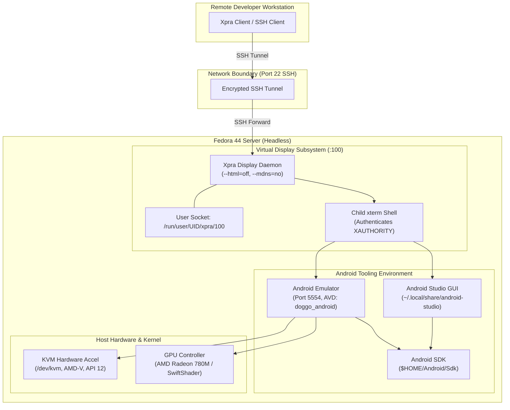
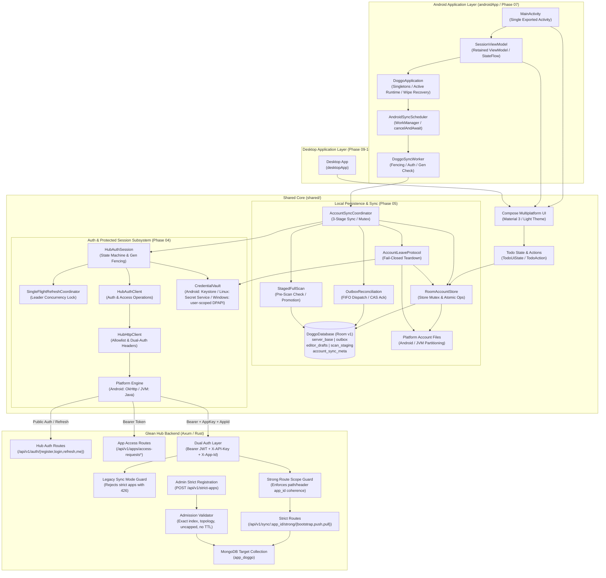

# Doggo System Architecture

Last Updated: 2026-10-14
Phase: Phases 01–10 implementation delivered; Phase 10 recorded at 100% (2026-10-14), with technical acceptance blocked pending operator prerequisites for interactive MSI installation, Narrator verification, and strict dependency verification; earlier-phase operator/runtime acceptance also remains pending
Related Docs: [Project Roadmap](./project-roadmap.md) · [Codebase Summary](./codebase-summary.md) · [Deployment Guide](./deployment-guide.md) · [Windows Desktop Guide](./windows-desktop-guide.md) · [Windows Acceptance](./windows-acceptance.md) · [Android Acceptance](./android-acceptance.md) · [Headless Android Setup](./headless-android-setup.md) · [Host Tooling Evidence](./host-tooling-evidence.md) · [Local Storage & Sync](./local-storage-and-sync.md) · [Sync Acceptance](./sync-acceptance.md) · [Hub Schema Integration](./hub-schema-integration.md) · [Hub Compatibility Acceptance](./hub-compatibility-acceptance.md) · [Auth Acceptance](./auth-acceptance.md) · [Authentication & Credentials](./authentication-and-credentials.md)

---

## 1. Architectural Scope & Principles

Doggo is designed as an Android-first shared Compose Multiplatform application developed on a headless Linux host. Development and validation rely on an isolated virtualization architecture that enables full graphical IDE and Android emulator capabilities without installing desktop environments (GNOME/KDE) or exposing insecure network services.

### Core Architectural Principles
1. **Headless Isolation**: The host operates in headless server boot mode. Graphical access is strictly encapsulated within user-isolated virtual display servers.
2. **Encrypted Transport Only**: All remote graphical interaction transits SSH tunnels with out-of-band host key verification. Zero public TCP listeners are permitted.
3. **Hardware-Accelerated Emulation**: Android virtual devices leverage host Linux KVM (`/dev/kvm`) acceleration directly without compromising system device permissions.
4. **Idempotent Tooling**: Host management scripts are deterministic, side-effect free on error, and safe for automated or repetitive execution.
5. **Durable Local State & Strict Sync**: Local mutations persist immediately in SQLite before network dispatch; outbox enforces FIFO per-row serialization; remote updates promote monotonically.

---

## 2. Infrastructure & Virtualization Architecture

### Component Topology

---

## 3. Subsystem Breakdown

### 3.1 Remote Display Subsystem (Xpra)
- **Display Identifier**: Dedicated display `:100` managed by `scripts/start-xpra.sh`.
- **Socket Isolation**: UNIX domain socket located in `/run/user/$(id -u)/xpra/` (mode `0700`).
- **Security Flags**: `--bind-tcp` omitted; `--html=off`; `--mdns=no`.
- **Authentication**: Spawns an authenticated child `xterm` shell ensuring child processes inherit valid `DISPLAY` and `XAUTHORITY`.

### 3.2 Android SDK & Tooling Subsystem
Configured through `scripts/android-sdk-env.sh`:
- **`ANDROID_HOME`**: Points to `$HOME/Android/Sdk`.
- **Tool Resolution**: Adds `cmdline-tools/latest/bin`, `platform-tools`, and `emulator` to `PATH`.
- **Java Compatibility**: Respects existing `JAVA_HOME`; detects Studio JBR or JDK 21 LTS; leaves `JAVA_HOME` unset if only host Java 25 is present.

### 3.3 Emulator Subsystem
Managed via `scripts/start-android-emulator.sh`:
- **Port Allocation**: Strictly bounded to decimal even integers in `5554` to `5682`.
- **Hardware Acceleration**: Checks `/dev/kvm` read/write access (AMD-V, KVM API 12).
- **Rendering Fallback**: Defaults to `-gpu auto`, supporting `-gpu swiftshader` if GLX rendering fails.
- **Headless Mode**: Supports `EMULATOR_HEADLESS=1` for automated CI runs.

---

## 4. Multiplatform Application & Sync Architecture

### 4.1 Storage Namespace & Backend Isolation
Strict sync completely segregates Doggo data from legacy Hub storage:
- **Naming Pattern**: `app_<appId>` (e.g. `app_doggo`).
- **Document Key (`_id`)**: Exact composite key `userId:rowId` preventing cross-user collisions.
- **Scan Index**: Exact compound index `{ userId: 1, tableName: 1, rowId: 1 }` with simple collation.
- **Publication-Last Registration**: Schema entry published only after storage and indexes pass admission.

### 4.2 Route Fencing & Middleware Isolation
- **Legacy Guard (`legacy_sync_mode_guard`)**: Rejects strict apps requesting legacy sync routes with HTTP 426 (`protocolUnsupported`).
- **Scope Guard (`strong_route_scope_guard`)**: Enforces exact match between `X-App-Id` header and URL path parameter `:app_id`.
- **Schema Immutability**: `PUT /api/v1/apps/:app_id/schema` updates reject strict apps with HTTP 400.

### 4.3 Mutation Semantics & Replay Confirmation
- **Create**: Conditional insert-only write requiring expectedRevision = 0, setting revision = 1 and atomic `lastOp`.
- **Update**: Conditional write matching current `revision == expectedRevision` and live row filter (`deleted: false`), incrementing revision by 1.
- **Delete**: Conditional write matching current `revision == expectedRevision`, incrementing revision by 1, replacing data with canonical empty document, and recording permanent tombstone.
- **Replay Confirmation**: Identical `(opId, digest)` mutations perform a conditional write updating `confirmationNonce` with journaled write concern, requiring `matched_count == 1`.

### 4.4 Durability Policy & Backend Topology Observation
- **Replica Set**: `{ w: "majority", j: true }` write concern and `majority` read concern.
- **Standalone**: `{ w: 1, j: true }` write concern and `local` read concern.
- **Implementation Observation**: In `services/strong_sync_service.rs`, `get_strict_collection` runs `hello` to inspect topology and falls back to standalone (`w: 1, local`) if `hello` errors. This behavior is flagged for downstream review to ensure fail-closed topology verification rather than transient fail-open on replica sets.

### 4.5 Hub Authentication & Protected Session Subsystem (Phase 04)
- **Session State Machine (`HubAuthSession`)**: `UNAUTHENTICATED`, `AUTHENTICATING`, `AUTHENTICATED`, `ACCESS_PENDING`, `REAUTH_REQUIRED`. Evaluates `/me.apps` for `"doggo"` grant.
- **Single-Flight Refresh (`SingleFlightRefreshCoordinator`)**: Deduplicates simultaneous refresh requests to a single leader network request.
- **Generation Fencing**: Atomic generation counter fences stale async completions on quiesce/logout/switch.
- **Prohibited Automatic POST Replays**: `authorizedRequest()` refreshes tokens on HTTP 401 but never replays mutating POST requests.
- **Android Keystore Vault (`AndroidKeystoreVault`)**: AES-256-GCM encryption per account key (`doggo_vault_key_{accountKey}`), fresh 12-byte random nonces per write, AAD binding (`"doggo_vault_v1:" + accountKey`), atomic file replacement.

### 4.6 Local Storage & Strict Synchronization Subsystem (Phase 05)

1. **Room KMP Persistence (`DoggoDatabase`)**:
   - Backed by `BundledSQLiteDriver`. Destructive migration is strictly forbidden; schema version 1 is validated against exported artifact `shared/schemas/.../1.json`.
   - Five stores: `server_base` (authoritative base & tombstones), `outbox` (queued/frozen strict mutations), `editor_drafts` (uncommitted local edits), `scan_staging` (cursor pagination staging), `account_sync_meta` (account sync metadata and active epoch).
2. **Account Directory Partitioning & Filesystem Model**:
   - Partitioned strictly by canonical `AccountKey` SHA-256 string.
   - `AndroidAccountFiles` and `JvmAccountFiles` verify `canonicalFile.toPath().startsWith(canonicalBase.toPath())` to reject path traversal outside the base root (intra-tree symlinks and TOCTOU races are outside this check).
   - Critical metadata writes (`wipe.marker`, `generation.dat`) flush file bytes via `fsync()` before atomic rename (`StandardCopyOption.ATOMIC_MOVE`).
3. **Local Mutation Lifecycle & FIFO Dispatch**:
   - Atomic local saves (`saveTodoAtomic`, `deleteTodoAtomic`) persist drafts and outbox entries under the store mutex before returning.
   - Only never-dispatched `PENDING` outbox operations coalesce; unsent create-delete cancels locally without network traffic.
   - Per-row FIFO: Outbox operations dispatch at most one operation per `rowId` in FIFO order (`localRevision`). If the head operation on a row is `DISPATCHING`, `CONFLICT`, or `UNKNOWN_SUPERSEDED`, all successor operations on that row are blocked.
   - Dispatch freezing: `prepareAndFreezeBatch` recomputes digest and expectedRevision from current base and executes `freezeOutboxAtomic` CAS transaction. `UNCERTAIN` retries strictly preserve original frozen fields.
4. **Staged Full Scan & Monotonic Promotion**:
   - 3-stage sync loop: Initial scan -> Push eligible outbox -> Final scan.
   - Pagination stages rows in SQLite `scan_staging`; detects loops, batch overflow, non-progressing cursors, and epoch mismatches.
   - Pre-scan identity check: All confirmed records in `server_base` sharing the `activeEpoch` must appear in staging; missing records trigger `SafeError.ResetRequired("CONSISTENCY_ERROR")`.
   - Monotonic promotion: Higher revisions promote; equal revisions check logical equivalence (divergent data triggers `SafeError.ProtocolIncompatible("DIVERGENT_REVISION")`); lower revisions retain higher local base. Promoted atomically via `promoteStagingAtomic`.
5. **Exact CAS-Ack Matching & Draft Preservation**:
   - Acknowledges an outbox op if and only if `opId`, `rowId`, and `digest` match, status is in `[accepted, replayed]`, and `acceptedRevision == expectedRevision + 1`.
   - Monotonically advances `server_base`. Retains `editor_drafts` if `draft.localRevision > outbox.localRevision`.
6. **UnknownSuperseded Disambiguation**:
   - Conflicts returned for operations with prior uncertain delivery history are classified as `UNKNOWN_SUPERSEDED` (the mutation may have committed remotely before being superseded). User workflows: `discardConflict`, `reapplyConflict`, `copyAsNew`.
7. **Crash Recovery & Interrupted Dispatches**:
   - `recoverInterruptedDispatches()` resets leftover `DISPATCHING` operations to `UNCERTAIN` on startup or round start.
   - Coroutine push cancellation uses `withContext(NonCancellable)` to mark dispatched batches `UNCERTAIN`.
8. **Fail-Closed Account Leave & Wipe Protocol**:
   - Teardown checks 5 unresolved work categories (`drafts`, `pending`, `uncertain`, `conflict`, `unknownSuperseded`).
   - Strict 7-step sequence: freeze store -> write generation and `wipe.marker` outside DB -> cancel/await schedulers -> close Room -> delete DB files -> clear vault -> clear marker.
   - Startup recovery (`completePendingWipe`) inspects `wipe.marker` and finishes teardown fail-closed before any account opens.

### 4.7 Shared Compose UI & Accessible Light Theme Subsystem (Phase 06)

1. **Light Theme & Design Tokens (`DoggoTheme`, `DoggoColors`)**:
   - Material 3 `LightColorScheme` mapping with custom semantic extensions (`DoggoCustomColors`).
   - Dynamic colors are disabled to avoid overriding calculated token ratios.
   - Calculated high-contrast pairings: 16 verified opaque token pairs exceeding 4.5:1 (text) and 3.0:1 (outline borders). Overall rendered control contrast across OEM devices is deferred to Phase 07.
2. **Platform-Universal Typography (`DoggoTypography`)**:
   - Pinned 12sp–34sp type scale built on Compose `FontFamily.SansSerif`.
   - Documented omission of upstream Latin-only binary font assets (`font-provenance.md`), delegating font resolution to platform system fonts. Broad Unicode script rendering, TalkBack/Orca, and OS-level 200% scaling require platform testing.
3. **Responsive Breakpoint Layout (`DoggoApp`)**:
   - Compact mode (<840dp): Vertical layout with warm cream header and scrolling list. Note: compact top bar is non-scrolling in `Scaffold.topBar`, tracked for Phase 07 200% font scale verification.
   - Expanded desktop mode (>=840dp): Two-column layout with fixed-width deep teal navigation sidebar (280dp) and constrained-width task workspace (max 760dp).
4. **Credential Security & Privacy in UI (`AccountForm`)**:
   - Masked inputs with `PasswordVisualTransformation` and `semantics { password() }`.
   - Transient password state is held in component memory and dereferenced upon submission, mode switch, or composable disposal (JVM string immutability precludes guaranteed memory erasure; device screen-reader behavior unverified).
   - `AuthSubmitAction.toString()` masks passwords with `[REDACTED]` to prevent leakage in diagnostic logs.
5. **Task Management & Dialogs**:
   - `TodoList`: LazyColumn with stable keys (`rowId`), non-color completion checkboxes (`stateDescription`), and >=48dp touch targets.
   - `TodoEditorDialog`: Modal task creation/editing dialog with `TitlePolicy` validation (1–200 Unicode scalars).
   - `SyncFeedback`: Real-time sync status badges, pause/reset guidance, and relative/UTC reconciliation timestamp display.
   - `ConflictReviewDialog`: Side-by-side local vs remote diff inspection with Discard, Reapply, CopyAsNew, and Decide Later workflows.
   - `LeaveGuardDialog`: Fail-closed sign-out confirmation warning displaying unsynced draft, pending, uncertain, and conflict tallies.
   - `LicenseNoticesDialog`: In-app attribution viewer for bundled open-source dependencies.

### 4.8 Native Android Architecture & Runtime Integration (Phase 07)

1. **Application Process Container & Singletons (`DoggoApplication`)**:
   - Manages process-scoped singletons: `hubConfig` (dynamically configured via `BuildConfig.DEBUG`), `vault` (`AndroidKeystoreVault`), `accountFiles` (`AndroidAccountFiles`), `syncScheduler` (`AndroidSyncScheduler`), and `authSession` (`HubAuthSession`).
   - Active account runtime is encapsulated in `AccountRuntime` (`accountKey`, `generation`, `database`, `store`, `coordinator`, `leaveProtocol`). Foreground UI (`SessionViewModel`) and background jobs (`DoggoSyncWorker`) share the exact same runtime instance and `coordinatorMutex`.
2. **Cold-Start Active Identity Persistence & Session Restoration**:
   - When an account authenticates, `saveActiveAccount(identity, accountKey)` writes serialized account identity to `active_account.tmp` and executes `StandardCopyOption.ATOMIC_MOVE`.
   - On application cold start, `completePendingWipesOnStartup()` executes synchronously before `checkAndRestoreEstablishedSession()` restores the auth session from the vault, ensuring wiped accounts cannot resurrect.
3. **Retained ViewModel & Reactive State Flow (`SessionViewModel`)**:
   - Extends AndroidX `ViewModel` with `viewModelScope`.
   - Collects `authSession.state` to trigger authenticated runtime initialization or unauthenticated teardown.
   - Collects `coordinator.progress` to update `TodoUiState.syncProgress`, inspect and present conflicts via `ConflictReviewDialog`, and reload todos.
   - Sanitizes storage errors to `SafeError.Internal` and validation errors to `SafeError.Validation`, preventing raw system exception details from leaking to the UI layer. Passwords and auth tokens are not retained in ViewModel fields or `SavedStateHandle` after submission.
4. **WorkManager Sync Scheduling & Worker Fencing**:
   - `AndroidSyncScheduler` schedules unique one-shot sync (`doggo_sync_oneshot_<key>_<gen>`) with `NetworkType.CONNECTED` constraint and `ExistingWorkPolicy.KEEP`, and unique periodic 15-minute sync (`doggo_sync_periodic_<key>`) with `ExistingPeriodicWorkPolicy.UPDATE`.
   - All sync tasks are tagged with `doggo_sync_account_<accountKey>`.
   - `DoggoSyncWorker` enforces check order: wipe marker check (fails closed) -> auth session check (retries if unauthenticated) -> account key check (drops mismatch) -> persisted generation check (drops stale work) -> runtime generation check.
5. **Teardown Quiescence & Fail-Closed Wipe Protocol**:
   - `cancelAndAwait(accountKey)` cancels WorkManager tasks by account tag, polls `WorkInfo.state.isFinished` for up to 5s (throwing `IllegalStateException` on timeout), and polls `coordinatorMutex.tryLock()` for up to 5s (throwing `IllegalStateException` on timeout).
   - `completePendingWipesOnStartup()` scans `accounts/*/wipe.marker` synchronously during `Application.onCreate`, cancelling tasks, deleting database files, clearing vault credentials, and removing markers fail-closed.
6. **Manifest Hardening, Cleartext Policies & Release Gating**:
   - Base manifest enforces single exported `MainActivity`, `allowBackup="false"`, and `usesCleartextTraffic="false"`.
   - Debug manifest links `network_security_config.xml` strictly allowing `127.0.0.1`, `localhost`, and `10.0.2.2`. Merged manifest inspection across dependencies is pending AGP compilation.
   - `build.gradle.kts` release signing task graph gate checks for `DOGGO_KEYSTORE`, `DOGGO_KEY_ALIAS`, `DOGGO_STORE_PASSWORD`, and `DOGGO_KEY_PASSWORD`, failing closed with a `GradleException` if any are missing.
7. **Diagnostic & Fault Injection Infrastructure**:
   - `scripts/debug-fault-proxy.mjs`: Dedicated loopback HTTP proxy (127.0.0.1:3000 -> 3001) for deterministic sync fault injection (`drop-push-response`, `drop-refresh-response`) with strict route allowlist and zero payload logging.
   - `scripts/android-smoke.sh`: Device smoke verification runner supporting device auto-detection, reverse port forwarding, and evidence screenshot capture.
---

### 4.9 Native Desktop Vault & Distribution (Phases 09–10)

Desktop code is shared at the JVM layer while platform-specific providers are selected through target-specific source sets and ServiceLoader descriptors. `desktopApp/build.gradle.kts` isolates Linux D-Bus dependencies from the Windows JNA dependencies and selects `gradle-linux.lockfile` or `gradle-windows.lockfile`; unsupported or host-mismatched targets fail before dependency resolution.

On Windows, `WindowsDpapiVault` calls JNA-backed `CryptProtectData` and `CryptUnprotectData` with `CRYPTPROTECT_UI_FORBIDDEN` and current-user scope. It serializes the account key and token pair as one JSON payload, protects the bytes through DPAPI, then atomically replaces `credentials.dpapi`. Plaintext byte buffers are cleared after cryptographic operations. The vault attempts an owner-only ACL through `AclFileAttributeView`, but unsupported views, absent owners, and ACL exceptions are not surfaced; effective filesystem ACL enforcement is therefore not guaranteed by this implementation.

The Windows `META-INF/services/dev.doggo.desktop.CredentialVaultProvider` descriptor registers the Windows provider. The distributable contains a bundled Java runtime and `Doggo.exe`; the MSI is configured for per-user installation. `scripts/windows-package-smoke.ps1` inspects packaged classes/provider registration, checks Linux D-Bus exclusion, hashes the MSI, reports Authenticode status, and reads MSI properties using Windows Installer COM. Phase 10 implementation is recorded at **100% (2026-10-14)**; technical acceptance remains blocked pending operator prerequisites for interactive MSI installation, Narrator verification, and strict dependency verification. Separately, ACL enforcement is not guaranteed by the current source, and clean-user runtime/sync plus uninstall/reinstall evidence remain open. The evidence report records a generated unsigned MSI, not an interactive installation.

---

## 5. Security & Isolation Invariants

1. **Virtual Display Network Policy**: Script policy omits `--bind-tcp` and specifies `--html=off --mdns=no`. A smoke test on display `:199` observed zero listening TCP sockets associated with Xpra.
2. **Device Nodes**: `/dev/kvm` permissions (`0666` on host) are managed by system udev rules; scripts do not run `chmod` on system devices.
3. **Privilege Separation**: Android Studio, emulator, and build tasks execute as unprivileged user (`loidinh`).
4. **Credential Safety**: Authentication tokens and keystores are never written to version control; `.gitignore` strictly excludes `local.properties`, keystores, and credentials.
5. **Memory-Only Unpersisted Secrets**: Passwords and raw credential tokens are excluded from logs, error envelopes, and toString representations.
6. **Strict Storage Isolation**: Strict-mode collections (`app_<appId>`) are strictly unreachable by legacy sync routes, background cleanup jobs, and older Hub binaries.
7. **Key Custody & Perms**: Provisioning outputs write API keys with strict `0600` file permissions; scripts support protected environment variables (`GLEAN_ADMIN_TOKEN`, `DOGGO_APP_KEY`) to prevent command-line argument exposure.
8. **Opaque In-Memory Credential Custody**: Tokens are held in memory and persisted only through the platform-protected vault (Android Keystore, Linux Secret Service, or Windows current-user DPAPI). `StateFlow` and public state models emit only `AccountIdentity`, `AccountKey`, and `AuthState`; `CredentialBundle.toString()` redacts token strings.
9. **Single-Flight Generation Fencing**: Foreground and background refresh calls are deduplicated into a single network operation; generation fencing discards stale async completions on quiesce or logout.
10. **Prohibited Automatic POST Replays**: The HTTP auth layer never automatically replays mutating POST requests across 401 refresh cycles; coordinator controls retry idempotency.
11. **Cryptographic AAD Binding & Nonce Freshness**: Android Keystore vault generates a fresh 12-byte random nonce per write and cryptographically binds ciphertext to the account key via Authenticated Additional Data (AAD).
12. **Strict Origin & Route Allowlisting**: Outbound requests are bound to `canonicalOrigin` and classified into public, bearer-only, and dual-auth strict routes; non-allowlisted and legacy endpoints fail closed locally.
13. **Zero Destructive Migration**: Room database version 1 uses explicit migrations; `fallbackToDestructiveMigration()` is forbidden.
14. **Per-Row FIFO Queueing & Head Blocking**: Outbox operations dispatch at most one operation per `rowId` in FIFO order. A head operation in `DISPATCHING`, `CONFLICT`, or `UNKNOWN_SUPERSEDED` state blocks all successors on that row.
15. **Exact CAS-Ack Matching & Monotonic Promotion**: Acknowledgements require exact 5-tuple verification. Staged scans verify pre-scan confirmed identity presence; promotion monotonically advances confirmed base without regressing.
16. **Fail-Closed Teardown & External Marker**: Account leave freezes edits, writes generation and `wipe.marker` outside SQLite before deleting files, and requires startup recovery to complete any interrupted wipe before reopening an account.
17. **Transient Password Privacy**: Password fields configure `PasswordVisualTransformation` visual masking, emit `semantics { password() }`, and dereference transient strings upon submission, mode switch, or disposal; `AuthSubmitAction.toString()` masks passwords with `[REDACTED]`. (JVM string immutability precludes guaranteed memory erasure; device screen-reader behavior unverified).
18. **WCAG 2.1 AA Palette Contrast**: Baseline mathematical pairing verified for 16 opaque token pairs (text >= 4.5:1, interactive outline borders >= 3.0:1); decorative mint is restricted to non-text accents. Rendered UI contrast across devices is deferred to Phase 07.
19. **Non-Color Conveyance**: Task completion, conflict, error, and leave status indicators provide explicit icons, text descriptions, and accessibility state descriptions without relying solely on color.
20. **Single Exported Activity**: Manifest declares only `MainActivity` as exported (`android:exported="true"`) with launcher intent filters. Zero public services, receivers, or content providers are declared in the application manifest. Merged manifest verification is pending AGP compilation.
21. **Strict Backup & Data Extraction Exclusions**: `backup_rules.xml` (API <= 30) and `data_extraction_rules.xml` (API >= 31) explicitly exclude private SQLite databases, shared preferences, and `accounts/` partition directories from cloud backups and device-to-device transfers.
22. **Cleartext Restrictions & Debug NSC**: Cleartext HTTP traffic is disabled globally (`usesCleartextTraffic="false"`). Debug builds override this exclusively for loopback development hosts (`127.0.0.1`, `localhost`, `10.0.2.2`) via `network_security_config.xml`. Custom trust anchors and public domain overrides are prohibited.
23. **WorkManager Account-Tag Cancellation**: All WorkManager sync requests are tagged with `doggo_sync_account_<accountKey>`, ensuring `cancel` and `cancelAndAwait` cancel all pending and running work for an account across generation increments.
24. **Teardown Quiescence & Wipe Fail-Closed Enforcement**: `cancelAndAwait()` verifies WorkManager and coordinator mutex quiescence with 5s deadlines, throwing `IllegalStateException` on timeout. Startup recovery completes pending wipes fail-closed before any account or database resources are initialized.
25. **Release Signing Custody Fail-Closed Gate**: The Gradle task graph dynamically inspects release build tasks; execution fails closed with a `GradleException` if `DOGGO_KEYSTORE`, `DOGGO_KEY_ALIAS`, `DOGGO_STORE_PASSWORD`, or `DOGGO_KEY_PASSWORD` are missing or the keystore file does not exist.

26. **Windows DPAPI Scope**: Windows credentials use DPAPI user scope; machine-wide protection and plaintext token fallback are not used. JSON credentials are written as one encrypted bundle and atomically replaced.
27. **Windows ACL Caveat**: The vault attempts to apply an owner ACL, but the current implementation suppresses ACL-view/owner errors; restricted ACLs are not guaranteed when that operation fails or is unavailable.
28. **Windows MSI Release Status**: The recorded MSI is unsigned and has only been generated and inspected. Authenticode signing and interactive installer/runtime acceptance are separate release gates.

## 6. Deadlines, reminders, and strict upgrade design — Phase 01 Frozen (Gate G1 Approved)

Phase 01 Contract and Transition Design frozen on 2026-10-15 ([Gate G1 review approved](../plans/reports/code-review-261015-0951-phase-01-freeze-temporal-model.md)). Binary preimages and checked 64-bit integer arithmetic pass across recorded test suites in Kotlin, Rust, and Node.js. Execution plan: [phased plan](../plans/261015-0752-task-deadlines-reminders-strict-upgrades/plan.md). Subsequent implementation phases 02–12 remain pending.

### 6.1 Wire Schema & Fingerprints
- Target sync protocol: `strict-v2`. Full replacement payloads, absent fields rejected, nulls explicit.
- Canonical schema files:
  - `strict-v1`: `integration/glean-hub/doggo-schema-v1.json` (fingerprint: `3361a80fdbc304a09d7847fad90841f82a3617b143a6a6eb8273d8c9d41fadec`).
  - `strict-v2`: `integration/glean-hub/doggo-schema-v2.json` (fingerprint: `5f53955105701cc8c778f4189a2f9a4b90787e36763d62133e11616cf801f6e4`).
  - Active `integration/glean-hub/doggo-schema.json` remains strictly on v1 until cutover.
- Table columns (16): `id` (string), `title` (string), `completed` (boolean), `createdAt` (integer), `deadlineDate` (nullable string), `deadlineTime` (nullable string), `deadlineZone` (nullable string), `deadlineOffsetSeconds` (nullable integer), `reminderAnchorTime` (nullable string), `deadlineAnchorEpochMs` (nullable integer), `deadlineOverdueEpochMs` (nullable integer), `reminderEnabled` (boolean), `reminderLeadMinutes` (integer), `reminderIntervalMinutes` (nullable integer), `reminderCount` (integer), `scheduleToken` (nullable string). Primary key: `id`.

### 6.2 Strict Binary Digest Specification
- Domain: `strict-v2`.
- Framed identity prefix: 8 strings (domain, appId, userId, epoch, tableName, rowId, opId, kind.wireName) each encoded as u32 big-endian length + UTF-8 bytes, followed by `expectedRevision` as 8-byte big-endian signed 64-bit integer.
- Data encoding: 0 bytes for DELETE operations. For CREATE/UPDATE, base 4 fields followed by 12 v2 fields in table order:
  - Strings: 1 byte presence tag (`0x00`=null, `0x01`=present) + u32 big-endian length + UTF-8 bytes.
  - Booleans: 1 byte (`0x00`=false, `0x01`=true).
  - Integers: 8-byte big-endian two's complement signed 64-bit integers (`createdAt`, `reminderLeadMinutes`, `reminderCount`). Nullable integers use 1 byte presence tag (`0x00`=null, `0x01`=present + 8 bytes).
- Validation rules: Wire input with `reminderCount == 1` MUST have `reminderIntervalMinutes: null`; wire input with non-null interval is rejected (`invalidRecord`), never silently normalized. Repeating count 2..10 requires interval >= 15m. Last scheduled occurrence cannot exceed anchor instant.
- Reference vectors: `integration/glean-hub/strict-v2-vectors.json` stores 9 valid vectors with explicit preimage hex and SHA-256 hashes, and 11 boundary/overflow rejection vectors. Validated across Kotlin (`dev.doggo.shared.contract.StrictSyncV2Digest`), Rust (`glean_hub_sync::models::strong_sync_v2`), and Node (`scripts/strict-v2-vector-runner.mjs`) per Phase 01 QA report ([QA report](../plans/reports/qa-261015-0938-phase-01-freeze-temporal-model.md)).

### 6.3 Management API & Fencing Contract [Planned Phase 03]
- Endpoints:
  - `GET /api/v1/apps/:app_id/strict-contract`: returns syncMode, active epoch, and schema fingerprint.
  - `POST /api/v1/apps/:app_id/strict-upgrades`: initiates migration with body `{ migrationId, expectedVersion, expectedSchemaFingerprint, expectedEpoch, targetVersion, targetSchemaFingerprint }`.
  - `GET /api/v1/apps/:app_id/strict-upgrades/:migrationId`: queries migration status.
- Authorization: Requires global admin role AND explicit app-scope authorization.
- Fencing: Readers AND writers acquire durable server-enforced app permits. Fence acquisition atomically blocks new permits; migration begins only after admitted requests definitively drain. Orphan permits require proving complete operations on supported Mongo topology before clearing; lease expiry alone never clears permits.

### 6.4 Legacy-Receipt Reconciliation & Outbox Replay [Planned Phase 03 / Phase 06]
- Endpoint: `POST /api/v1/sync/:app_id/strong/legacy-receipts`: app-scoped and user-scoped dual-auth, bounded batch size <= 100.
- Inputs: original v1 preimage + digest.
- Outputs: per-operation status: `provenAccepted` (returns original acceptedRevision), `provenNotAccepted`, `unknownSuperseded`, or `integrityFailure`.
- Outbox transition: Legacy Room v1 databases lack original contract version, dispatch history flag, and changed-field mask. Where dispatch provenance or intention history cannot be proven, the record is flagged as `UNKNOWN_SUPERSEDED` for explicit user review; it is never auto-reapplied or auto-rehashed.
