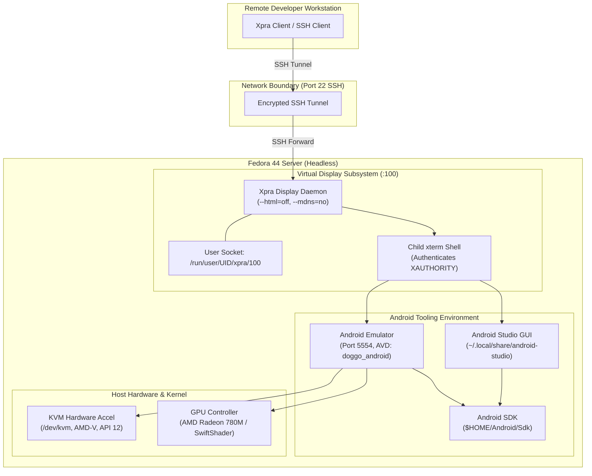
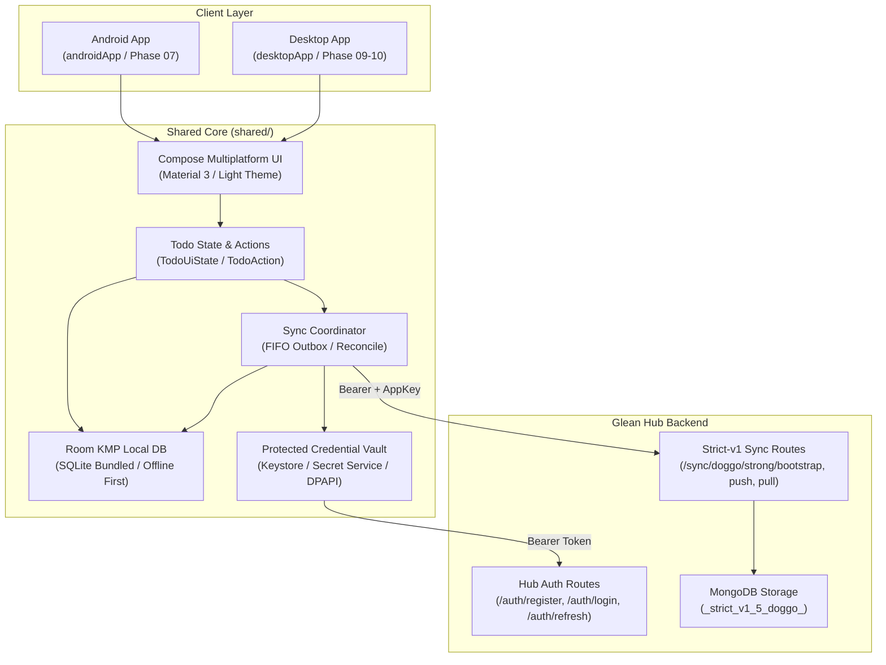

# Doggo System Architecture

Last Updated: 2026-10-13  
Phase: Phase 01 Headless Tooling & Android Environment  
Related Docs: [Headless Android Setup](./headless-android-setup.md) · [Host Tooling Evidence](./host-tooling-evidence.md) · [Project Roadmap](./project-roadmap.md) · [Codebase Summary](./codebase-summary.md)

---

## 1. Architectural Scope & Principles

Doggo is designed as an Android-first shared Compose Multiplatform application developed on a headless Linux host. Development and validation rely on an isolated virtualization architecture that enables full graphical IDE and Android emulator capabilities without installing desktop environments (GNOME/KDE) or exposing insecure network services.

### Core Architectural Principles
1. **Headless Isolation**: The host operates in headless server boot mode. Graphical access is strictly encapsulated within user-isolated virtual display servers.
2. **Encrypted Transport Only**: All remote graphical interaction transits SSH tunnels with out-of-band host key verification. Zero public TCP listeners are permitted.
3. **Hardware-Accelerated Emulation**: Android virtual devices leverage host Linux KVM (`/dev/kvm`) acceleration directly without compromising system device permissions.
4. **Idempotent Tooling**: Host management scripts are deterministic, side-effect free on error, and safe for automated or repetitive execution.

---

## 2. Infrastructure & Virtualization Architecture

### Component Topology

---

## 3. Subsystem Breakdown

### 3.1 Remote Display Subsystem (Xpra)

The remote display architecture decouples graphical application execution from the host operating system's desktop stack:
- **Display Identifier**: Dedicated display `:100` managed by `scripts/start-xpra.sh`.
- **Socket Isolation**: UNIX domain socket located in user-specific `/run/user/$(id -u)/xpra/` directory (mode `0700`), inaccessible to other system users.
- **Security Flags**:
  - `--bind-tcp` omitted: completely disables direct TCP network socket creation.
  - `--html=off`: disables internal WebSockets/HTTP server to prevent browser-based unauthenticated access.
  - `--mdns=no`: disables local network broadcast (Avahi/Bonjour).
- **Authentication Inheritance**: Xpra launches an authenticated child `xterm` session. Graphical processes spawned from this shell inherit valid `DISPLAY` and `XAUTHORITY` credentials.

### 3.2 Android SDK & Tooling Subsystem

Configured through `scripts/android-sdk-env.sh`:
- **`ANDROID_HOME`**: Points to `$HOME/Android/Sdk`, accommodating command-line tools, platform tools, build tools, platforms, and system images.
- **Tool Resolution**: Adds `cmdline-tools/latest/bin`, `platform-tools`, and `emulator` to `PATH` without duplicating entries.
- **Java Runtime Compatibility**:
  - Respects existing `JAVA_HOME` if defined by the operator.
  - Automatically identifies compatible Studio JBR (`$HOME/.local/share/android-studio/jbr`) or system JDK 21 LTS (`/usr/lib/jvm/java-21-openjdk`).
  - Leaves `JAVA_HOME` unset if only host Java 25 is present, providing non-interactive safety and interactive configuration guidance.

### 3.3 Emulator Subsystem

Managed via `scripts/start-android-emulator.sh`:
- **Port Allocation**: Strictly bounded to decimal even integers in the range `5554` to `5682`, matching standard ADB console/ADB port pairs (`emulator-5554`). Leading-zero octal numbers and odd ports are rejected.
- **Hardware Acceleration**: Checks `/dev/kvm` read/write access. Relies on AMD-V CPU virtualization (KVM API 12).
- **Rendering Fallback**: Defaults to `-gpu auto`, allowing selection of software rasterization (`-gpu swiftshader`) if GLX rendering encounters issues under remote display forwarding.
- **Headless Mode**: Supports `EMULATOR_HEADLESS=1` (`-no-window -no-audio`) for automated CI runs.

---

## 4. Multiplatform Application & Sync Architecture

Phase 02 freezes the foundation for Doggo's Kotlin Multiplatform client and its integration with Glean Hub:

- **Shared Core (`shared/`)**: Pure Kotlin Multiplatform library targeting Android (minSdk 26) and Desktop JVM (bytecode 17).
- **Local Storage**: Room KMP with `androidx.sqlite:sqlite-bundled` driver. Offline-first: mutations persist to local SQLite and durable outbox immediately.
- **Vault Abstraction**: OS-level protected credential custody without plaintext storage or fallback.
- **Strict Synchronization**: Opt-in strict per-record sync against Glean Hub with canonical SHA-256 digest hashing and atomic server revision increments.
- **Staged Module Assembly**: Root build includes `:shared` immediately, while `:androidApp` and `:desktopApp` are guarded by script existence to prevent broken stub builds.

---

## 5. Security & Isolation Invariants

1. **Virtual Display Network Policy**: Script policy omits `--bind-tcp` and specifies `--html=off --mdns=no`. A smoke test on display `:199` observed zero listening TCP sockets associated with Xpra.
2. **Device Nodes**: `/dev/kvm` permissions (`0666` on host) are managed by system udev rules; scripts do not run `chmod` on system devices.
3. **Privilege Separation**: Android Studio, emulator, and build tasks execute as unprivileged user (`loidinh`).
4. **Credential Safety**: Authentication tokens and keystores are never written to version control; `.gitignore` strictly excludes `local.properties`, keystores, and credentials.
5. **Memory-Only Unpersisted Secrets**: Passwords and raw credential tokens are excluded from logs, error envelopes, and toString representations.
