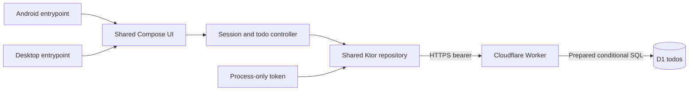
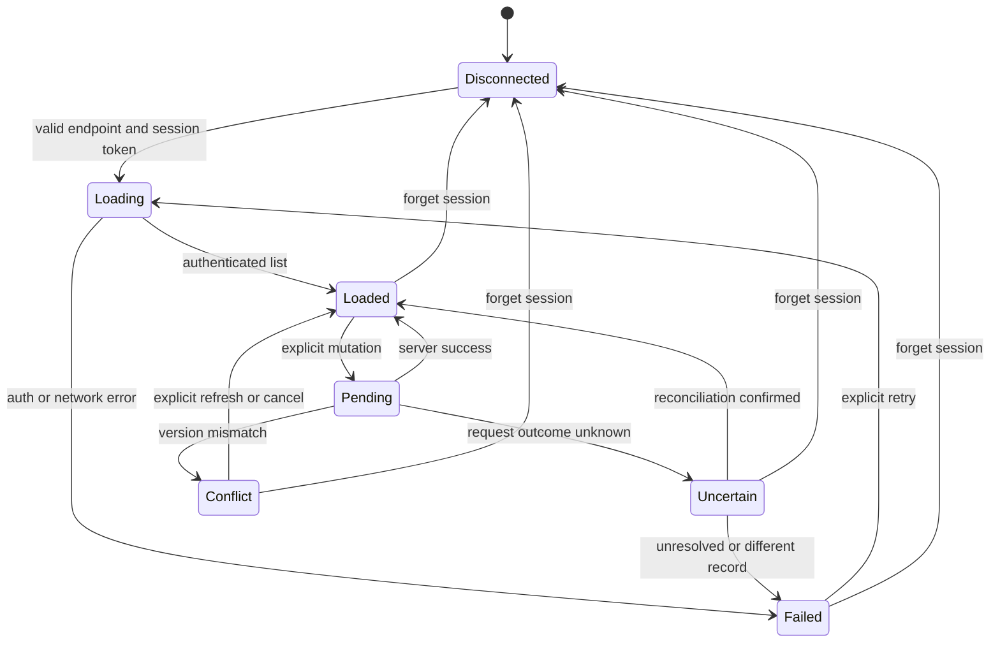

# Proposed Doggo architecture

Planning only. No existing application architecture: scout found no source or project docs. This document fills that gap before the overview. [Parent decisions](reports/design-decisions.md) override superseded research. **Private shared dataset, session-only token, online-first, light-only are proposed defaults—not user-approved.** Public multi-user or offline writes require contract revision before implementation.

## Boundaries
- `shared`: one Kotlin Multiplatform library; `com.android.kotlin.multiplatform.library` Android target and JVM target. Common packages `dev.doggo.shared.contract`, `.data`, `.state`, `.ui`, `.theme`; platform adapters in androidMain/jvmMain. Common code never imports Android APIs or D1.
- `androidApp`: separate Android application plugin, package/application ID `dev.doggo.android`, launcher `dev.doggo.android.MainActivity`, minSdk 26 proposed. Debug ID remains identical for documented adb commands; never install debug over release data without conscious choice.
- `desktopApp`: JVM Compose application, package `dev.doggo.desktop`, packaged main class `dev.doggo.desktop.MainKt` hardcodes `BuildMode.RELEASE`; Gradle-only `runDebug` selects `dev.doggo.desktop.DevelopmentLauncher` with `BuildMode.DEBUG`. Neither launcher reads a mode from environment/properties/arguments. Distribution name `Doggo`, version `1.0.0`. Linux RPM and Windows MSI configured once by phase 09. No Windows cross-compilation claim.
- `worker`: TypeScript Worker, authenticated native-client HTTP API, D1 binding `DB`, secret `APP_SESSION_TOKEN`. No Cloudflare control-plane credentials in Kotlin.

## Data and state
- D1 authoritative; no local database, offline queue, persisted token or sync engine. Loaded todos/drafts survive transient errors only in process memory.
- Session manager validates endpoint, holds masked token outside serializable UI state, owns cancellable scope/client/controller. Disconnect increments generation, cancels work, closes client and clears todos/drafts/token; reject late results by session generation.
- UI receives immutable `TodoUiState` and `(TodoAction) -> Unit`, never repositories or token. Session form dispatches a secret-bearing action directly; it is not replayed, saved or logged.
- List uses bounded keyset pages, immutable creation tuple descending; refresh resets cursor and data. Filters are server-side; counts concern entire dataset, not loaded rows. Concurrent edits/deletes mean pages are not a snapshot.
- Mutations pessimistic: per-item pending affordance; no optimistic success. Preserve title drafts on validation/network/conflict errors. Serialize controller mutations, allow cancellable reads, reject stale list generations.
- Create uses UUIDv4 once per draft submission; collision never overwrites. Reconciliation is a read, not an automatic retry. Version-conditioned update/delete prevents silent lost edits; conflict action must explicitly refresh/reapply or cancel.

## Invariants and tradeoffs
1. Native release accepts HTTPS only; debug permits exact loopback/emulator aliases, never arbitrary LAN HTTP. Disable bearer redirects; do not forward across origins.
   Desktop installed launcher and normal Gradle `run` always use RELEASE; explicit `runDebug` alone permits documented local HTTP. No heuristic packaged detection or user-selected mode.
2. Auth before D1; fail closed when secret unavailable. Supported constant-time comparison on validated fixed-size bytes; CORS is not access control.
3. All token holders access the same dataset. Rotation revokes everyone; process restart requires re-entry. This is not public user identity or per-user authorization.
4. All mutation SQL bound; POST INSERT only; PATCH/DELETE conditional on version. Server owns UTC epoch-millisecond times and increments versions.
5. UI/data/Worker/migrations implement against [frozen contracts](contracts.md); no silently expanded features.
6. Root/shared build files one owner. No generated application stubs. Foundation proves tuple in disposable wizard project; final settings may reference future modules but no final repo Gradle gate until those scripts land.
7. Tests demonstrate behavior, not file text. Module tests are not runtime proof; actual Android first, deployed Android release, Linux installed RPM, Windows installed MSI each have separate gates.
8. Faults reopen original file owner. Integration/deployment cannot edit others' source/config; re-run all affected gates after repair.

## Design-first and post-implementation gates
Before phase 02 freeze: validate private/online/light defaults, confirm compatible wizard tuple against official constraints, exact contracts and ownership. Before release: compare architecture to real dataflow/schema/state, fix unintended drift through original owners; architecture owner phase 02 records approved changes.

## Unresolved questions
- Approve private token/shared-dataset usability versus multi-user accounts, online-first, light-only, manual Windows release?
- Font redistribution and glyph coverage, exact wizard tuple, Cloudflare access and later Windows machine are implementation prerequisites—not assumed verified.
