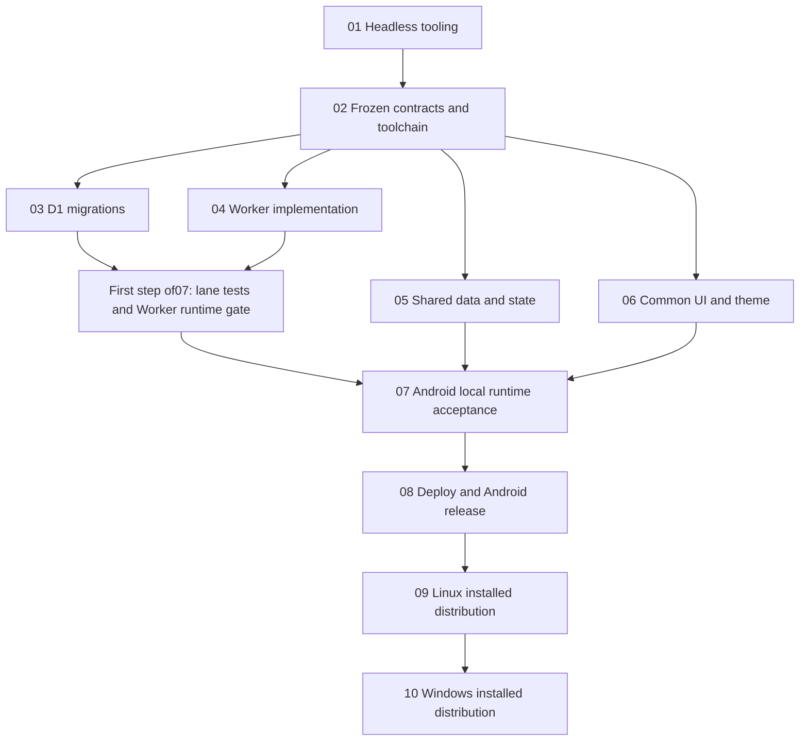

# Dependency and verification matrix

Total **60h** implementation effort, not elapsed time or a scheduling guarantee. 10 phases; all pending. File edits exclusive per [registry](file-ownership.md). Parent requirements take precedence over raw research.

| Phase | Hours | Start/code prerequisite | Runtime/acceptance prerequisite | Group | Gate output |
|---|---:|---|---|---|---|
| 01 Headless tooling | 4 | Approved setup permissions | Xpra SSH, SDK/AVD real boot | A | Host evidence, usable virtual terminal |
| 02 Frozen foundation | 6 | 01; product defaults approved | Disposable current-wizard compatibility proof | B | Exact pinned tuple, real contracts, ownership freeze |
| 03 D1 migrations | 3 | 02 | Own SQL tests executed at07; standalone Node24 harness | C | Schema/code ready; constraints/order/index evidence at07 |
| 04 Worker API | 8 | 02 | 03 landed plus04 harness; tests executed at07 | C | Worker/code ready; real local D1 behavior evidence at07 |
| 05 Shared data/state | 9 | 02 | Contract/state tests executed at07; live integration at07 | C | Repository/controller code ready; behavioral evidence at07 |
| 06 Compose UI/theme | 9 | 02; font-license gate | Semantic tests executed at07; actual app at07 | C | UI/theme code ready; behavior/rendering evidence at07 |
| 07 Android integration | 6 | 03–06 code ready (not tests passed) | 01 usable device; first blocking step runs all lane tests | D | Lane tests then actual local API + Android debug gate |
| 08 Deployment/security/release | 6 | 07 | Cloudflare account/scoped credentials, signing access | E | Deployed API and actual signed Android release acceptance; essential docs |
| 09 Linux distribution | 5 | 08 | Installed RPM actual UI over Xpra | F | Desktop entrypoint/all-target build; Linux acceptance |
| 10 Windows distribution | 4 | 09 | Later Windows machine/native JDK/packager | G | Installed MSI actual Windows acceptance |

## Important gates
- 03/04/05/06 start concurrently after02. Worker implementation may start before migration lands, but Worker runtime gate waits03. Phase03 node:sqlite tests do not require package.json/harness owned04, preventing completion cycle. SQLite tests alone do not prove D1 behavior.
- Final root settings intentionally include future modules; no final-repo Gradle build claimed at02 because missing module build files are intentional, not stubs. Phase02 compatibility proof runs in disposable wizard workspace with actual generated modules; root/shared commands in final repo start at07 after androidApp script, with desktopApp conditionally included only when its build file exists. Foundation settings use that documented existence condition, not a fake desktop implementation.
- Shared lane tests can be written in C but one integration owner executes the full final-repo check batch at07 after all C code lands. A disposable current-wizard project proves toolchain, not app behavior. Worker gate is also run once in07 main gate using04 permanent tests; no parallel CPU storm.
- Unit tests use controlled transport or reducer inputs to expose real error/state semantics. They never replace live local/deployed API or actual platform smoke.
- Android debug acceptance precedes deployment. Signed Android release + deployed HTTPS acceptance precedes Linux work. Windows remains required/pending until actual Windows runtime gate, no Linux cross-build substitute.
- Phase08 essential docs ship at Android release with honest Linux/Windows pending status; reopen08 to update its general summary/changelog/roadmap after09/10. Reopening owner does not create graph cycle or change ownership.

## Commands and evidence ownership
- Phase07 main integrator runs `npm --prefix worker ci`, `npm --prefix worker test`, `npm --prefix worker run test:migrations`, `./gradlew :shared:allTests :androidApp:assembleDebug :androidApp:connectedDebugAndroidTest` once after lanes land. Foundation selects actual wizard-generated shared Android test task names and records them if allTests requires different names; no successful execution claimed now.
- Lane completion means code/tests ready, not gate passed. Phase07 begins by executing their permanent checks; no prerequisite requiring07 evidence before07 can start.
- Phase08 executes permanent live API/security checks local and deployed, release APK inspection + install + visual interaction. Phase09 executes desktop tests/build/RPM actual install. Phase10 executes native Windows build/install/UI checks.
- A failing gate blocks advancement. Report file and owner, reopen that owner, fix root cause, rerun affected permanent tests plus gate. Integrator never edits others’ files quietly; never suppress warnings/errors or narrow acceptance.

## Unresolved questions
Account/signing/Windows access and private-online-light defaults remain prerequisites; unavailable Windows machine defers gate honestly, does not erase phase10.
