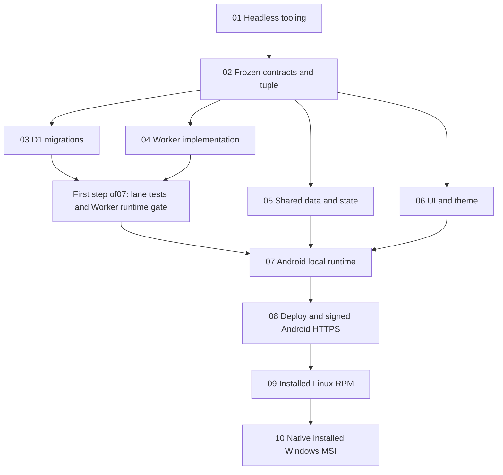

# Doggo implementation plan
HISTORICAL — superseded by [Doggo Glean Hub reuse](../261013-1540-doggo-glean-hub-reuse/plan.md). Do not execute these phases or use the old60h estimate/shared-token/online-only/Worker-D1 contracts. Preserved only as prior decisions and platform/theme evidence; no implementation performed.

## Scope and evidence
Android-first CRUD, filters/counts/refresh/pages; shared KMP library/UI, Worker-mediated D1; Linux installed RPM next, Windows native MSI on later machine. Fedora headless Xpra SSH, no GUI desktop/public port. Measured ForumFlash visual language only, no IELTS/content/brand assets.
[Decisions (authoritative)](reports/design-decisions.md) · [Brief](reports/planning-brief.md) · [Scout](scout/scout-01-workspace.md) · [Theme evidence](research/researcher-03-theme-observation.md) · [Prior incomplete gate](reports/planner-gate-incomplete.md). Researcher01/02 superseded where conflicting.
[Architecture](architecture.md) · [Frozen contracts](contracts.md) · [Dependency matrix](dependency-matrix.md) · [Command/status index](evc-cmd-plan.md).

## Phases
| Phase | Group | Hours | Status / progress |
|---|---|---:|---|
| [01 Headless tooling](phase-01-headless-tooling.md) | A | 4 | completed / 100% |
| [02 Frozen foundation](phase-02-frozen-foundation.md) | B | 6 | pending / 0% (superseded) |
| [03 D1 migrations](phase-03-d1-migrations.md) | C | 3 | pending / 0% |
| [04 Worker API](phase-04-worker-api.md) | C | 8 | pending / 0% |
| [05 Shared data/state](phase-05-shared-data-state.md) | C | 9 | pending / 0% |
| [06 Compose UI/theme](phase-06-compose-ui-theme.md) | C | 9 | pending / 0% |
| [07 Android local integration](phase-07-android-integration.md) | D | 6 | pending / 0% |
| [08 Deployment/security/Android release](phase-08-deployment-security-release.md) | E | 6 | pending / 0% |
| [09 Linux installed RPM](phase-09-linux-distribution.md) | F | 5 | pending / 0% |
| [10 Windows installed MSI](phase-10-windows-distribution.md) | G | 4 | pending / 0% |

## Dependencies

## Execution strategy
Approve product/security defaults before02 freeze; prove current wizard compatible tuple in disposable workspace, pin exact versions/checksums/owned locks during implementation. No app stubs. After02,03–06 implementation lanes may run concurrently on frozen contracts; written tests are not passed gates. Final root intentionally becomes runnable at07; desktop included only once09 script exists.
Single main integrator executes lane tests first at07, then real Android/local D1/UI gate. Deploy08 with scoped permissions, secret rotation/recovery and actual signed HTTPS APK; release rejects local HTTP. Installed Linux then actual later Windows gates mandatory. No Linux cross-build shortcut. Defects reopen original owner; rerun affected gate after repair, no shared edits.08 essential docs ship with Android, then owner updates after09/10.

## Compact ownership matrix
Summary only; [exact Path | Phase | Action registry](file-ownership.md) is binding, including tests/docs/locks/resources/evidence. Every row exclusive; consumers read only.
| Owner | Exclusive slice |
|---|---|
| 01 / 02 | Host scripts/docs / root+shared build/catalog/wrapper/verification/shared lock/contracts/docs |
| 03 / 04 | SQL+migration test/docs / Worker source+manifests+lock+harness+tests/docs |
| 05 / 06 | Client data/state/adapters/tests/docs / common UI/theme/fonts/resources/tests/design docs |
| 07 / 08 | Android build+lock/manifests/composition/tests/debug evidence / live checks/security/release/general docs |
| 09 / 10 | Desktop build+lock/all-target config/composition/tests/Linux evidence / Windows script/docs/evidence |

## Review and unresolved questions
Parent [document review](reports/plan-review.md) completed: ordered phase sections,60h,131 exclusive ownership rows,113 resolved links and matching acyclic dependency graphs. Resubmit-state and desktop transport evidence gaps corrected. No runtime/security certification. Subsequent validation requires scope revision as recorded below.
Product decisions below override prior proposals. Existing phase files intentionally unchanged during validation; do not implement their private-token/online-first contracts. Toolchain/font/account/signing/Windows prerequisites still require verification.

## Validation Summary
Validated: 2026-10-13. Questions asked: 4. [Answers and revision checklist](reports/validation-summary.md).
Confirmed: separate user accounts; offline editing and sync; reference light theme; manual Windows builds.
Action items:
- [ ] Revise identity/per-user D1 authorization, secure credential lifecycle, local persistence, durable outbox and sync/conflict/deletion contracts.
- [ ] Revise affected phases, exclusive ownership, dependency graph, acceptance tests and effort; current60h does not estimate approved scope.
- [ ] Review revised plan before implementation; retain approved light theme, headless setup and manual native Windows delivery.
