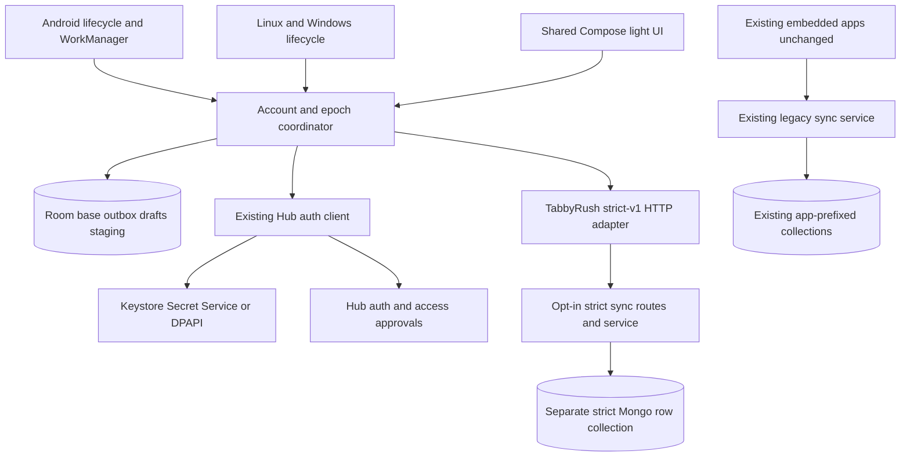

# TabbyRush architecture — Hub accounts and isolated strict sync
Date:2026-10-13. Selected after feasibility interview; planning only. [Plan](plan.md) · [Contracts](contracts.md) · [Decisions](reports/design-decisions.md) · [Feasibility](reports/strong-sync-feasibility.md).

## Scope and cutover
Shared Kotlin Multiplatform/Compose todo app, ForumFlash-inspired light theme. Android first on headless Fedora through SSH Xpra; Linux installed RPM next; Windows MSI built manually on another machine. Offline local editing, Android best-effort background sync, OS-protected SQLite and platform-protected tokens. No Worker/D1/OAuth/new auth backend.
Glean Hub supplies existing signup/login/refresh/me, app registry/access approval and dual auth. **TabbyRush alone opts into strict-v1 per-record sync**; existing embedded apps/shared Rust+TS clients remain legacy unchanged. Their update/rebuild/migration is not part of this plan. Separate protocol/storage is intentional coexistence for independent apps, not a deprecated TabbyRush compatibility shim. TabbyRush has no legacy fallback.

## Components

## Module and phase boundaries
Shared common packages: contracts02,auth04,data/sync/state05,UI/theme06. Android07 owns real composition/WorkManager/manifest/signing wiring; Desktop09 owns JVM launcher/provider interface/Linux adapter and host-selected source/resources/locks; Windows10 adds only Windows-owned provider/descriptor/test/lock. No FFI/Tauri conversion or common API leakage from Room/Ktor.
Hub03 owns opt-in schema mode/provisioning/index admission/strict models/service/routes, necessary guards/wiring/tests/docs. Parent plan registry lists exact external ownership. Superseded narrow legacy upsert patch is removed: strict data never traverses legacy persistence. New service uses current generic schema registration and existing authentication, not hard-coded passwords or a second account system.
02 freezes compatible stable Kotlin/Compose/AGP/Gradle/JDK/Room/KSP/Ktor tuple and cross-language strict DTO/digest/epoch/error boundaries before independent03/04/05/06 coding. Runtime integration07 waits all real implementations; original owners repair defects, integration never edits shared ownership ad hoc.

## Identity, grants and custody
Native Hub email/password login; signup username/email/password. New account needs tabbyrush access request/admin approval. `/me.apps` is current cooperative-client authority; request status alone never grants access. Refresh after approval obtains updated JWT claim. Current access6h/refresh30days; server consumes old refresh before separate successor creation. Any ambiguous rotation requires reauth with local data retained; failed successor persistence pauses workers and durably marks recovery.
Sync401 is overloaded (JWT/key/grant); operation-specific bounded diagnosis avoids refresh loops. Access-request service errors can also401; reconcile list once, then `/me`. No new logout/revocation API. User accepted local-only logout and admin login with warning; privileged admin JWT remains privileged in vault, recommend ordinary account.
Dedicated TabbyRush app key is extractable identifier/config, not human secret. User JWT+tabbyrush grant+owner-scoped queries protect data. One-time operator key custody; no rotation/recovery endpoint. No admin/signing/Mongo/deploy secrets in binaries. Android Keystore atomic wrapped bundle, Linux Secret Service fail-closed, Windows user-scoped DPAPI; no plaintext fallback or credentials in DB/UI/WorkData/logs.

## Strict per-row safety
Immutable opt-in syncMode strict-v1 and server epoch. Dedicated admin `/strict-apps` avoids old-server silent registration;legacy `/apps` unchanged. Strong bootstrap/push/pull reuse dual auth. Optional-string mode keeps legacy listing safe;strict schema updates rejected. Intrinsic `_id=userId:rowId` uniqueness and exact collection/scan-index/noTTL/simple-collation admission precede registry publication;admission failure affects one app,not Hub startup. Every request reads active registry epoch before namespace access;only admission specs cached. Separate non-app-prefixed per-app/epoch collection excludes legacy writers. New router guard rejects legacy routes for strict apps;old binary returns unsupported strict routes,client pauses.
Every mutation freezes opId,epoch,row,kind,expectedRevision,payload and canonical digest. Create insert-only expected0/rev1; update/delete exact expected server revision,live-row predicate,no upsert; server increments revision. Atomically store logical state+revision+lastOp. Permanent compact deleted identity prevents implicit recreation and retains no deleted title. No ordinary undelete; explicit copy uses new UUID.
Exact latest replay gets durable acknowledgement only after real conditional metadata confirmation write with journaled write concern; no no-op/visibility-only receipt. Initial acceptance also waits concern. Last-op superseded means an uncertain earlier result can remain UnknownSuperseded: preserve local intent,show remote state,explicit review/discard/reapply/copy. No payload-equality ack, automatic rebase or historical receipt guarantee. Per-row FIFO freezes uncertain operation before dispatching its successor; separate localRevision prevents late ack clearing newer edits.
Guaranteed scope: stale-base writes rejected,immutable retry at most one logical effect within intact epoch,ordinary stale update cannot resurrect deletion. Not universal losslessness, arbitrary historical opId ledger, multi-row atomicity, snapshot/feed or external-effect delivery. Standalone journal durability has no redundancy; replicas use explicit majority+journal concern. Timeout never proves rollback. Operator/direct database corruption remains outside normal protocol safety.

## Local state and reconciliation
Room bundled SQLite is visible source; local action atomically commits desired intent/outbox/draft before success. Partition by full SHA256 framed canonical origin+exact userId; no guest merge/email partition. OS-private storage is not encrypted SQLite or forensic secure erasure.
Base,outbox,drafts,scan staging,account metadata separated. Sync validates identity/grant/epoch,full stable-rowId scan,reconciles,pushes eligible immutable mutations,full scans again. Tombstones included; complete staging only. Pages100 paced for429; no timestamp-string cursor or long-lived delta cursor. Stable-key scans are eventual, NOT snapshots: creates behind cursor/edits after read wait another round.
Promotion keeps higher confirmed revision and any acknowledgement/creation after scan start. Same-revision differing logical contents is protocol error; missing identity known before scan start in same epoch is inconsistency/reset,not permission to silently delete/recreate. Interrupted/corrupt scans retain current base/outbox. Pull equality never proves operation receipt. Unknown/conflict/invalid states preserve local editing and draft data; only explicit discard loses intent.

## Epoch and recovery boundary
Epoch carried in every strict request/response/cursor/outbox. Changed epoch enters ResetRequired retaining old work for review; no automatic rebase/replay. Capture namespace from request epoch so late requests cannot mutate fresh namespace. Separate epoch check/write does not prevent late OLD-namespace commit; no stronger reset ordering promised.
08 owns actual mongosh maintenance recovery: block traffic,retire writers,restore isolated source,validate logical rows,fresh epoch/namespace/import rev1+lastOpnull.03 read-only helper validates candidate with SAME Rust admission code BEFORE journaled registry epoch CAS. PreCAS failure oldpointer unchanged;ambiguous CAS may commit,so traffic stays blocked until authoritative old/candidate reconciliation (no blind retry/new epoch). Actual readmission/bootstrap/oldepoch409 gate reopening. No lost-backup recovery,rolledbackepoch/divergentlegacy import,transaction/feed or auto outboxrebase.

## Scheduling and account lifecycle
Android default-process network-constrained unique one-shot plus periodic15min best effort; coordinator and refresh lock shared. Durable DISPATCHING before socket,interruption->UNCERTAIN. Drain/re-enqueue during active work; restart repairs commit/enqueue gap. Desktop sync only while open; normal close retains account/local queue. Established account can reopen offline; first signup/login/switch online.
Logout/switch guard counts drafts,pending,uncertain,conflict,UnknownSuperseded/reset review. Sync then leave only after all resolution/final scan; cancel returns exact prior state; explicit discard warns about local loss and prior remote commits. Freeze edits/scheduling,persist generation+wipe marker outside DB,cancel both worker kinds and await terminal WorkInfo+owned callbacks,close Room,wipe DB/WAL/SHM/cache/drafts,remove vault/identity,clear marker. Startup marker before DB/vault; failures fail closed,never open B before A teardown. Remote work may still commit; local wipe is not revocation or rollback.

## Verification and decision evidence
Source/official Mongo documentation support architectural feasibility, not deployed proof. Required deterministic actual-Mongo concurrency/replay-durability/delete/index/epoch gates, legacy bypass/old-client/old-binary compatibility smoke and runtime installed Android→Linux→Windows evidence. All tests belong their owning phase; execute coordinated gates after source handoffs, no mocks standing in for live acceptance.
Baseline100h is superseded by strict plan148h (±25–35%); ideal critical path96h excludes waits/rework. No source implementation,build/install/database mutation now. Prior public health502 and local refusal remain unverified deployment prerequisites,not evidence strong service exists.

## Unresolved prerequisites
Approved reachable Hub/Mongo version/topology/journal/indexes,deployed revision/operator key/grants/epoch recovery,stable toolchain,Xpra/font/vault/signing and later Windows access. User selected strict A,accepted permanent compact deletion markers/explicit unknown review,confirmed embedded clients unchanged,admin-warning/local-only logout. First implementation remains Phase01 tooling.
