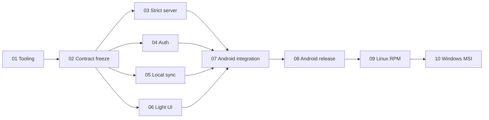

# TabbyRush — Glean Hub reuse implementation plan
User-selected strict A incorporated; Phase 01 tooling, Phase 02 frozen foundation, Phase 03 isolated strict server, Phase 04 Hub authentication and protected session, Phase 05 durable local state and strict per-record sync, Phase 06 shared Compose UI and accessible light theme, Phase 07 Android composition and runtime integration marked completed administratively (2026-10-14; Phase 07 technical acceptance NOT ACCEPTED 4/10), Phase 08 authorized Hub operations and signed Android release tooling marked completed / 100% (2026-10-14T17:00:00Z; operational tooling & security audit delivered, live release gates pending operator prerequisites), and Phase 09 Linux desktop and RPM implementation delivered / 100% (2026-10-14T17:35:00Z; technical acceptance blocked; desktop tooling, SPI, lockfiles, distributable, and test suites verified; live RPM build and Xpra session pending operator prerequisites). Existing embedded apps/shared Rust/TS libraries/adminUI/auth server stay unchanged; strict client never falls back to legacy sync.

Phase 10 — Native Windows DPAPI and installed MSI: implementation delivered / 100% (2026-10-14); technical acceptance blocked by root-level strict dependency verification, interactive MSI installation, and Narrator verification. Clean-user runtime/sync, uninstall/reinstall, and prior-phase acceptance remain open. Overall plan status stays in progress.

## Phases
| Phase | Link | Group | Status | Effort |
|---|---|---|---|---|
|01|[headless-tooling](phase-01-headless-tooling.md)|A|completed / 100% (2026-10-13)|6h|
|02|[frozen-foundation](phase-02-frozen-foundation.md)|B|completed / 100% (2026-10-14)|12h|
|03|[isolated strict server](phase-03-hub-schema-compatibility.md)|C|completed / 100% (2026-10-14)|40h|
|04|[auth-session](phase-04-auth-session.md)|C|completed / 100% (2026-10-14)|12h|
|05|[local strict sync](phase-05-local-sync-state.md)|C|completed / 100% (2026-10-14T11:30:00Z)|28h|
|06|[compose-ui-theme](phase-06-compose-ui-theme.md)|C|completed / 100% (2026-10-14T12:56:00Z)|12h|
|07|[android-integration](phase-07-android-integration.md)|D|administratively closed / 100% (2026-10-14; NOT ACCEPTED 4/10)|14h|
|08|[android-release-operations](phase-08-android-release-operations.md)|E|completed / 100% (2026-10-14T17:00:00Z; tooling & operational readiness delivered, live release gates pending operator prerequisites)|10h|
|09|[linux-distribution](phase-09-linux-distribution.md)|F|implementation delivered / 100% (2026-10-14T17:35:00Z; technical acceptance blocked; desktop tooling, SPI, lockfiles, distributable, and test suites verified; live RPM build and Xpra session pending operator prerequisites)|8h|
|10|[windows-distribution](phase-10-windows-distribution.md)|G|implementation delivered / 100% (2026-10-14; technical acceptance blocked)|6h|

## Dependency DAG

[Exact coding/runtime gates](dependency-matrix.md).03–06 code independently against02 contracts;real runtime integration waits their completed implementations. Platform delivery order remains mandatory.

## Compact ownership matrix
| Phase | Exclusive surface | Exact paths |
|---|---|---|
|01|Host scripts/native setup evidence;unchanged setup|6|
|02|Root/shared build/catalog/contracts/digest/tests/verification/shared lock|37|
|03|Strict models/registration/service/routes/errors/guard/wiring/admission helper/tests/docs|26|
|04|Auth/HTTP/single-flight/Android vault/tests;auth core unchanged|14|
|05|Room/schema1/outbox/strict adapter/scans/session/wipe/tests|29|
|06|Common UI/light theme/fonts/notices/tests|20|
|07|Android config/lock/WorkManager/device tests/evidence|25|
|08|Live/recovery/security scripts/general docs/Android release evidence|20|
|09|Desktop build/SPI/Linux vault+lock/RPM tests/evidence|23|
|10|Windows vault/provider descriptor+lock/PowerShell/MSI tests/evidence|15|

## Selected strict contract and execution
Immutable schema mode,POST strong/bootstrap,push,pull and isolated app+epoch namespace; server revision1/exact CAS/insert-only create,real journaled nonce-write replay confirmation,per-row frozen FIFO requests. Permanent empty tombstones;stable rowId full scans not snapshots;explicit UnknownSuperseded review,monotonic promotion,no equality/absence receipts. Every request checks authoritative epoch;maintenance recovery quiesces writers,new namespace/fresh epoch/registry CAS,never reopens stale epoch or reconstructs receipts.
New strict-apps registration/read-back/admission mandatory;legacy-only route guard rejects strict/unknown modes non401. Ordinary legacy routes/clients unchanged. No obsolete legacy upsert repair,transactions/feed/receipt ledger/GC/reset HTTP API/global Mongo setting changes.
One integrator executes future required suites after lane handoffs;original owners repair. Desktop09 freezes target/SPI/lock inclusion;10 adds only its Windows files,never routine shared edits. ForumFlash light theme/auth/vault/background/wipe/source/native release gates retained.
148h=6+12+40+12+28+12+14+10+8+6 (+48h baseline);uncertainty±25–35%. Ideal critical96h=6+12+40+14+10+8+6;not observed runtime/calendar promise,operator waits/rework excluded. No effort allocated to changing embedded apps/shared clients.

## Contracts and evidence
[Architecture](architecture.md) · [Contracts](contracts.md) · [Decisions](reports/design-decisions.md) · [215-path registry](file-ownership.md) · [Command index](evc-cmd-plan.md) · [Completion report](reports/strict-plan-completion.md).
[Selected feasibility](reports/strong-sync-feasibility.md) · [Design evidence](reports/strong-sync-design-feasibility.md) · [Exact source/isolation inventory](reports/strong-sync-isolation-feasibility.md) · [Mongo primary evidence](reports/mongodb-feasibility-evidence.md) · [Strict contract review](reports/strict-contract-review.md). Older100h/one-file reports historical only,not active authorization or current validation.

## Validation Summary
Confirmed2026-10-13:strict A/permanent compact markers/UnknownSuperseded/non-snapshot tradeoff;unchanged embedded clients;admin warning;local-only logout. [Interview record](reports/validation-summary.md). [Final structural/content review passed](reports/strict-plan-review.md);implementation/runtime gates unexecuted.

## Unresolved prerequisites
Approved reachable Hub/Mongo topology/version/journaling/index/revision/operator provisioning/recovery/key/grants;old-binary/unchanged-client sanitized fixtures;Xpra permissions,stable tuple,font/vault/signing proof and Windows host. Selected protocol/auth/logout choices resolved. No universal losslessness,snapshot/feed or unbounded causal receipt history claimed.
