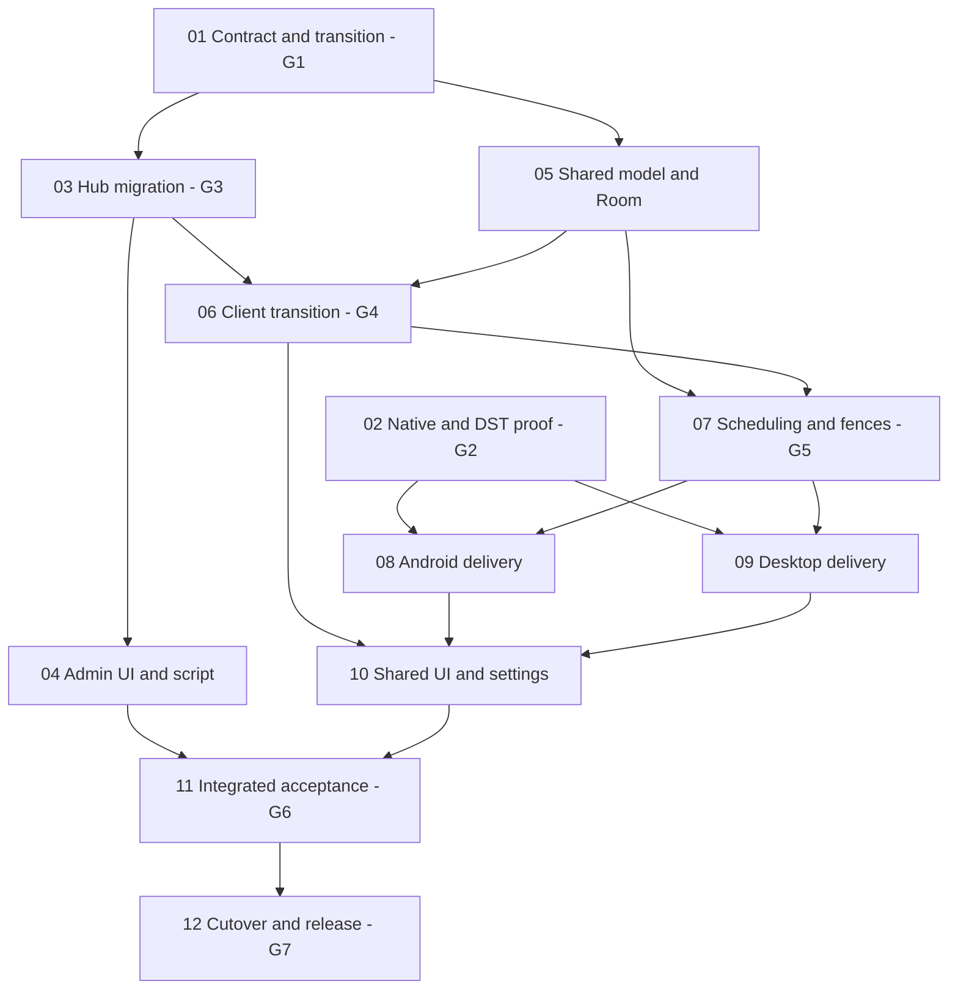

# Execution map and ownership

[Parent plan](plan.md). Status: Phase 01 complete (100%, Gate G1 passed); Phase 02 logic/contracts DELIVERED (Gate G2 physical delivery BLOCKED); Phase 03 DELIVERED (Contracts/Logic/Tests; technical acceptance blocked by 3 code findings and unexecuted Gate G3 live cluster tests; Code Review: ADMISSION ON HOLD 8.0/10); Phase 04 complete (100%); Phase 05 complete (100%); Phase 06 complete (100%, Gate G4 passed); Phase 07 complete (100%, Gate G5 passed); downstream native phases 08 and 09 have shared prerequisites delivered while native proof/runtime delivery remains gated by G2. Read [phase01](phase-01-freeze-contract-and-transition-design.md) for contract details; [acceptance matrix](acceptance-matrix.md) for observable outcomes.

## True implementation dependencies

Phase 07 shared scheduling, persisted projection, occurrence ledger, delivery gate, and fail-closed leave protocol are complete (Gate G5 passed). Phase 10 UI design can read G1/G2/G5 before 08/09 finish; final capability integration/acceptance waits for real adapters. No broad UI implementation before native proof. Phases 01, 04, 05, 06, and 07 complete; Phase 02 logic/contracts delivered (Gate G2 physical delivery BLOCKED); Phase 03 contracts/logic delivered (Gate G3 physical cluster execution ON HOLD pending live replica set testbed); downstream native Phases 08 and 09 have shared scheduling prerequisites delivered (Gate G5 passed), while native proof and runtime delivery remain gated by G2.

## Safety gates
- **G1 / phase01:** freeze schema/version/digest/null/temporal/API/legacy outcome and maintenance-fence invariants. Reviewed, not guessed source facts.
- **G2 / phase02:** actual native proof on all three target runtimes; Windows installed AUMID/binding and strict DST resolver selected. Missing platform blocks gate.
- **G3 / phase03:** live two-instance fence/crash/publish-last/data-preservation/legacy receipt proof. Backend contracts, logic, unit/route tests, and mock smoke delivered (2026-10-15); technical acceptance remains formally ON HOLD blocked by 3 open code findings and unexecuted live multi-instance MongoDB cluster tests before production admission.
- **G4 / phase06:** populated offline old-client transition; uncertain receipts and safe changed-field rebasing, original digest preservation.
- **G5 / phase07:** draft-free persisted projection, grace/identity/ledger and delivery-vs-mutation/wipe races. Exactly-once not claimed. **PASSED** (2026-10-15): 270/270 automated tests PASS across 6 suites, code review 9.2/10 approved; delivers shared prerequisites for downstream native adapter phases 08 (Android Exact Alarm / WorkManager) and 09 (Desktop Linux D-Bus / Windows Toast), while native proof and delivery remain gated by G2.
- **G6 / phase11:** AC01–AC12 with separate native/device/browser/CLI runtime evidence, final security/build/dependency checks.
- **G7 / phase12:** rehearsed and explicitly authorized operator cutover/readback and signed/platform release acceptance; docs reflect real state.

## Independent work and integration ownership
- Start 01 and 02 independently. Once G1 passed, 03 backend and 05 storage can proceed independently using frozen fixture/digest/API contracts.
- Phase 03 contracts, admission logic, and tests are delivered, unblocking Phase 04 operator tooling (admin UI and script) and Phase 06 client transition planning on contracts (Phase 06 implementation remains dependent on Phase 05); physical production deployment remains gated on Gate G3 live cluster execution and code remediations.
- With Gate G5 passed (shared prerequisites delivered; native proof and runtime delivery remain gated by G2), Phase 08 Android and Phase 09 desktop adapters can proceed independently with adapter implementation under their native testbed prerequisites; shared scheduler/model stay under integration owner. Linux and Windows target adapters can run independently with one owner for desktop main.kt/build/package files.
- Shared `contract/`, `data/`, `sync/` files need one integration owner across05/06/07; sequence commits or disjoint file ownership, never concurrent conflicting edits.
- Phase10 owns shared Compose; Android session-view-model.kt and desktop main.kt actions need coordinated handoff from platform owners, not competing replacements.
- Phase11 QA reads all delivered code and exercises runtime; backend/operator release owner performs12. Missing evidence is blocked, not waived implicitly.

## Per-phase execution discipline
Read context+requirements+related files; honor checked invariants; use unchecked Todo list. Freeze exported symbol contract/references first. Implement assigned behavior only; update broken behavior tests, keep deterministic plausible-regression tests. Run actual smoke before marking complete. Update docs/changelog after permanent implementation; remove throwaway proof scaffolds. Never perform production upgrade/account destructive wipe just because a plan checkbox exists.

## Unresolved questions
Execution resources/topology/binding proofs listed in parent. No extra parallel execution is requested by this planning deliverable; graph documents safe future ordering.
