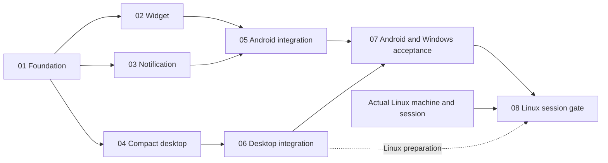

# Doggo sticky task surfaces

As of 2026-10-17, Phases 01–06 are delivered (112h); Phase 07 documentation and automated-verification evidence are delivered, with 6h of 12h credited (**118h / 132h; 89.4%**). The evidence includes Android and Windows acceptance summaries and four visual design baselines; these PNGs are not runtime OS captures. The Phase 07 acceptance and code-review reports each list 364/364 Gradle tests; the earlier Cycle 2 review lists 363/363 (231 shared, 98 desktop, 34 Android). These totals are attributed to their respective reports; no tests were rerun here. Native Android/Windows hardware acceptance remains conditionally held under Gate G2; Phase 08 is pending an actual Linux target/session. Root dependency provenance (149 unmatched classpath checksums) and separate Glance artifact provenance remain held, as do release gates G2/G3/G6/G7. Android's delivery-drain timeout is caught/logged; `closeActiveRuntime()` then clears the active runtime reference while coroutine cleanup and Room closure are skipped. Glance cleanup failures also remain open.

## Phases
| # | Phase | Status / progress | Effort | Group | Detail |
| --- | --- | --- | --- | --- | --- |
| 01 | Shared/store/build foundation | delivered / 100%; implementation accepted; strict provenance and native gates pending | 24h | A | [phase01](phase-01-shared-foundation.md) |
| 02 | Android widget leaf | delivered / 100%; implementation/tests verified; native acceptance pending Phase 07 | 16h | B | [phase02](phase-02-android-widget.md) |
| 03 | Deadline notification/settings leaf | delivered / 100%; implementation/tests verified; native acceptance pending Phase 07 | 20h | B | [phase03](phase-03-android-notification.md) |
| 04 | Compact desktop UI/geometry/preferences | delivered / 100%; implementation/tests verified; native acceptance pending Phase 07 | 12h | B | [phase04](phase-04-desktop-compact.md) |
| 05 | Android runtime/navigation/wipe integration | delivered / 100%; unit/security verified; Cycle 2 safety findings remain open | 24h | C | [phase05](phase-05-android-integration.md) |
| 06 | Desktop controller/window/tray integration | delivered / 100%; unit/review verified; native acceptance pending Phase 07/08 | 16h | C | [phase06](phase-06-desktop-integration.md) |
| 07 | Android/Windows acceptance + shared docs | documentation & automated-verification evidence delivered 2026-10-17; native hardware acceptance conditionally held (Gate G2); 6h credited | 12h | D | [phase07](phase-07-acceptance-docs.md) |
| 08 | Linux-only adaptation + real-session gate | pending / 0%; actual Linux target/session required | 8h | E | [phase08](phase-08-linux-acceptance.md) |
| | Total planned effort credited | in progress / 89.4% (118h of 132h) | **132h** | | |

## Dependencies

Waves A, B, and C are delivered: Phase 01 foundation; Phase 02/03/04 leaves; and Phase 05/06 integrations. Cycle 2 reviewed the delivered surfaces at 8.8/10 Conditional Pass with no critical issues and authorized downstream acceptance. Wave D / Phase 07 documentation and automated-verification evidence is delivered (6h credited); native Android/Windows hardware acceptance remains conditionally held under Gate G2. Wave E / Phase 08 remains pending an actual Linux target/session. The tombstone-overlay finding is resolved and regression-tested. File independence never implies zero runtime dependencies. No stubs, temporary runtime hosts, or second store.

## Ownership matrix
| Owner | Exclusive boundary |
| --- | --- |
| 01 | Shared contracts/store/tests, Android dependency setup, catalog/all locks/verification |
| 02 / 03 / 04 | Separate widget / notification+settings / compact+geometry modules and their tests |
| 05 / 06 | Android roots/manifest/wipe/auditor / desktop main/controller/tray/lifecycle and own tests |
| 07 / 08 | Android+Windows acceptance/affected shared docs / Linux-only adapter/tests/docs/evidence |
Exact disjoint paths/actions: [ownership manifest](file-ownership.md). Contracts: [architecture](architecture-contracts.md). Acceptance1–12, edge cases, future commands: [matrix](acceptance-matrix.md).

## Execution and gates
Preserve authoritative local-first/strict-sync persistence, existing order, independent main filter, explicit desired completion, current-account/generation admission and publication drain. No Room migration/new backend, auto-start, activation IPC, FGS or exact-alarm permission. Notification opt-in off by default, reminder-independent, durable dismissal; desktop close hides and only Quit tears down. Native launcher/shade and Windows window/tray evidence required, not builds alone.

Strict dependency provenance is mandatory and not waived: (1) the root Gradle verification baseline still has 149 unmatched classpath checksums in `gradle/verification-metadata.xml`; and (2) Glance 1.2.0 artifact provenance is not verified. These are distinct but related holds. Existing release G2/G3/G6/G7 holds, native reminder gaps, and the Windows toast stub remain unchanged. Reported test passes do not close dependency-provenance or native-acceptance gates.

## Validation Summary
**Validated:** 2026-10-16. **Questions asked:** 6 across two batches; four decisions confirmed after Android-specific clarification.

### Confirmed Decisions
- Android notification dismissal suppresses the same task/deadline across refresh/restart; different selection/deadline or deliberate re-enable may show it again. Widget/desktop/reminder alerts unaffected.
- Include saved conflicted deadlines with a conflict indication; completion does not resolve sync conflicts.
- Desktop sticky starts hidden when no preference exists; subsequent manual launches restore saved visibility.
- Remember Android opt-in; prompt on explicit enable, then show unavailable and user-invoked permission/Settings guidance after denial. No automatic repeated prompts.

### Action Items
None: confirmed choices match planned contracts; no phase revisions required. Dependency compatibility, native surface proof and later Linux session remain execution gates, not validated runtime claims.

## Unresolved questions
No blocking product questions. Open execution and safety items: Phase 07 native acceptance and disposition of the Cycle 2 Android drain-timeout and Glance cleanup findings; the separate root checksum and Glance artifact-provenance holds; and Phase 08's actual Linux target/session. Cycle 2 review also lists Glance process-death/session behavior as unwaived; no platform behavior is inferred from unit tests.
