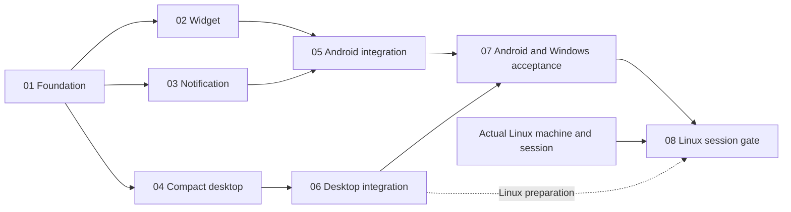

# Doggo sticky task surfaces

Phase 01 is **delivered / 100% of planned scope (24h / 24h); technical acceptance conditional, dependency-provenance gate pending**. Cycle 3 code review scored **9.4/10 (Conditional Pass — Terminal Handoff Authorized; External Provenance Gate Pending)**. Latest QA reports **307/307 Gradle tests passing** (shared JVM 231, desktop 64, Android unit 12), plus 18/18 fixture smoke, 6/6 source security diagnostics, and 8/8 strict-v2 self-test checks. The residual server-tombstone/local-draft-or-outbox finding is resolved and regression-tested. Cycle 3 authorizes the terminal conditional handoff to Phases 02, 03, and 04; those leaves are unblocked, while strict Glance artifact provenance remains a pending, unwaived hold and their native proof remains downstream. Overall plan stays in progress at 24h / 132h (18.2%). See [full-suite QA](../reports/qa-261016-1911-phase-01-full-suite-validation.md), [Cycle 3 review](../reports/code-review-261016-1911-phase-01-shared-foundation-cycle-3.md), [foundation evidence](reports/phase-01-foundation-evidence.md), and [PM progress report](../reports/project-manager-261016-1911-phase-01-shared-foundation.md). Scope and confirmed product decisions: [approved scope](../reports/brainstorm-261016-1302-sticky-task-surfaces.md), [analysis](reports/01-codebase-analysis.md), [brief](reports/02-planner-brief.md), [Android research](research/researcher-01-android-surfaces.md), [desktop research](research/researcher-02-desktop-surfaces.md).

## Phases
| # | Phase | Status / progress | Effort | Group | Detail |
| --- | --- | --- | --- | --- | --- |
| 01 | Shared/store/build foundation | delivered / 100%; conditional acceptance; gates pending | 24h | A | [phase01](phase-01-shared-foundation.md) |
| 02 | Android widget leaf | pending / 0% | 16h | B | [phase02](phase-02-android-widget.md) |
| 03 | Deadline notification/settings leaf | pending / 0% | 20h | B | [phase03](phase-03-android-notification.md) |
| 04 | Compact desktop UI/geometry/preferences | pending / 0% | 12h | B | [phase04](phase-04-desktop-compact.md) |
| 05 | Android runtime/navigation/wipe integration | pending / 0% | 24h | C | [phase05](phase-05-android-integration.md) |
| 06 | Desktop controller/window/tray integration | pending / 0% | 16h | C | [phase06](phase-06-desktop-integration.md) |
| 07 | Android/Windows acceptance + shared docs | pending / 0% | 12h | D | [phase07](phase-07-acceptance-docs.md) |
| 08 | Linux-only adaptation + real-session gate | pending / 0% | 8h | E | [phase08](phase-08-linux-acceptance.md) |
| | Total planned effort credited | in progress / 18.2% (24h of 132h) | **132h** | | |

## Dependencies

Cycle 3 authorizes terminal conditional handoff to Phases 02/03/04; these leaves are unblocked and may proceed concurrently against the frozen contracts. The tombstone-overlay finding is resolved and regression-tested. Strict dependency provenance remains pending and is not waived. Phase 01 remains conditionally accepted; overall plan remains in progress. C starts on its own completed prerequisites; D waits for both integrations; E remains pending without the required Linux machine/session. File independence never implies zero runtime dependencies. No stubs, temporary runtime hosts, or second store.

## Ownership matrix
| Owner | Exclusive boundary |
| --- | --- |
| 01 | Shared contracts/store/tests, Android dependency setup, catalog/all locks/verification |
| 02 / 03 / 04 | Separate widget / notification+settings / compact+geometry modules and their tests |
| 05 / 06 | Android roots/manifest/wipe/auditor / desktop main/controller/tray/lifecycle and own tests |
| 07 / 08 | Android+Windows acceptance/affected shared docs / Linux-only adapter/tests/docs/evidence |
Exact disjoint paths/actions: [ownership manifest](file-ownership.md). Contracts: [architecture](architecture-contracts.md). Acceptance1–12, edge cases, future commands: [matrix](acceptance-matrix.md).

## Execution and gates
Preserve authoritative local-first/strict-sync persistence, existing order, independent main filter, explicit desired completion, current-account/generation admission and publication drain. No Room migration/new backend, auto-start, activation IPC, FGS or exact-alarm permission. Notification opt-in off by default, reminder-independent, durable dismissal; desktop close hides and only Quit tears down. Native launcher/shade and Windows window/tray evidence required, not builds alone.

Implementation owners author behavioral tests alongside code; integrator verifies a coherent final snapshot once after integrations. No source-string tests or fake-runtime acceptance. Strict dependency provenance is mandatory; existing 149-checksum baseline and release G2/G3/G6/G7 holds, native reminder gaps and Windows toast stub remain unchanged. Compatibility/device/session evidence is pending, not inferred.

## Validation Summary
**Validated:** 2026-10-16. **Questions asked:** 6 across two batches; four decisions confirmed after Android-specific clarification.

### Confirmed Decisions
- Android notification dismissal suppresses the same task/deadline across refresh/restart; different selection/deadline or deliberate re-enable may show it again. Widget/desktop/reminder alerts unaffected.
- Include saved conflicted deadlines with a conflict indication; completion does not resolve sync conflicts.
- Desktop sticky starts hidden when no preference exists; subsequent manual launches restore saved visibility.
- Remember Android opt-in; prompt on explicit enable, then show unavailable and user-invoked permission/Settings guidance after denial. No automatic repeated prompts.

### Action Items
None: confirmed choices match planned contracts; no phase revisions required. Dependency compatibility, native surface proof and later Linux session remain execution gates, not validated runtime claims.

## Unresolved questions
No blocking product questions. Phase 01 is delivered; Cycle 3 terminal conditional handoff unblocks the three B leaves. Strict dependency provenance remains unresolved, the Cycle 3 non-gating observer-test hardening recommendations remain to be dispositioned, Phase 02 must prove bounded session-update quiescence, and the Linux target/session/machine remains a later gate.
