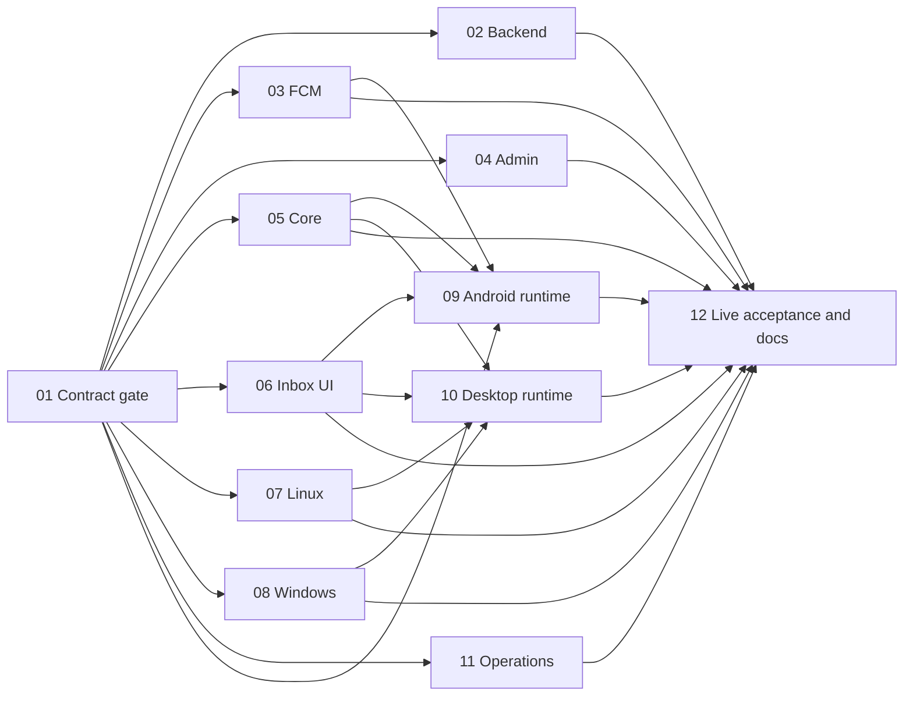

# Server admin announcements

## Strategy
Contract-first clean cutover: Mongo canonical90day inbox/read + bounded immutable audience acceptance, leased in-process recovery, generic Android FCM and authenticated running-desktop SSE. Shared bounded in-memory state, separate from tasks. Validated rollout: restricted Android/Linux pilot, then full delivery after installed Windows C++/WinRT/JNA activation passes. No broker, transaction assumption, offline content/read outbox or new native shell.

## Scope and Status
Phases P01–P12 implemented across TabbyRush and GleanHub. QA verification reports 548 passing test executions plus 18 vector/static checks (566 passing verifications; 0 failures, 1 ignored doc-test; see qa-261018-1548 report). Code review Cycle 2 approved with score 8/10 (0 critical issues, 12 warnings tracked for operational disposition). User approved implementation on 2026-10-18. Implementation and tooling delivered across all phases; staged pilot acceptance and operator authorization pending (selected audience bound <= 500 recipients per announcement). Windows native C++/WinRT bridge and MSI identity held at announcement Gate G5 per restricted pilot staged rollout plan. Inherited release holds (G2 connected device, G3 live replica-set cluster, G6 live three-device sync, G7 live production cutover, 149-checksum root verification baseline, Glance 1.2.0 provenance, and browser/Linux session gates) remain open. Credited effort: **262h / 276h (94.9% planned effort credited; P12 credits 14h for tooling/docs while 14h live acceptance remains pending)**.

## Phases
| # | Phase | Status / progress | Effort | Group |
|---|---|---|---|---|
| 01 | [Contract, pure interfaces and common build gate](phase-01-contract-build-gate.md) | implemented / 100% | 12h | A |
| 02 | [Backend storage, audience, device routes and durable worker](phase-02-backend-canonical-inbox.md) | implemented / 100% | 32h | B |
| 03 | [FCM HTTP v1 transport and legacy push cutover](phase-03-fcm-http-v1-transport.md) | implemented / 100% | 16h | B |
| 04 | [React admin composer, confirmation and sent history](phase-04-react-admin-composer.md) | implemented / 100% | 16h | B |
| 05 | [Shared remote inbox core and authorized HTTP/SSE](phase-05-shared-remote-core.md) | implemented / 100% | 28h | B |
| 06 | [Shared Compose inbox UI and remote navigation](phase-06-shared-inbox-ui.md) | implemented / 100% | 16h | B |
| 07 | [Linux persistent D-Bus remote alert adapter](phase-07-linux-native-adapter.md) | implemented / 100% | 20h | B |
| 08 | [Windows C++/WinRT bridge, JNA and MSI identity](phase-08-windows-native-packaging.md) | implemented (Gate G5 held) / 100% | 36h | B |
| 09 | [Android Firebase runtime, install operations and inbox integration](phase-09-android-runtime-integration.md) | implemented (Gate G2 held) / 100% | 32h | C |
| 10 | [Desktop process runtime, tray and native inbox activation](phase-10-desktop-runtime-integration.md) | implemented / 100% | 24h | C |
| 11 | [Operations, credentials, feature gates and deployment assets](phase-11-operations-config-deployment.md) | implemented / 100% | 16h | B |
| 12 | [Cross-system live acceptance, evidence and permanent docs](phase-12-cross-system-acceptance-docs.md) | implemented (Tooling/Docs delivered; live acceptance pending) / 50% (14h credited / 14h pending) | 28h | D |

## Dependency DAG

Implementation edges shown; code/build dependencies unchanged. P12 separates **pilot** Android/Linux evidence from **full** Windows-inclusive acceptance; Windows acceptance may remain held during pilot. [Canonical dependency matrix and wave gates](reports/04-execution-ownership.md#dependency-matrix).

## Compact exclusive ownership
| Owner | Exact scope summarized; full paths authoritative in manifest |
|---|---|
| P01 | Pure contracts/vectors, common Kotlin/Rust manifests/exports/locks/checksums, new contract doc |
| P02 / P03 / P04 | Backend storage/routes/config/init/SSE primitive / FCM implementation+legacy caller migration / existing admin page+composer/history/service |
| P05 / P06 | Authorized remote core+HTTP allowlist / shared inbox/root UI, never TodoAction |
| P07 / P08 | Linux persistent adapter / Windows native/JNA/desktop build+locks/MSI resources |
| P09 / P10 | All Android runtime/build/audit files / desktop process runtime+target providers, not adapter/build files |
| P11 / P12 | Deployment assets+ops setup / only new smoke/evidence+permanent release docs |
[Full144-path manifest](reports/04-execution-ownership.md#full-file-manifest). No overlap, including sequential repairs, build resources and generated handoff artifacts.

## Canonical supporting artifacts
- [Frozen routes/storage/device fencing/SSE/native contract](reports/03-contract-specification.md).
- [Every brainstorm requirement, owner tests, actual surfaces and pass/fail gates](reports/05-acceptance-matrix.md).
- [Fresh source analysis](reports/01-codebase-analysis.md) (scout intentionally skipped), [authoritative synthesis](reports/02-design-decisions.md), [agreed brainstorm](../reports/brainstorm-261018-0228-server-admin-notifications.md).
- [Command-plan overview](evc-cmd-plan.md). Phases P01–P12 implemented; automated test runner and static verifications passing (566 checks); Cycle 2 code review approved 8/10; user approved.
- [Cycle 2 Code Review Report](../reports/code-review-261018-1550-server-admin-announcements-cycle2.md) (Score 8/10, 0 critical issues, 12 warnings).
- [QA Regression Verification Report](../reports/qa-261018-1548-c1-c6-regression-verification.md) (548 test executions + 18 vector/static checks PASS).

## Prerequisites / unresolved questions
Mongo live cluster execution (G3), physical Android connected device/Keystore (G2), active Linux graphical session, and physical Windows C++/WinRT/WiX MSI runtime testbed (announcement Gate G5) held. Preserve inherited G2/G3/G6/G7/checksum/Glance holds. 12 code review warnings (W1–W12: binding string dates, stuck dispatches on empty install_id, worker loop error logging, simulated pagination test Mongo integration, N+1 queries, unescaped cursor JSON, controller silent reconnect unit test, controller activeJobs thread-safety/tight loop, stream client cancellation swallowing, Windows destroy retry, native callback lost wakeup, and Android install store transient identity reset) tracked for operational disposition. Effort 276h engineering estimate, not delivery deadline; environment wait/release holds uncredited.

## Validation Summary
**Validated:** 2026-10-18 · **Questions asked:** 3 · **Implementation Status:** User approved following Cycle 2 review (Score 8/10, 0 critical issues) and QA verification (566 passing verifications).
### Confirmed Decisions
- **Offline inbox:** online details only; retain in-memory cache and authenticated server reauthorization, no persistent content/read queue.
- **Audience bound:** maximum500 resolved recipients per announcement, reject rather than truncate.
- **Rollout:** stage a restricted Android/Linux pilot before Windows acceptance. Windows remains required for full feature delivery.
### Action Items
- [x] Propagated staged pilot/full-delivery gates into [P11 rollout](phase-11-operations-config-deployment.md), [P12 acceptance](phase-12-cross-system-acceptance-docs.md), P10 desktop handoff and supporting reports.
- [x] Defined operator-approved selected-user cohort, unchanged safety gates, Windows-not-yet-accepted disclosure, stop/rollback conditions and mandatory Windows exit gate in [rollout acceptance](reports/05-acceptance-matrix.md#pilot-and-full-delivery-gates).
- [x] Executed full implementation across all P01–P12 phases; remediated critical issues C1–C6; achieved 8/10 review score with 0 critical issues.
- [x] Executed automated verification suites: 548 passing test executions + 18 vector/static checks passed cleanly without regressions.
- [ ] Operator authorization and deployment of restricted selected-user pilot cohort.
- [ ] Physical Windows native testbed execution and announcement Gate G5 clearance for full multiplatform delivery.
