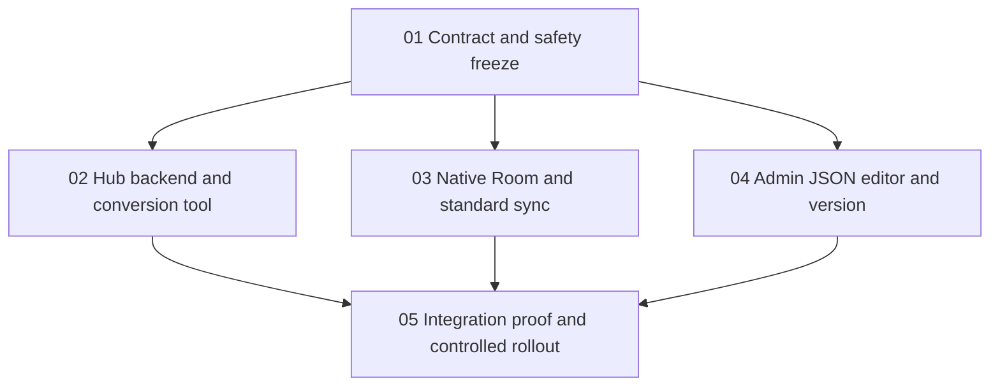

# Option B — Standard Sync & Schema Version

## Scope

Implementation authorized after planning. Preserve native Android/Desktop apps, task data, offline intent, hierarchy, deadlines, reminders and account isolation. Replace strict task transport with standard push/pull/delta; add server-managed schemaVersion to API/UI. `glean-hub` remains a normal app; only TabbyRush requires protocol/data conversion if its registry is still strict. Live data conversion remains separately gated.

**Correction:** Standard sync is schema-validated, not schemaless. JSON edits do not automatically add native UI or migrate Room. Standard sync does not retain strict receipts, permanent tombstones or server hierarchy enforcement.

## Authority

- [Target architecture](../../docs/standard-sync-cutover-design.md)
- [API contracts, exclusive ownership, acceptance and side-effect checklist](contracts-and-ownership.md)
- [Parallel source research and observed runtime prerequisites](reports/scout-findings.md)

## Dependency graph

## Phases

| Phase | Deliverable | Status | Execution group |
|---|---|---|---|
| [01](phase-01-contract-and-safety.md) | Freeze API, migration states, risks and ownership | Complete | Prerequisite |
| [02](phase-02-hub-backend.md) | Registry version/API, generic metadata, migration binary | Source complete; verification in progress | Parallel A |
| [03](phase-03-native-standard-sync.md) | Room migration, outbox/transport, native capability cutover | Source complete; verification in progress | Parallel A |
| [04](phase-04-admin-ui.md) | JSON save/read-back/version/conflict handling | Source complete; verification in progress | Parallel A |
| [05](phase-05-verification-and-rollout.md) | Real Mongo/API/admin/native proof, docs, authorized cutover | In progress — verification and rollout gates | After A |

## Status and verification — 2026-10-20

- **Phase status:** Phase 01 contract/safety freeze complete. Phases 02–04 source delivered; core integrated verification passed, while phase status remains verification in progress. Phase 05 remains in progress for the named browser acceptance holds in [phase04](phase-04-admin-ui.md), Android connected/UI acceptance and authorized rollout. Overall plan remains in progress, not full acceptance.
- **Parent-reported disposable API/browser smoke (2026-10-20):** On local Mongo 27191, Hub 3100 and admin 3102, ordinary schema baseline 1 changed to 2; identical save/no-op remained at 2; a distinct stale save returned 409. Actual admin JSON paste of nullable `customNotes` moved version 1→2; no-op stayed 2; stale 409 preserved the draft and latest inspection was read-only. Explicit discard/reload to adopt version 2 was exercised. Standard create/pull/delta/update/delete retained unknown JSON. No live production migration occurred. See the [final integration verification](reports/verification-final.md) for the complete evidence record.
- **Backend/operator/admin:** Parent reports 83 affected Rust tests passed and 1 pre-existing strict-live-gate ignored (66 plugin + 5 schema Mongo + 7 operator Mongo + 4 client + 1 engine; operator's 7/7 cases cover concurrency, maintenance-deadline and recovery). `cargo check --workspace --all-targets` passed with existing unused warnings. Hub admin unit suite passed 22; TypeScript/Vite production build passed; Node proxy/version/security suites passed 43. See [final integration verification](reports/verification-final.md).
- **Native verification:** Strict Gradle passed: shared JVM 264, Desktop 131, Android unit 50 (445 total). `assembleDebug`, `assembleDebugAndroidTest` and Windows `createDistributable` succeeded; isolated Android artifact manifest uses `dev.tabbyrush.android.standardsmoke`. A parent-reported Windows runtime smoke passed using real DPAPI, HubAuthSession HTTP and Room offline restart across two stores/coordinators; schemaVersion 2, opaque nested JSON/`customNotes`, parent-child sync and group delete were exercised without mocks or JUnit. Android connected instrumentation was not run; interactive native UI remains blocked after two computer-control grant timeouts.
- **Dependency/review boundaries:** 50 dependency checksum entries are officially validated, including the AAPT Windows addition; strict Gradle passed. Latest source-only reviews ([native](reports/review-native-final.md), [Hub/operator](reports/review-hub-ui-final.md)) approve scoped fixes with no actionable findings; these are not runtime acceptance. Existing Glance provenance and release holds remain open.
- **Cutover safety:** Exact-target approval, external all-node/job isolation, verified backup/restore, remaining platform/release hold closure, and user-data ownership/preservation remain mandatory before live cutover. The inherited strict-v3 runbook restore procedure remains **not approved for execution**: its MongoDB namespace is wrong and `_schemas`/`_coordination` are omitted. Do not use it for this Option B conversion; require a separate validated recovery rehearsal.

## Next action

Close the named phase04 browser acceptance holds and Android connected/UI acceptance; keep phase05 in progress. Do not migrate the live database without exact-target authorization and independently verified recovery that preserves user data. Current core evidence is in the [final integration verification](reports/verification-final.md).

Execution record: phase01 contract/safety freeze complete; implementation owners delivered phase02/03/04 source changes; phase05 is the current integration and rollout workstream. See each phase file for lane-specific status.

## Default decisions

- Counter begins at 1; effective schema changes increment; identical saves/retries do not. Server alone assigns it.
- expectedSchemaVersion guards stale UI saves with 409; no automatic overwrite.
- Native hubSchemaVersion is informational, distinct from Room version and record/checkpoint metadata; no exact-version handshake.
- Full record JSON preserves unknown fields; pending/uncertain intent never silently discarded or replayed across protocols.
- Keep standard retention policy; conservative full rescan/review after long offline gaps. No new strict engine or compatibility fallback.
- Conversion requires maintenance isolation, backup/restore rehearsal and stage journal; no naked syncMode unset.

## Gates and verification

Integrated verification and rollout remain in progress; see phase05. Exact-target authorization, external all-node/job isolation, verified backup/restore, review-finding closure, and user-data ownership/preservation remain mandatory before any live cutover.

## Unresolved questions

None for planning. Isolated MongoDB credentials and live cutover authorization must be supplied through protected execution configuration, never copied from archived logs.
