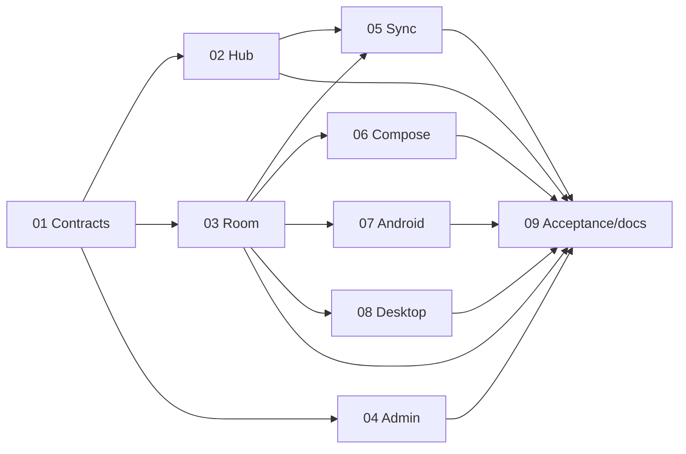

# Collaborative task assignees
Plan directory: `G:/ws/sharing/doggo/plans/261021-1552-tabbyrush-task-assignees`.
Implementation and targeted Cycle 3 review complete; implementation approved with noted issues per user-provided disposition. Phases 01–09 are complete for implementation delivery. Reported test evidence and remaining acceptance/release holds are explicit below; completion does not pass the full runtime/release gate.
Authority: [frozen contracts](reports/01-frozen-design-contracts.md), [source evidence](reports/00-context-and-source-evidence.md), [handoff](reports/02-planner-handoff.md), [12-criterion traceability](reports/03-acceptance-traceability.md), [document validation](reports/05-plan-validation.md), [Cycle 3 review](../../reports/code-review-261022-1649-collaborative-assignees-cycle3.md).
## Phases
| Phase | Status / progress | Effort | Group | Reported implementation verification |
|---|---|---:|---|---|
| [01 Contracts and pure projections](phase-01-canonical-contracts-and-pure-projections.md) | **Completed / 100%** | 24h | A | Cycle 3 review reports shared JVM 179/179 and sync-engine 6/6; review scope includes canonical access contracts. |
| [02 Hub enforcement](phase-02-hub-authorization-and-reconciliation.md) | **Completed / 100%** | 48h | B | Disposable Mongo targets: `task_assignment_integration` 6/6 and `schema_version_integration` 4/4; Hub sync library 31/31 per Cycle 3 review. |
| [03 Room v5 persistence](phase-03-room-v5-and-access-persistence.md) | **Completed / 100%** | 40h | B | Cycle 3 review reports shared JVM migration/access coverage 179/179; selected shared JVM suite 329/329 in QA. |
| [04 Admin and provisioning](phase-04-admin-policy-and-native-provisioning.md) | **Completed / 100%** | 16h | B | Hub admin unit 51/51 in QA; provisioner Node suite 12/12 in earlier regression QA. |
| [05 Native transport and sync](phase-05-native-transport-and-sync-lifecycle.md) | **Completed / 100%** | 40h | C | Shared JVM 179/179 in Cycle 3 review (outbox/reconciliation coverage); selected shared JVM suite 329/329 in QA. |
| [06 Shared Compose UI](phase-06-shared-compose-assignee-workflows.md) | **Completed / 100%** | 24h | C | Shared JVM 179/179 in Cycle 3 review (workflow coverage); selected shared JVM suite 329/329 in QA. |
| [07 Android runtime/surfaces](phase-07-android-actions-and-access-surfaces.md) | **Completed / 100%** | 32h | C | Android unit suite 40/40 in Cycle 3 review; earlier regression QA reported 60/60 on its separate snapshot. |
| [08 Desktop runtime/surfaces](phase-08-desktop-actions-and-sticky-surfaces.md) | **Completed / 100%** | 28h | C | Desktop unit suite 95/95 in Cycle 3 review; earlier Windows-target regression QA reported 145/145 on its separate snapshot. |
| [09 Integrated acceptance/docs](phase-09-integrated-acceptance-and-documentation.md) | **Completed — implementation/docs / 100%** | 32h | D | Selected QA run 390/390: shared JVM 329, admin 51, disposable Mongo targets 6+4. Dedicated feature smoke/native UI and full G2–G6 acceptance remain separate. |

Phase status records implementation delivery, not satisfaction of all release criteria. Test counts are attributed to separate reports/snapshots and are not additive: [selected QA](../../reports/qa-261022-1521-selected-test-suite-results.md), [earlier 625/625 regression QA](../../reports/qa-261021-2225-critical-fix-regression-tests.md), [Cycle 3 review](../../reports/code-review-261022-1649-collaborative-assignees-cycle3.md).

## Dependency graph

## Dependency matrix
| Phase | True construction dependencies | Additional runtime/integration gate |
|---|---|---|
| 01 | None | Whole feature compilation after owned caller migrations |
| 02 | 01 | Replica-set;04 fixture;05/07/08 native integration |
| 03 | 01 | Real SQLite;05/07/08 runtime callers |
| 04 | 01 | 02 enforcement before any local opt-in |
| 05 | 01,02,03 | 04 disposable config;06/07/08 consumers |
| 06 | 01,03 | 05 lookup/sync;07/08 action controllers |
| 07 | 01,03 | 02,04,05,06;connected Android/approval |
| 08 | 01,03 | 02,04,05,06;native desktop/approval |
| 09 | 02,03,04,05,06,07,08 | All behavioral and real feature gates;production authorization separate |
## Execution waves
A:01 → B:[02,03,04] → C:[05,06,07,08] → D:09. Wait for complete handoffs before next conservative wave.
Parallel means exclusive files/frozen interfaces; it never means cross-layer runtime independence. Main runs authorized checks once after integration, not mid-flight.
## Main file ownership matrix
| Owner | Concrete principal files/groups; exhaustive paths in manifest |
|---|---|
| 01 | Canonical contracts/projectors;Kotlin hub-sync-dtos;Rust engine sharing/protocol;Rust client/export;generated TS source/client |
| 02 | Hub sync_service/app_service/schema_validator;plugin routes/models/cleanup;Hub behavior tests |
| 03 | RoomAccountStore/DAO/entities/migrations;Android/JVM Room builders;schema5;SQLite tests |
| 04 | Admin sync-admin-service/registration/edit pages;tabbyrush-schema.json;hub-schema-provision.mjs/tests |
| 05 | HubSyncClient/coordinator/outbox/staged scan/merge;native auth lookup;shared reminder coordination/tests |
| 06 | Shared tabbyrush-app/todo-list/editor/conflict-feedback/picker;UI behavior tests |
| 07 | Android SessionViewModel/runtime/intents/widgets/alarms/notifications;Android tests |
| 08 | Desktop main/controller/sticky/schedulers/OS adapters;desktop tests |
| 09 | Dedicated live/runtime smoke;desktop Gradle smoke wiring;implementation docs/changelog/evidence |
[Exhaustive action/purpose manifest](file-ownership.json): one full path, one owner including tests/config/docs;new paths proposed. Integration fixes return to original owner;no shared-source takeover by09.
## Gates and boundaries
Standard routes/SharingConfig only;canonical creator-owned todos;stable taskAssignees slot;capability1;transaction app fence;stable-E scan+bounded checks+final explicit[];Room5 two-stage owner binding;privacy-first revoked payload purge.
No strict sync/new task service/invitations/notifications/app-ID hardcoding/Cham-lang migration/production actions. No compatibility aliases/stubs/no-ops at cutover.
G0 policy validation was confirmed 2026-10-21. Automated verification is report-attributed: earlier regression QA reports 625/625 across seven suites; the later selected QA reports 390/390 across its four targets. Cycle 3 review scores 9.5/10 with 0 critical issues, 3 warnings and 4 suggestions. G2 has partial disposable-Mongo evidence (6 assignment-integration and 4 schema-version tests passed); dedicated feature smoke, collision-recovery/contention and complete pagination/race acceptance remain unproven. G3 coordinator/Room runtime, G4 connected Android, G5 interactive desktop and G6 security/release audit remain pending/not run. Release remains blocked; production migration and schema enablement are unauthorized.
Unresolved questions: none blocking implementation design. Remaining release prerequisites and warning dispositions are documented separately; see the [completion report](../../reports/project-manager-261022-1715-tabbyrush-task-assignees-completion.md).

## Validation Summary
**Validated:** 2026-10-21.
**Questions asked:** 3 decision questions; 1 clarification exchange.
### Confirmed Decisions
- Revocation: purge unsent collaborative content; retain non-replayable metadata only.
- Enablement: block legacy TabbyRush sync clients at opt-in; require upgrade.
- Write ordering: retain replica-set transactions and simpler app-wide authorization guard.
### Action Items
- [x] Propagate confirmed choices into all9 phase requirements/checklists/gates; design, ownership, dependencies and effort unchanged.
Project disposition records implementation approval with noted issues per user direction; this is not a release decision. Policy validation and automated test results do not authorize runtime acceptance, release, or production actions.
[Interview record](reports/06-validation-interview.md).

## Implementation & Review Status (2026-10-22 Review Cycle 3)
**Implementation:** Remediations verified for all 3 critical issues from Cycle 2:
1. Stale policy race in `push_sync_collaborative`: Resolved. Authoritative schema, sharing config, and assignment policy are reloaded and verified within the active MongoDB transaction session immediately following guard acquisition (`sync_service.rs:957–975`).
2. Non-transactional schema publication & fence invalidation: Resolved. Wrapped in a shared MongoDB multi-document transaction (`session.start_transaction()` / `session.commit_transaction()`) in `app_service.rs:201–224`.
3. Checkpoint filter cursor comparison: Resolved. The `$or` filter branch for `ObjectId` now strictly evaluates `syncedAt > cp_time || (syncedAt == cp_time && _id > oid)`, eliminating the `rowId > cp.id` comparison (`sync_service.rs:1840–1846`).
4. Secondary UI handlers affirmative gating: Verified in desktop `main.kt` (`RequestDelete`, `toggleCompleted`, `confirmDelete`) and Android `session-view-model.kt` (`RequestDelete`, `toggleCompleted`, `confirmDelete`) with explicit `(isOwner || canEdit/canDelete == true)` gating.
**Code review:** Overall Score: 9.5/10. Critical issues: 0. Warnings: 3. Suggestions: 4.
**Remaining Warnings:**
1. Desktop sticky note `CompactTaskRow` (`sticky-task-content.kt:520`) uses `?: true` when `accessState` is null; should be passed `currentUserId` for strict UI-level gating, although underlying store fails closed.
2. N+1 membership queries in `execute_access_checks` (`assignment_reconciliation.rs:178–200`).
3. Missing automated integration test simulating concurrent slot/task insert collision recovery.
**Next steps:**
1. Optional optimization: batch user app membership check at entry of `execute_access_checks`.
2. Add integration test for insert collision recovery (`is_duplicate_key_error`).
3. Proceed to integration acceptance (G2–G6) under Main coordinator direction.
### Remaining Release Holds
- G0 policy validation confirmed 2026-10-21. G1 automated suites are report-attributed: earlier QA 625/625; selected QA 390/390; Cycle 3 review 9.5/10, 0 critical. Separate snapshots, not additive.
- G2 partially evidenced: disposable integration targets passed 6/6 assignment and 4/4 schema-version tests; dedicated Hub API smoke, complete pagination/race/collision/contention acceptance remain open.
- G3 dedicated Room v5 coordinator runtime smoke remains unrun. G4 connected Android/device acceptance remains pending provider/device approval.
- G5 interactive desktop/sticky acceptance remains pending. G6 documentation/security/release audit is not evidenced. Release remains blocked; production migration and operational schema enablement remain unauthorized.
